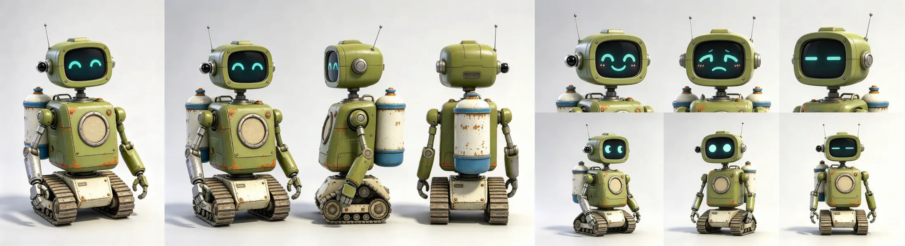
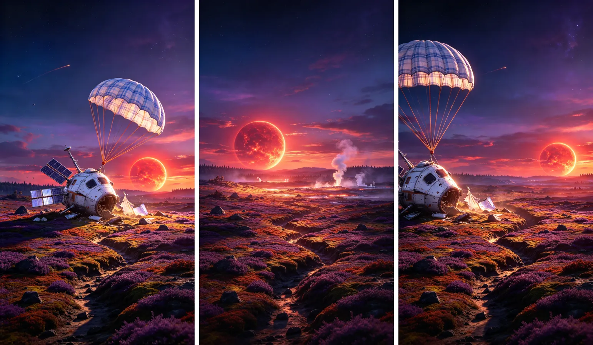
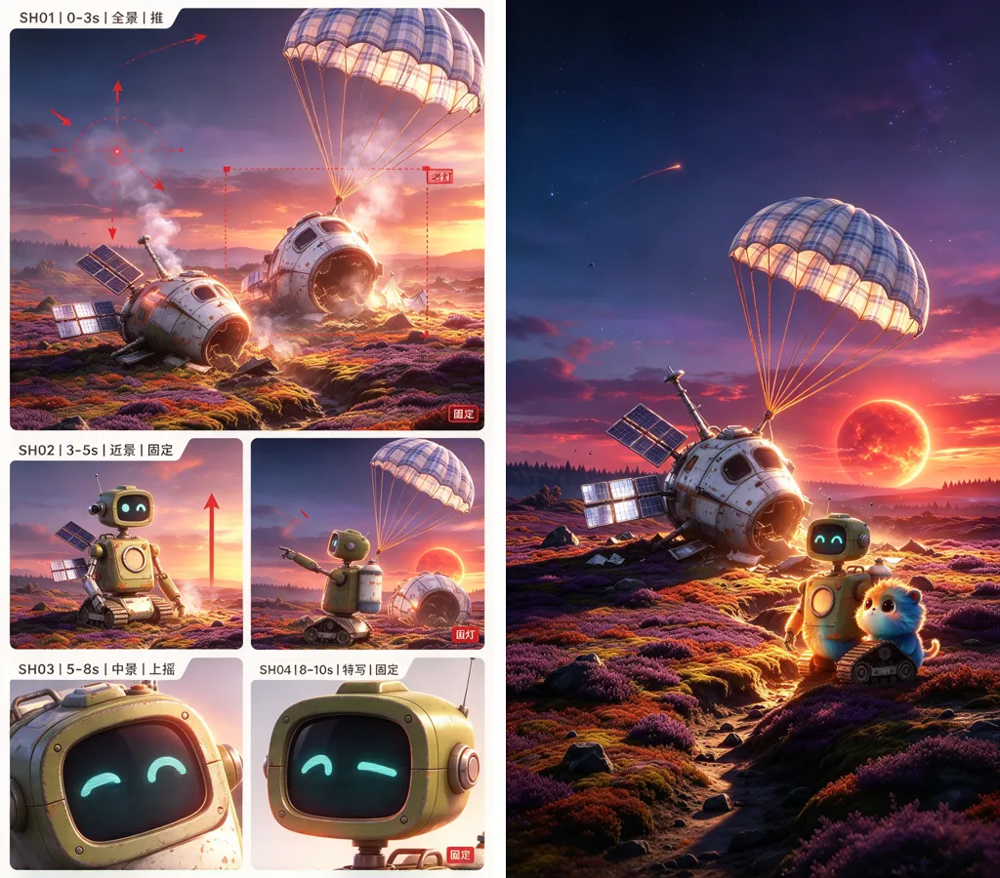

Start with some test results. They all come from building the assets for episode 1 of the original animated series *Xiejiao Star*, with images generated by Seedream 4.0:

- **Putting both characters into the location for a test shot broke their identity.** With only the character reference boards and the location plate as references, the hero Weng came out yellowish, and his sidekick Rongrong grew to the height of Weng's chest, her orange-left, blue-right fur turning mostly blue.
- **The sun showed up in the reverse plate.** In that camera direction the red dwarf should be behind the camera, and the prompt said so. All 4 derived plates in that round drew it into the frame anyway.
- **Layout is controllable; counts and positions aren't.** A 2×2 storyboard came back with the first panel spanning a whole row. Six color swatches came back as twelve.
- **Text can't remove what a reference image contains.** One hero design had an extra necklace, and every later image kept it. Writing "no necklace" in the prompt didn't help.

So consistency isn't solved by writing "keep the character consistent". Only two things are under your control: **the reference images you feed the model**, and **the text you reuse verbatim every time**. This post is about how to organize those two things.

## How does the industry do it?

| Source | Practice | What it means for a team using APIs only |
|---|---|---|
| Model sheets in animation | Turnarounds, expressions, props and location layouts are drawn before production, and every shot is drawn against them | Design sheets are finished before shots, and built step by step |
| [Google Veo: generate videos from references](https://docs.cloud.google.com/gemini-enterprise-agent-platform/models/video/generate-videos-from-references) | Each reference image is a single person, character or product whose appearance the video preserves; the text describes the action | One subject per reference: appearance comes from the image, action from the text |
| [Seedream API](https://www.volcengine.com/docs/82379/1541523), [Seedream 4.0 report](https://arxiv.org/abs/2509.20427) | Text-to-image, single-image editing and multi-image composition in one model | The same model can derive turnarounds, expressions and plates from a hero design |
| [drama-skills](https://github.com/zenstory-ai/drama-skills) image and storyboard skills | Each reference states its role, what it controls and what it doesn't; continuity-lock phrases are copied verbatim into prompts; watermarks and subtitles baked into a reference can't be removed with negative prompts | Very close to this post's approach and worth reading |
| [StoryDiffusion](https://arxiv.org/abs/2405.01434), [ConsiStory](https://arxiv.org/abs/2402.03286), [The Chosen One](https://arxiv.org/abs/2311.10093) | Modify the model's attention, or iteratively train a consistent character | Requires access to the model; not usable through an API |

Most research methods change the model. A commercial API leaves you with reference images and prompts. What remains is an engineering problem: where the references come from, in what order they are made, what each one controls, and how to check the output.

## Try it first

The asset library in the demo is the UI for this approach: each asset has a production chain, and each step offers 4 candidates marked with the locks they break. Character and prop images were really generated; the rest are placeholders. The UI is in Chinese. You can also [open it in a new tab](/demos/ai-drama/asset.html?k=char&e=EP01&id=weng).


### ① One production chain per asset
Character: hero design → turnaround (human review) → single views → reference board → detail sheet (human review) → expression sheet. Each step derives from the previous step's approved image.
<!-- step: char-chain -->
---
### ② Continuity locks
Each lock is a fixed sentence plus an evidence region marking where it is on the reference image. Locks are permanent; changes across episodes are recorded as per-episode states.
<!-- step: locks -->
---
### ③ Prompts in a fixed order
Purpose → identity → layout → light → exclusions. The identity part is the lock text, inserted as tags.
<!-- step: prompt -->
---
### ④ Props have states
The reflector has three states: loose parts, assembled, and after the accident, each with its own image. A shot references whichever state it needs.
<!-- step: prop-states -->
---
### ⑤ One plate per camera direction
A plate fixes only one direction. Master, reverse, side and background plates each record where the light comes from and which shots use them.
<!-- step: scene-geo -->
---
### ⑥ One storyboard per segment
The 4 shots of a segment map to the 4 panels of one 2×2 storyboard, and that image goes straight to the video model as the segment's reference.
<!-- step: board -->
---
### ⑦ Check shot by shot
A shot × lock matrix: ✅ consistent, ⚠ deviation, ? can't tell. In SH07 the solar panel hides the left arm, which then comes back olive green.
<!-- step: appear -->
---
### ⑧ Sample take next to the storyboard
In review, the sample take sits beside the approved storyboard so composition drift is easy to see.
<!-- step: compare -->


## Two kinds of images: for people and for the model

| | For people | For the model |
|---|---|---|
| Examples | Turnarounds, detail sheets, top-down layouts, annotated storyboards | Hero designs, single views, reference boards, plates, keyframes |
| Layout | Multiple panels, text labels allowed | One subject, clean background, no text at all |
| Use | Human review of structure and details | Fed to the model as references |

Don't feed images with text to a video model: labels, arrows and dimension lines get painted into the frame. drama-skills makes the same point: watermarks, corner marks and subtitles already in a reference can't be removed with negative prompts; crop them out or use another image.

The storyboard is the one exception: it carries shot numbers and camera marks and is still fed to the video model. More on that below.

## Production chains: settle the source, then derive

| Asset | Production chain (steps in bold are reviewed by a person) |
|---|---|
| Character | **Hero design** → **turnaround** → single views (front, side, back) → reference board → **detail sheet** → expression sheet |
| Prop | **Final design** → turnaround → scale against a character → state images → FX reference → **prop sheet** |
| Location | **Master plate** → reverse plate → side plate → background close plate → **top-down layout** → test shot |

There is one rule: **don't move on until the source image is approved.** The hero design, the final prop design and the master plate are the parents of every image that follows. A flaw in a parent (an extra accessory, colors on the wrong side) is inherited by dozens of images, and gets harder to fix the further down it goes. The necklace above is the example: either write it into the lock, or redo the hero design. There is no third option.

Each step produces 4 candidates, each marked with the locks it breaks, and a person picks one. Only the picked image becomes the reference for the next step.

## Continuity locks: fix them, reuse them verbatim

Don't expect the model to "remember" a character. Write the attributes that must not change as fixed phrases and paste them into every prompt unchanged:

> **LOCK-WENG-TANK**: a white enamel-mug-shaped power tank on the back, blue rim, chipped paint, no text on the tank

What we learned writing locks:

- **A lock must match the reference image.** The image outweighs the text. Text can't remove what's in the image, and when the two disagree, the model usually follows the image.
- **Give every lock an evidence region.** Mark where it is on the reference image, and check against that region.
- **Watch left and right.** "Left forearm" in a lock means the character's own left, which appears on the right side of a front view. In our generated front view, the silver arm is on the left side of the frame, which is the character's right arm. Say whether you mean the character's left or the frame's left when writing a lock, and check against the same rule.
- **Locks are permanent.** If a shell is removed or a cooling module lost in one episode, write it as that episode's state and append it to that episode's prompts. The lock stays.
- **No quality words.** Leave out "8K, masterpiece, top quality" and similar words unrelated to identity; the look comes from one style paragraph shared by the whole series.

Prompts always follow the same order: **purpose → identity (lock text) → outfit → layout → light → exclusions.**

## State what each reference is for

A generation often takes several references. The prompt should say what each one controls and what it doesn't:

> Image 1 is the character reference board, used only for identity and outfit, not for composition or pose; image 2 is the location plate, used only for geography and light direction, not for framing.

drama-skills puts reference roles into a fixed set of categories: appearance, subject, outfit state, spatial layout, composition, scale, effect, start frame, end frame and style, and every image states its scope.

After the failed test shot, we filled in the references: single views for front, side and back structure, a height lineup for the two characters' scale, and the reference board for identity. Leave any one out and the model improvises on exactly that.

## Locations: one plate fixes one direction

A reference image controls only what appears in it. A reverse shot shows the side the plate never saw; a close-up's background is a small patch of the plate, and once it is enlarged, the model fills in the details itself. So each location gets a set of plates, one per camera direction:

- **Approve the master plate first and derive the rest from it.** Prompt with "same place, camera turned towards X" so geography and materials line up.
- **Write directions relative to something in the location lock.** Write "facing the wreck, the parachute is on the right", not "on one side of the frame".
- **Rewrite the light for each camera direction.** The master plate is backlit, so the reverse is front-lit and the side plate side-lit. To keep the light source out of frame, say "no sun disk" in the camera, light and exclusion parts of the prompt. The reverse plate in the middle above is what you get with only one of the three.
- **Draw the top-down layout by hand.** Asked for a labeled top-down plan, the model drew a perspective illustration with duplicated and misplaced labels. For blocking and the 180° line, which need precision, a hand sketch is faster.

## One storyboard per segment

Video is generated in segments of about ten seconds, with 4 shots each. Each segment gets one 2×2 storyboard whose 4 panels map to the 4 shots, and the whole image goes to the video model as the segment's reference. This grid storyboard method is common among AI short-drama creators:

- **Benefit**: the characters and location in the four panels are consistent by construction, since they are generated together, and the video model reads one image at a time instead of hunting for the right row in a large sheet.
- **Cost**: low resolution per panel, and the layout isn't always followed (the first panel above spans a row), so shot-number labels are the backstop for panel order.
- **Draw only the opening instant of each shot.** Leave the motion to the video prompt. Variants without a reference image (a scorched tail, say) stay out of the storyboard and are left to the video.
- **Labels carry only shot number, time, framing and camera move.** No dialogue in the panels; long Chinese text tends to come out garbled.

A segment with a single shot has a one-panel storyboard that doubles as the first frame. Simple segments can skip the storyboard and use only asset references and the shot list.

## Check shot by shot: shots × locks

After generation, don't ask "does it look right?". Check each shot against each lock. For the hero in episode 1: 10 shots × 6 locks gave 1 deviation and 8 can't-tells.

- **Deviation**: in SH07 the solar panel covers his body, and the left forearm comes back olive green. Parts that reappear after being hidden are the most error-prone.
- **Can't tell**: a close-up shows only the bottom edge of the screen; a wide shot is too far to see the shoulder camera. Can't-tell is not a pass; confirm it in a neighboring shot.
- **The same problem comes back**: in SH10 Rongrong is drawn as tall as Weng's chest, just as in the test shot. Problems found in a test shot must go into a lock or an extra reference image, rather than hoping the next run gets lucky.

The check is done by an agent that took no part in generation and sees only the asset cards, locks and extracted frames. Deviating shots go to the video agent for repair, or back to the asset library for another reference.

## Why this approach?

| Approach | Good for | Problem |
|---|---|---|
| Text descriptions only | Single images, style exploration | Read differently every time; drift across shots is guaranteed |
| One character image all the way | Single-character, front-facing, close-up-heavy sketches | Side, back and reverse views are guesses; props and locations have no reference |
| Train a model for the character | Photorealistic actors, long-running series | Training and hosting a model, and retraining for every new outfit |
| Production chains + locks + shot checks (this post) | Stylized series made through APIs only | More images up front; locks must be precise and match the references |

The production chains look like a lot of images, but they are images, far cheaper than video. Keep consistency problems in the image stage, and the budget can go to generating a few takes per segment and picking the best.

## References

- Google Cloud, [Generate videos from references](https://docs.cloud.google.com/gemini-enterprise-agent-platform/models/video/generate-videos-from-references)
- Volcengine, [Seedream image generation API](https://www.volcengine.com/docs/82379/1541523)
- [Seedream 4.0: Toward Next-generation Multimodal Image Generation](https://arxiv.org/abs/2509.20427)
- [Seedance 1.0: Exploring the Boundaries of Video Generation Models](https://arxiv.org/abs/2506.09113)
- zenstory-ai, [drama-skills](https://github.com/zenstory-ai/drama-skills): `short-drama-image-prompts`, `short-drama-storyboard`
- [StoryDiffusion: Consistent Self-Attention for Long-Range Image and Video Generation](https://arxiv.org/abs/2405.01434)
- [Training-Free Consistent Text-to-Image Generation](https://arxiv.org/abs/2402.03286)
- [The Chosen One: Consistent Characters in Text-to-Image Diffusion Models](https://arxiv.org/abs/2311.10093)
