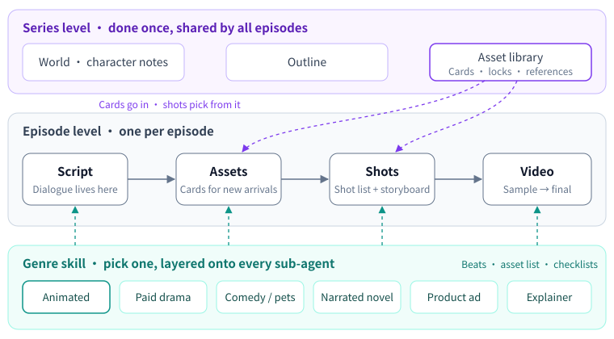

Calling the models is the easy part of making AI short dramas. Two other things are hard.

The first is managing artifacts. A 30-second animated episode has two characters, five props and one location, each needing five or six reference images; three video segments, each with a storyboard and a sample take. That adds up to forty or fifty artifacts, every one of them paid for and every one of them liable to be redone.

The second is that different genres need different things:

- **Paid short drama**: conflict within the first 3 seconds, mostly close-ups and medium close-ups, an emotional beat roughly every 15 seconds.
- **Narrated novel**: voice-over carries the story; the picture is mostly slow push-ins and pull-outs, and the less motion the more reliable it is.
- **Product ad**: done in 15 seconds, and the product's shape, logo and colours must not change in a single frame.

One set of prompts and checks can't cover every genre. But building a separate pipeline per genre means rebuilding the stages, the asset library and the tools each time.

So the prototype works like this: **the stages and the asset library are a fixed backbone shared by every genre; what differs between genres is written as one genre skill, which the director agent picks and layers onto every sub-agent.**

## Try it first

Below is the prototype itself. The demo project is an original animated series, *Xiejiao Star*: a robot crash-lands on a planet circling a red dwarf, and episode 1 of 8 is half done. The character and prop images in the asset library were really generated with Seedream; the script edits, agent replies and video generation are simulated. The UI is in Chinese. You can also [open it in a new tab](/demos/ai-drama/).


### ① Canvas and stage bar
The top bar has the four stages: script, assets, shots and video. The canvas is read-only: nodes and links are generated from the project files, and double-clicking a node opens that stage's studio. On the right, the director agent diagnoses the project and proposes the next step.
<!-- step: canvas -->
---
### ② Genre skill library
The prototype ships with six genres: paid short drama, AI animated series, comedy and pet clips, narrated novel, product ad, and explainer. Each card shows aspect ratio, length and cost tier. This project uses the animated series.
<!-- step: skills -->
---
### ③ What a genre skill contains
Taking paid short drama as the example: structural beats, best practices, common pitfalls, the assets to build, and the checklists layered onto each sub-agent, plus a sample shot list that can run as is.
<!-- step: skill-drama -->
---
### ④ Series level: 8 episodes × stages
The overview is a progress matrix, with cost counted per episode. Episode 1's script is final; later episodes only have an outline.
<!-- step: series -->
---
### ⑤ One asset library for all episodes
Characters, props and locations are built once, and each asset lists the episodes it appears in. The right-hand column lists things that first appear in the outline and don't have an asset card yet. They are built before the storyboard.
<!-- step: library -->
---
### ⑥ Your inbox
Everything that needs a human decision is collected here: turnarounds awaiting review, plates and storyboards to redo, shots that break a lock. Each item jumps straight to where it is handled.
<!-- step: inbox -->
---
### ⑦ Rewrite one line
Click ✨ at the end of a script line and the rewrite candidate appears under it. Once adopted, only this segment's video needs to be regenerated. The storyboard is unaffected.
<!-- step: script-ai -->
---
### ⑧ Review room
Cheap sample takes come first; final takes only after they are confirmed. On the right is the issue list: deviations found by the appearance check can go to the video agent for repair, or back to the asset library.
<!-- step: review -->


## What do open-source tools and papers do?

Plenty of AI short-drama tools have appeared in the last year or two, and their pipelines look alike: script, characters and locations, storyboard, video, assembly. Here we look at one question only: how do they handle different genres?

| Project | How the work is organized | How genres differ |
|---|---|---|
| [Toonflow](https://github.com/HBAI-Ltd/Toonflow-app) | Infinite canvas: text, assets, images and video are all nodes | Aimed at short dramas, animated series and short videos; no per-genre templates, but prompts and agent behaviour are editable |
| [LocalMiniDrama](https://github.com/xuanyustudio/LocalMiniDrama) | List and canvas views over the same data | One fixed flow; input a synopsis and a style, pick an aspect ratio |
| [Huobao Drama](https://github.com/chatfire-AI/huobao-drama) | Stage progress rail; each stage marked done by hand | Four fixed agents; only the visual style and aspect ratio change |
| [MediaGo Drama](https://github.com/mediago-dev/mediago-drama) | Each stage writes a document that later stages reference | Skills split by role, with built-in photoreal, 2D, 3D and chibi styles; the docs say different genres can combine different skills and templates, but none are preset |
| [shortdrama-pipeline](https://github.com/drasstry/shortdrama-pipeline) | Command-line pipeline | Input theme, length, episode count and style; the flow is fixed |
| [drama-skills](https://github.com/zenstory-ai/drama-skills) | 12 agent skills writing five Markdown files | Skills split by stage; script development includes a genre-and-hook handbook, and static comics skip the video-prompt step |
| [ViMax](https://github.com/HKUDS/ViMax) | One flow each for idea, script and novel | Flows split by input type, not by genre |
| Papers such as [FilmAgent](https://arxiv.org/abs/2501.12909) and [MovieAgent](https://arxiv.org/abs/2503.07314) | Multi-agent roles: director, screenwriter, cinematographer | One fixed flow; genre differences are out of scope |

Two things stand out:

- **Differences mostly stop at visual style.** Presets like photoreal, 2D or 3D, plus an aspect ratio, change what the picture looks like, not how the piece tells its story.
- **Few tools distinguish by genre.** Only drama-skills carries a genre handbook in script development. Paid dramas, ads and explainers need very different beats and checks, and none of these projects ships a preset for them.

## Four stages, with assets before shots



The stage order is **script → assets → shots → video.** Every genre goes through these four steps.

- **Script**: each episode is split into generation segments of about ten seconds, with the hook, twist and cliffhanger marked. Dialogue lives only in the script; the sound in the shot list is derived from it.
- **Assets**: characters, props and locations are extracted from the script, each gets a card, and reference images are produced along its production chain. The next post, on [character consistency](/en/posts/ai-drama-consistency/), covers this.
- **Shots**: each segment gets a shot list and one storyboard. Shots pick assets from the library. If a shot needs an angle or state the library lacks, such as a reverse plate or a prop after it has burned, the request goes back to the asset agent.
- **Video**: cheap sample takes first, final takes only after they are confirmed, then segments are concatenated.

Assets come before shots because shots reference specific assets. Draw the storyboard first and the characters in it are whatever the model improvised, which won't match the reference images later.

Skipping post-production is a decision too. Dialogue, sound effects and voice-over all go into the video prompt and come straight out of the model; the final cut only concatenates segments. That way, changing a line affects only that segment's video, instead of also dragging subtitles, dubbing and mixing back into rework.

## One skill per genre

The stages stay the same; what changes is the standard each step is held to. In the prototype, a genre skill contains:

- **Spec**: aspect ratio, length, cost tier.
- **Structural beats**: what each time span has to do; the script and shot agents check against them.
- **Best practices and pitfalls**: lessons written for every sub-agent.
- **Asset list**: the characters, props and locations this genre usually needs.
- **Sub-agent rules**: a checklist for each sub-agent: script, shots, character, video and so on.
- **Sample**: a script and shot list that can run as is.

The six genres differ mainly here:

| Genre | Length | Beats | Asset focus | Shot and video rules |
|---|---|---|---|---|
| Paid short drama | 60–120s per episode | Hook → situation → setup for the twist → payoff → cliffhanger | The lead's face; costume variants generated separately | At least 60% close-ups and medium close-ups; a reaction shot of the antagonist after each payoff |
| AI animated series | 30–90s per episode | Hook → problem → makeshift fix goes wrong → cost and next-episode hook | Character sheets first: hero design, turnaround, reference board | One 2×2 storyboard and one video per segment; small motions |
| Comedy / pets | 15–30s | Odd opening → setup → twist → topper | Animals and props | One action per shot, a pause before the punchline, an ending that loops back to the start |
| Narrated novel | 60–180s | Striking opening line, narration drives, cut off on a cliffhanger | Characters still need character sheets | Shot length follows the narration (about 4.5 Chinese characters per second); non-climax shots use only slow push, slow pull or static |
| Product ad | 15s | Pain point → product reveal → selling points → call to action | Product board: multiple angles and details, locking shape, logo and colours | The product is recognisable in every shot, at most 3 selling points, the model never redraws the logo |
| Explainer | 45–90s | Counter-intuitive question → explanation → question for viewers | The presenter's look | Talking-head shots no longer than 10 seconds, a new picture every 3–5 seconds, diagrams for abstract ideas |

How it fits together:

- **Layer, don't replace.** Each sub-agent has its own agent skill describing its general job, such as how the shot agent writes a shot list. A genre skill only adds the standards for that kind of piece on top. Adding a genre means writing one genre skill, without touching any sub-agent.
- **The director picks.** When the user says "make a promo video for a portable blender", the director agent matches it to product ad, plans with its beats, and hands work to the sub-agents.
- **Checks follow the genre.** When the director asks a sub-agent to check its own work, it uses the genre skill's checklist. Checking shots for a paid drama means counting close-ups; for a narrated novel it means checking that picture and narration line up.
- **A new genre is a new project.** Beats, asset lists and samples all belong to the genre, so switching mid-way means starting over; the prototype prompts you to create a new project.

## Series level and episode level

A series has eight episodes, and most things are shared across them:

- **Series level**: world, outline and asset library, done once. Each asset records which episodes use it.
- **Episode level**: script, shots, sample and final takes, one set per episode, with cost counted per episode.

From episode 2 on, most assets are already in the library; cards are built only for what first appears in the outline.

**Continuity locks are permanent.** A lock states something that must not change, such as the hero's screen face, the enamel tank on his back or his silver forearm. Damage or loss in one episode (the heat shield removed, the cooling module lost) is recorded as that asset's state in that episode and appended to the prompt for that episode only; the lock stays. Changing a lock is different: every episode that uses the asset has to be checked again.

A one-off piece such as an ad or a comedy clip is just a series with one episode. The structure is the same; the UI simply hides the series level.

## People talk to one director agent

There are seven sub-agents: script, shot list, storyboard, character, prop, location and video. People don't need to remember who does what:

- **The director diagnoses the project and proposes the next step.** With nothing selected, it advances by stage. With canvas nodes selected, it suggests actions for those nodes and routes them to the right sub-agent. It can keep executing its suggested next steps, but it stops and waits at a cost confirmation or any choice.
- **Fix things where they are.** Script lines, shot rows and asset boards all have a ✨ button with a few common edits plus "just say it". Results appear in place, to adopt, retry or discard. The call is logged in that agent's conversation, but no panel pops up.
- **The panel pops up only for decisions.** Sign-offs, cost confirmations and open questions open the agent panel; nothing else does.

The review agent sees only files on disk: asset cards, shot lists and extracted frames, never the conversation that produced them. If the tool supports it, run it in a fresh session. The agent that generated an image tends to think it's fine; a different agent that doesn't know the history is better at spotting deviations from the locks.

## A project is a folder

All state lives in project files, and the agents and the UI read and write the same ones. The structure is in these files: which asset appears in which episodes and which storyboard uses which reference images are references between files.

```
project.yaml  outline.yaml  workflow.yaml   project, outline, stages and production chains
bible/                                       world and character notes
assets/<kind>/<name>.yaml                    asset cards: attributes, locks, per-episode states, candidates
episodes/ep01/                               script, shots, sign-offs, cost ledger, review notes
media.yaml                                   media index: path, hash, model, request, owner
media/                                       images and video, not in Git
```

- **The canvas is a read-only view.** It is generated from the project files: nodes are artifacts, links are references between them, laid out by stage. Neither people nor agents change the structure by drawing links on the canvas. To change content, open that stage's studio or have an agent edit the project files, and the canvas redraws.
- **Text goes in Git; media doesn't.** Settings, scripts and shot lists are readable YAML and Markdown that can be diffed and rolled back. Images and video are large, so the index records their path, hash, model and the request that produced them.
- **Not tied to any AI tool.** Sub-agent responsibilities and genre skills are both skill files that Claude Code, Codex, Copilot and similar tools can all read. Generation and cost logging go through a command-line tool, so the results are deterministic.
- **Edits keep history.** Edits, new references and extensions all create a new version, and the old one stays in the media library.
- **Never pay twice for the same request.** When neither the prompt nor the references have changed, the existing image is reused. Video task handles are saved locally, so a rerun after a crash only fetches results and never resubmits.

## Why this approach?

| Approach | Good for | Problem |
|---|---|---|
| Free-form canvas, connect anything | One-off pieces, style exploration | The canvas is the structure and dependencies are drawn by hand; across several episodes, nobody can say which artifact references which |
| One flow, only the style changes | A single genre | Switch to an ad or a narrated novel and the beats and checks are all wrong |
| A separate pipeline per genre | A few genres that differ enormously | Stages, asset library and tools are rebuilt each time; an improvement in one can't be shared |
| Shared stages and assets, one skill per genre (this post) | Many genres, multi-episode series, cross-episode consistency | Each genre needs its own skill; beats and checklists have to be validated on sample takes |

The canvas is still useful: it shows the progress and dependencies of a whole episode at a glance. But in this prototype the structure lives in the project files and is defined by the stages and the genre skill; the canvas only draws it.

## References

- HBAI-Ltd, [Toonflow-app](https://github.com/HBAI-Ltd/Toonflow-app)
- xuanyustudio, [LocalMiniDrama](https://github.com/xuanyustudio/LocalMiniDrama)
- chatfire-AI, [huobao-drama](https://github.com/chatfire-AI/huobao-drama)
- mediago-dev, [mediago-drama](https://github.com/mediago-dev/mediago-drama)
- drasstry, [shortdrama-pipeline](https://github.com/drasstry/shortdrama-pipeline)
- zenstory-ai, [drama-skills](https://github.com/zenstory-ai/drama-skills)
- HKUDS, [ViMax](https://github.com/HKUDS/ViMax)
- [FilmAgent: A Multi-Agent Framework for End-to-End Film Automation in Virtual 3D Spaces](https://arxiv.org/abs/2501.12909)
- [Automated Movie Generation via Multi-Agent CoT Planning](https://arxiv.org/abs/2503.07314)
- [StoryAgent: Customized Storytelling Video Generation via Multi-Agent Collaboration](https://arxiv.org/abs/2411.04925)
- Anthropic, [Building effective agents](https://www.anthropic.com/research/building-effective-agents)
