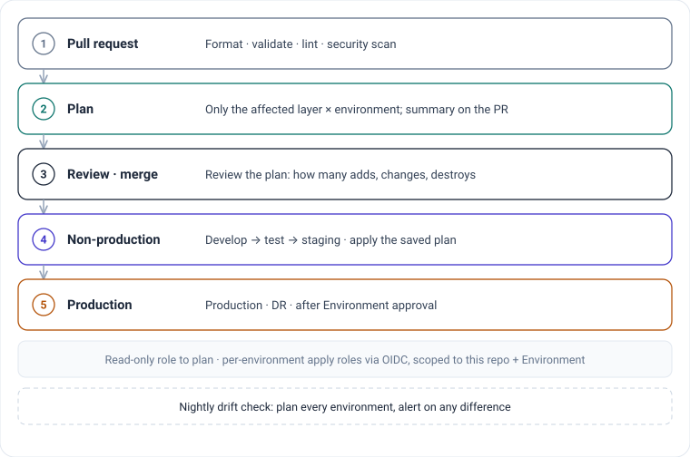
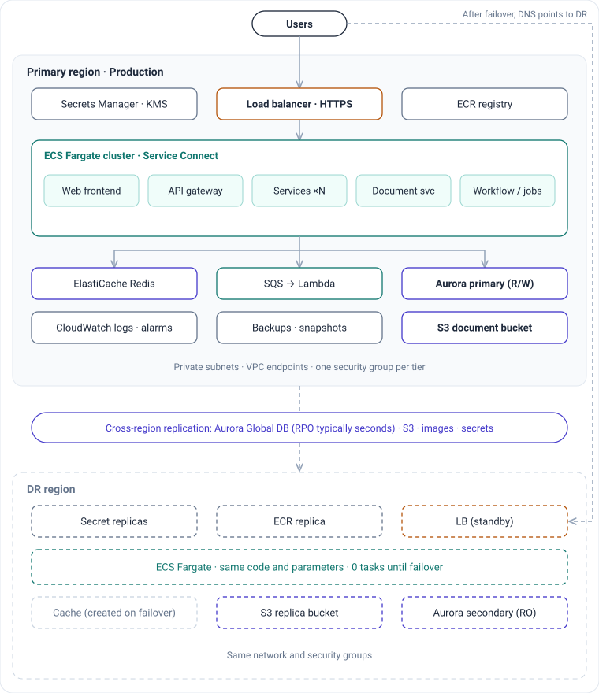

Picture a typical business system: a web frontend, a dozen containerized microservices, a relational database, a cache, an object store for business documents, and a few async jobs triggered from queues. It runs in four environments (development, test, staging and production), and production also needs a disaster recovery copy in a second region.

Getting these resources up with Terraform isn't hard. You'll have it working in the first week. The hard part is two years later:

- You only meant to change a security group, but the plan says `destroy` on the database cluster, and you sit there afraid to press Enter.
- Production breaks, and after hours of digging you find that someone changed a setting in the console six months ago. It was never in the code.
- A change that passed in staging fails in production, because the production directory stopped matching staging a long time ago.
- The approval was based on the code diff, but the apply re-ran the plan, and someone else's change got merged in between.
- The DR document says "RTO 30 minutes", but nobody has ever actually failed over.
- A new teammate asks where a subnet ID came from, and nobody knows.

None of these come from writing bad Terraform. They come from a few early choices that weren't thought through. Below are seven of those choices. For each one: the common options, where each breaks, and what to pick.

## Choice 1: Which tool?

| Tool | How you write it | Good fit | Watch out for |
|---|---|---|---|
| CloudFormation / AWS CDK | YAML or a general-purpose language; AWS manages state | AWS-only shops that know CDK | AWS only; monitoring, DNS and SaaS resources need something else |
| **Terraform** | HCL, declarative | Most teams; the largest ecosystem | Moved to the BSL licence in 2023 |
| OpenTofu | HCL, compatible with Terraform | Teams that care about the licence and want community governance | Hosted by the Linux Foundation; new features are starting to diverge from Terraform |
| Pulumi | General-purpose languages | Teams that prefer code or need complex logic | Reviewers have to understand the program to know what it will build |
| CDK for Terraform | General-purpose languages that generate HCL | — | Sunset and archived on December 10, 2025; don't use it for new work |

**Pick Terraform (or OpenTofu; they're interchangeable here).** The reason isn't features, it's review. HCL is deliberately limited, and that's a feature: reviewers can see at a glance where a resource is and what it looks like. With infrastructure written in a general-purpose language, once loops and conditions pile up, only the author knows what it will create.

## Choice 2: How do you lay out environments?

This is the choice that goes wrong most often and is the hardest to undo.

| Approach | Who recommends it | Do environments drift? | Where it breaks |
|---|---|---|---|
| Copy the whole codebase per environment | Where many projects start | **Always** | Obvious on day one; by month three, five copies have each gone their own way |
| CLI workspaces | — | No | One backend and one set of credentials for every environment; officially not recommended for this |
| One root module + one parameter file per environment | AWS Prescriptive Guidance | No | Every environment must have the same structure; a module upgrade hits all of them at once |
| **A thin directory per environment that only calls shared modules** | Google Cloud, terraform-best-practices | Rarely | A little repeated wiring in each directory |
| The same, with Terragrunt removing the repetition | Gruntwork | Rarely | One more tool to learn, and two layers to read when debugging |
| Terraform Stacks | HashiCorp | No | Runs only on HCP Terraform and is billed per managed resource |

Workspaces look like a natural way to split environments, but both HashiCorp's and Google Cloud's docs say otherwise. Environments need different credentials and access controls, and CLI workspaces share one backend, so they are **not a suitable isolation mechanism**.

"Copy the whole codebase" and "thin directories" look alike, since both give each environment its own directory. The difference is what goes inside. A copy holds every resource definition, so each time someone says "let's try it in development first", the change lands in one copy and the other four slowly drift. A thin directory holds only three things: where its state lives, which version of which module it calls, and this environment's parameters. Resource definitions live in the shared modules, and there is only one copy of them.

**For this system, pick thin directories with versioned modules,** for three reasons:

- **Each environment is already in its own account**, so backends and credentials differ anyway. One directory per environment is the most direct way to express that.
- **The DR region is deliberately different from production**: the database is a secondary cluster and services run 0 instances. Thin directories express that honestly, without piling conditionals into one root module.
- **Module upgrades roll out one environment at a time.** Bump the version in the development directory first, verify, then test, staging and production. That's what "try it in development first" should look like.

If every environment lives in one account with exactly the same structure, one root module with parameter files is simpler and works fine. Bring in Terragrunt once you have dozens of states and the repetition between directories starts to hurt.

## Choice 3: How big should a state be?

| Split | Blast radius of a mistake | Plan speed | Where it breaks |
|---|---|---|---|
| One big state per environment | The whole environment | Slow | Changing one tag locks the whole environment; each plan takes minutes |
| By AWS service (ECS, RDS, S3…) | One kind of service | Fast | Looks tidy, but one directory mixes the load balancer, IAM, secrets and services, which change at very different rates |
| **By lifecycle layer** | One layer | Fast | Layers need an agreed way to pass values to each other |

Splitting by service is a common half-step. It's better than one big state, but it splits along the wrong axis. What should actually be separated is **how often things change** and **what a mistake costs**:

| Layer | What it owns | How often it changes |
|---|---|---|
| Bootstrap | State bucket, encryption keys, CI roles | Almost never; applied once by hand |
| Network | VPC endpoints, per-tier security groups | Rarely |
| Data | Database, cache, document bucket | Rarely, and the most dangerous to delete |
| Platform | Image registry, cluster, load balancer, service discovery, log groups | Occasionally |
| Services | Each service's task definition, scaling, routing, secret grants, queues and functions | Often |

With this split, the services layer you change every day can't touch the database. That `destroy` you were afraid to approve can't show up in the first place.

**How do layers pass values?** There are three options:

- **Hard-coded IDs**: the easiest and the most dangerous. Rebuild the network and you're searching and replacing across the repo, and a development subnet ID can easily end up in production.
- **`terraform_remote_state`**: read the lower layer's state directly. But reading state requires read access to the whole state file, which can contain sensitive values, and it ties both layers to the same kind of backend.
- **Parameter Store (recommended)**: the lower layer writes its outputs (subnets, security groups, cluster) to SSM Parameter Store, and the layer above looks them up by name. Access can be scoped to individual parameters, and non-Terraform tools can read them too.

Keep state in S3 with versioning and encryption, and use S3's native lock file. DynamoDB locking is officially deprecated, so there's no need for a lock table anymore.

## Choice 4: How do you split accounts?

| Approach | Isolation | Blast radius of a mistake | Cost |
|---|---|---|---|
| One account; environments separated by VPC or naming | Weak; depends entirely on getting IAM right | The whole account | Easy to run; costs need tags to split |
| One production account, one shared by everything else | Production is isolated | Non-production environments affect each other | Easy to run; non-production costs are mixed |
| **One account per environment, plus shared accounts** | Strong; the account is the boundary | One environment | Needs AWS Organizations; costs are clear per account |

AWS's multi-account guidance recommends grouping accounts into organizational units (OUs): security accounts (log archive, security tooling), infrastructure accounts (networking, shared services) and workload accounts (one per environment). Most large teams split their accounts this way.

**Pick one account per environment.** The image registry and CI live in a shared-services account, and DR is a second region of the production account. A small team can start with two accounts, production and non-production. Even then, design directories and names for one account per environment from the start, so splitting later doesn't require code changes.

## Choice 5: Who runs apply?

| Approach | Is the reviewed plan what gets applied? | Audit and locking | Cost |
|---|---|---|---|
| Engineers apply from their laptops | Not necessarily | No audit trail; locking is an honour system | Free, but credentials end up on everyone's laptop |
| **A GitHub Actions pipeline you build** | Only if you make it so | Audited; you configure locking | Low |
| Atlantis | Yes | Recorded on the PR; locks automatically per PR | You run and maintain a service |
| HCP Terraform / Spacelift / env0 | Yes | Complete, built in | Priced per resource or per user; policy, drift detection and run history out of the box |

Applying from laptops is where most drift starts. The line that really matters is whether **what gets applied is the plan that was reviewed**.

**Pick GitHub Actions, but add four things:**

1. **Plan on the PR.** Plan only the layer × environment combinations the change touches, post the summary back to the PR, and use a read-only role for it.
2. **Apply the saved plan file.** Don't re-plan after merge, so nothing new can slip in after the review.
3. **Run one job at a time per state**, queued with a concurrency group.
4. **Give each environment its own apply role.** CI gets short-lived credentials through OIDC, and each role trusts only "this repository + this Environment". Production and DR also need a manual approval on their Environment.

Add one more scheduled job: a nightly plan against every environment that alerts if someone changed something in the console. The setting someone changed six months ago would have been caught the next morning.

If the team needs policy as code, cost estimates and a full run history and doesn't want to build them, buying Spacelift or HCP Terraform costs less than assembling it yourself.



## Choice 6: Where do secrets live?

Start with one fact: **any value passed in through a Terraform variable is written to the state file in plain text.** `sensitive = true` only hides it from command-line output. It's still plain text in state.

| Approach | Ends up in state? | Rotation | Where it breaks |
|---|---|---|---|
| Put it in tfvars or CI variables and pass it to Terraform | **Yes** | Needs a code change | The state file becomes a password list |
| Encrypt it with SOPS and commit it | Yes | Needs a code change | No longer plain text in the repo, but still plain text in state |
| **Terraform creates the container; the value is written separately** | No | Automatic rotation, or the owner updates it | One extra step on first deploy |
| Vault dynamic credentials | No | New credentials every time | You run Vault |

**Pick the empty container.** Terraform creates the Secrets Manager entry, the encryption key and the access grants. The owner writes the value, or automatic rotation does. RDS manages the database master password itself. Newer Terraform versions also have write-only arguments that keep a value out of state, for the cases where Terraform really has to pass it.

Each service's execution role can read only its own secrets. No wildcards like `secret:*`.

## Choice 7: How far should DR go?

AWS's disaster recovery whitepaper describes four levels:

| Strategy | What the DR region has day to day | RPO | RTO | Cost |
|---|---|---|---|---|
| Backup and restore | Backups only | Hours | Hours | Lowest |
| Pilot light | Data replicated live; compute "switched off" | Seconds to minutes | Tens of minutes | Low |
| Warm standby | A full, scaled-down environment that's always running | Seconds to minutes | Minutes | Medium |
| Multi-site active/active | Both regions serve traffic | Near zero | Near zero | Highest |

The whitepaper explains the difference between pilot light and warm standby in one line: **pilot light can't process requests until you take some action first, while warm standby can take traffic immediately, at reduced capacity.**

A lot of "DR" only gets to level one and a half. The database is replicated, but there's no compute, network or load balancer. If you have to build an environment from scratch on the night of the outage, that isn't pilot light. It's a backup.

**For this system, pick pilot light, and upgrade the entry point and core services to warm standby if you need to:**

- **Data**: Aurora Global Database replicates production to the DR region, with RPO typically in seconds. The S3 document bucket uses cross-region replication. Images and secrets are replicated too.
- **Compute**: the DR region deploys the full network, platform and services layers from the same code with its own parameter file. Service instance counts stay at 0 until needed.
- **Failover**: planned drills use a managed switchover, which loses no data. In a real outage, you promote the DR cluster to primary, scale up the services and point DNS at the DR region.
- **Afterwards**: update the primary/secondary roles in the code to match. Otherwise the next apply will try to "fix" them back.



The most important part: **rehearse regularly.** Until you've actually failed over, the RTO is just a number in a document.

## What does it look like in the repo?

Following Google Cloud's directory guidance and Gruntwork's `infrastructure-live` example, the repo is organized by account, then region, then layer:

```text
infrastructure/
├── modules/                  reusable modules, see the table below
├── live/
│   ├── shared-services/
│   │   └── primary/          registry/  ci-roles/
│   ├── development/
│   │   └── primary/          network/  data/  platform/  services/
│   ├── test/                 (same layout)
│   ├── staging/              (same layout)
│   └── production/
│       ├── primary/          network/  data/  platform/  services/
│       └── recovery/         network/  data/  platform/  services/
├── bootstrap/
├── policies/
├── runbooks/
└── .github/                  workflows/  CODEOWNERS
```

Each leaf directory under `live/` is one state and holds only a few files:

```text
live/production/primary/services/
├── backend.tf            state bucket in the production account
├── main.tf               calls modules at pinned versions
├── terraform.tfvars      service list, sizes, instance counts
├── versions.tf           Terraform and provider versions
└── .terraform.lock.hcl
```

| Directory | What goes there | Who reviews |
|---|---|---|
| `modules/` | Reusable modules, each matching a piece of the architecture: network baseline, Aurora cluster, document bucket, ECS platform, ECS service, async worker | Platform team |
| `live/<account>/<region>/<layer>/` | One state; only calls modules and sets parameters, never defines resources directly | App teams for the services layer; platform team for the data layer and production |
| `bootstrap/` | State bucket, KMS, OIDC roles; applied once per account by hand | Platform team |
| `policies/` | Rules for linting and security scanning | Security team |
| `runbooks/` | Failover and failback steps, updated after every drill | Platform team |

The key points:

- **The path is the address.** From the path alone you can tell what a state manages, which account it's in and which region. CI looks at the paths a PR touches to decide which directories to plan.
- **Regions are directories.** In a real project, name them after AWS regions. The DR region sits next to the primary region under the production account, using the same modules with different parameters.
- **Modules start in the same repo.** As more teams join, move them to their own repo or a private registry and reference them by version. That's the catalog/live split Gruntwork describes.
- **CODEOWNERS gates by path.** `live/production/**` and `**/data/**` need approval from the platform team. Before anyone deletes the database, at least one more person has to say yes.

## The remaining baselines

None of these need to be debated each time. They are module defaults, and turning one off has to be written out explicitly:

- **Security groups chain by tier.** The load balancer accepts only port 443. Services accept traffic only from the load balancer and from each other. The database and cache accept traffic only from services. Tiers never share a security group.
- **Outbound traffic goes through endpoints.** Everything sits in private subnets. Pulling images, reading secrets and writing logs all go through VPC endpoints.
- **Production data is protected.** Deletion protection is on, a final snapshot is required before deletion, and automatic minor version upgrades are off. The database does not log every statement, so business data stays out of the logs.
- **Build each image once.** Tag it with an immutable version and promote it from development to production. Terraform decides what a service looks like; the application pipeline decides which version runs.
- **Pin every version.** Terraform, providers and modules all have pinned versions, and the lock file is committed.
- **Tags and logs don't depend on memory.** Default tags are set on the provider. Every log group has a retention period. Subscriptions that forward logs to an external monitoring platform are managed in Terraform too.

## If you can only do three things

1. **Keep one copy of the resource definitions; let environments differ only in parameters and module versions.** That alone removes half of the "but it worked in staging" problems.
2. **Only the reviewed plan gets applied.** Add the nightly drift check, and nothing changed quietly in the console stays hidden for more than a day.
3. **Actually fail over once.** Only then do you know what your RTO really is.

You can swap tools, and the Terraform can stay simple. Whether this is still easy to maintain in two years comes down to these early choices.

## References

- AWS Prescriptive Guidance: [Terraform AWS Provider best practices: code base structure](https://docs.aws.amazon.com/prescriptive-guidance/latest/terraform-aws-provider-best-practices/structure.html)
- Google Cloud: [Best practices for root modules](https://cloud.google.com/docs/terraform/best-practices/root-modules)
- HashiCorp: [CLI workspaces](https://developer.hashicorp.com/terraform/cli/workspaces), [S3 backend](https://developer.hashicorp.com/terraform/language/backend/s3), [Stacks](https://developer.hashicorp.com/terraform/cloud-docs/stacks)
- Gruntwork: [terragrunt-infrastructure-live-stacks-example](https://github.com/gruntwork-io/terragrunt-infrastructure-live-stacks-example)
- Anton Babenko: [terraform-best-practices.com, code structure](https://www.terraform-best-practices.com/code-structure)
- AWS whitepapers: [Disaster recovery options](https://docs.aws.amazon.com/whitepapers/latest/disaster-recovery-workloads-on-aws/disaster-recovery-options-in-the-cloud.html), [Organizing your AWS environment](https://docs.aws.amazon.com/whitepapers/latest/organizing-your-aws-environment/recommended-ous-and-accounts.html)
- Amazon Aurora: [Global Database switchover and failover](https://docs.aws.amazon.com/AmazonRDS/latest/AuroraUserGuide/aurora-global-database-disaster-recovery.html)
- CDK for Terraform: [sunset notice](https://github.com/hashicorp/terraform-cdk)
