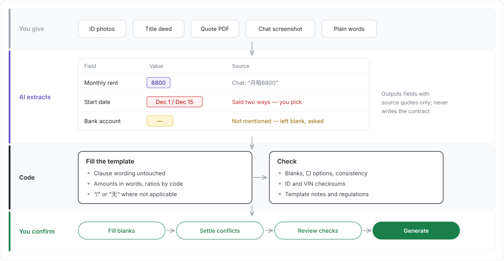

When people in China rent a flat, sell a used car or hire a renovation company, many of them use a model contract from the State Administration for Market Regulation's [template library](https://htsfwb.samr.gov.cn/). The clauses are already written; all you do is fill the blanks and tick the boxes.

The filling is the hard part. The facts are spread across ID cards, a title deed, a quote and dozens of chat messages. There are dozens of blanks, and each template has its own rules about which must be filled and which can be struck out. The amount in words has to match the figures, the deposit plus the balance has to equal the price, and a lease can't run longer than twenty years.

Hand all of this to a model and ask for "a filled-in contract", and you get something that looks right but can't be used: clauses reworded, a late-payment penalty nobody agreed to, one of two conflicting dates quietly picked.

So this agent splits the work: **AI only gathers facts from the materials and notes where each one came from. Clauses, arithmetic and checks belong to code. Anything never agreed, or said two different ways, goes to a person.**

The pattern isn't specific to contracts. Any job of filling a formal document in a fixed format, such as an application form, a customs declaration or an insurance proposal, can be split the same way.

## Try it first

Below is the prototype itself, loaded with three model contracts: an urban housing lease (2025), a used-car sale (2015) and a home renovation contract (2000). The templates are Chinese, so the demo UI is in Chinese. Each slide switches the prototype to a scene and outlines what it's about in red. You can also [open it in a new tab](/demos/contract-fill/) to send files and type terms yourself.


### ① Send materials like a chat
The conversation is on the left. The user sends two ID cards and the title deed, plus a line with phone numbers and an email. The model contract is in the middle, the checks on the right.
<!-- step: layout -->
---
### ② Files are input too
Open the title deed: the original on the left, what the AI read on the right, and the six fields it filled.
<!-- step: files -->
---
### ③ Every value has a source
Click any value in the contract to see which file or sentence it came from; the quote lights up in the conversation.
<!-- step: source -->
---
### ④ Code writes the amount in words
The AI filled "6800". The words "陆仟捌佰元整" come from code and can't be edited by hand; change the figure and the words follow.
<!-- step: code -->
---
### ⑤ What wasn't said gets asked
Blanks the materials don't cover are left empty, not invented. The agent lists them by clause so the user can just reply.
<!-- step: ask -->
---
### ⑥ Said two ways, you pick
The screenshot says the lease starts on 1 December; later the user says the 15th. Both are kept, each with its source, and the user chooses.
<!-- step: conflict -->
---
### ⑦ Numbers that don't add up are stopped
Used car: a deposit of 5,000 plus a balance of 80,000 doesn't match the 86,000 price. The AI copied the chat faithfully; code caught the problem.
<!-- step: checks -->
---
### ⑧ Rules come from templates and regulations
Renovation: the quote says 60 days, but the start and end dates span 62. A one-year warranty is below the two-year minimum in the national rules on home renovation.
<!-- step: law -->
---
### ⑨ "/" or "无"?
The used-car template's own instructions say empty blanks must read "无" (none); the lease template strikes them through with "/". Code applies each template's convention to optional or inapplicable blanks.
<!-- step: na -->
---
### ⑩ Generate only when everything passes
Once the penalty terms are in and the price is settled at 85,000, every check turns green and "Generate" unlocks.
<!-- step: done -->


## Why not let the model write the contract?

The easy route is to give the model the template and the materials and ask for the finished contract. Four things go wrong:

- **It edits clauses.** It polishes wording or adds a sentence. The whole point of a model contract is that nobody has touched the clauses.
- **It invents numbers.** Penalty rates and notice periods the parties never discussed get a "typical" value.
- **It decides for people.** If the chat mentions two start dates, it picks one and doesn't say so.
- **It gets arithmetic wrong.** Amounts in words, split fees and copy counts can be wrong without any warning.

All four come down to one thing: the model can't tell copying facts apart from making decisions.

## Four steps: who does what?

- **Extract (AI):** reads messages and files and outputs only "field, value, quote". If something isn't in the materials it stays empty; if it's said two ways, both are returned.
- **Fill the template (code):** puts values into the fixed clauses without changing a word of them. Amounts in words, split amounts and the "/" or "无" for inapplicable blanks all come from code.
- **Check (code):** goes through every rule, and runs again after each edit.
- **Confirm (person):** fills the blanks, settles the conflicts, reviews the checks, then generates.

The model appears only in the first step, and the task there is narrow: copy facts out of the materials, make no judgement calls.

## Where do the materials come from?

What people actually have at signing time is rarely a form. It's this:

- **IDs:** ID cards, business licences;
- **The property or goods:** title deed, vehicle registration, a quote;
- **The agreed terms:** chat screenshots, emails, or a passing remark like "deposit one, pay three, landlord covers the management fee".

So the agent's entry point is a conversation that accepts both files and text. After each turn it says three things: what it read from which file, what contradicts earlier input, and what's still missing. The missing items are grouped by clause so the user can simply reply.

Wherever a value came from, the user can click it in the contract and see the original. Reviewing the contract means comparing against the source, not guessing.

## What stays with people?

The AI decides nothing in two cases:

- **Never discussed.** Penalty rates, notice periods, which court handles disputes: if the materials don't say, the blank stays empty and goes onto the list of things to confirm, which can be copied and sent to the other party.
- **Said two ways.** The contract shows a red "undecided" with both versions and their sources side by side, and a person chooses.

The clauses aren't handed to the model either. Anything extra the parties want can only go into the "other terms" article the template sets aside.

## Where do the checks come from?

The rules aren't made up. Most come from each template's own instructions and risk notes, and a few from regulations:

| Template | Rule | Basis |
|---|---|---|
| Urban housing lease | Term within 20 years; landlord and tenant don't both pay the same fee | Template instructions, risk notes |
| Used-car sale | Empty blanks read "无"; VIN check digit valid; deposit plus balance equals price | Template instructions, GB 16735 |
| Home renovation | Duration matches the start and end dates; three payments add up to the price; warranty at least two years | National rules on home renovation |

On top of these, every template gets the same basic checks: required blanks filled, every □ group ticked, no conflicting statements, and valid check digits on ID numbers and company credit codes. Red items block generation; yellow ones are reminders, such as a landlord who isn't the registered owner.

## One template, one configuration

All three templates share the same flow, and each one only describes what's specific to it:

- its blanks and their types (date, amount, option, ID number);
- the clause text, and where each blank sits in it;
- when a blank doesn't apply (no parking space means no parking rent);
- which values code computes;
- its own rules and risk notes.

Adding a template means adding one more configuration like this. The 2000 renovation template still has a field for a pager number and cites a contract law that has since been repealed. The prototype keeps the text as published and only flags it in the risk notes, because rewriting clauses isn't the agent's job either.

## When does this fit?

It's worth considering when all three hold:

- there's a **fixed template or format**, and the clauses themselves aren't negotiated;
- the information is **scattered across several documents**, so gathering it by hand is slow and error-prone;
- **mistakes are costly**, so every item needs checking and a source.

If the format itself has to be drafted from scratch, that's a different problem. If the job is replying to a message by scenario, see the [template reply agent](/en/posts/template-reply-agent/).

## Closing thoughts

The AI does one thing here: pull the facts out of the materials, one by one, each with its source.

The template owns the clauses, code owns the arithmetic and the checks, and people own the decisions. The less the AI does, the easier its work is to check, and the easier it is to check, the more you can trust it.
