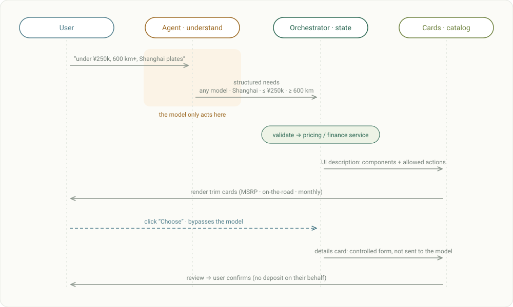
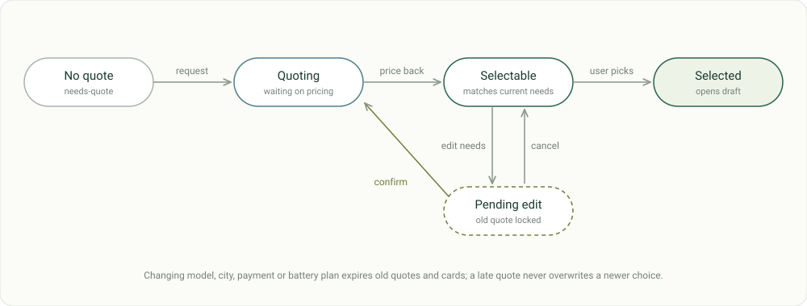

Here's a very ordinary exchange:

> **User**: My budget is ¥250k, I want good range. How much a month if I finance?
>
> **Bot**: Go for the NIO ET5 with battery rental: only ¥228k, about ¥3,000 a month. Shall I place the deposit for you?

That one answer is wrong three times. With battery rental, the ¥228k excludes the battery and a monthly battery fee comes on top, so "only ¥228k" is misleading. The monthly payment should come from a finance calculator, not an "about". And a deposit is never something a bot should decide on the user's behalf.

The model didn't miscalculate. It shouldn't have been calculating in the first place.

This post uses an online EV quote to walk through the UI design of a conversational quoting agent. The idea fits in one sentence: **the model understands and explains, pricing and finance services set the numbers, and cards carry the choices and the confirmation.** The prototype uses a few trims of the Xiaomi SU7, NIO ET5 and BYD Seal. Prices are approximate public samples; check each brand's official site for real ones.

## What we borrowed

There are plenty of public examples in this space. What interested me was not how their chat bubbles look but **how a decision gets made inside the conversation**:

| Example | Official description | How the prototype translates it |
|---|---|---|
| Expedia in ChatGPT | Turns destination and price constraints into hotels, flights and maps in the chat, with live prices and availability | Constraints become an editable needs summary; an explicit budget filters candidates; prices always carry their unit; the priciest option is never pre-selected |
| Uber Eats Cart Assistant | Turns a text or image intent into a reviewable, editable cart; the user decides to order | Missing conditions are never invented and only the missing item is asked; choosing opens an editable draft directly |
| DoorDash in ChatGPT | Turns recipes into a shoppable list; the user reviews, adjusts and checks out in the cart | Chat handles discovery and explanation; details, review and confirmation live in controlled cards; detailed comparison stays in a dialog |
| Shopify Agentic Storefronts | Products appear in AI conversations, the Catalog supplies structured data, checkout runs through a single Checkout | The price source stays separate from the AI's explanation; old quotes never carry over to new needs; the result says plainly that nothing was ordered |
| OpenAI Apps SDK UI guidelines | Cards serve a single decision and allow inline edits; at most two primary actions; no nested scrolling or repeated input | One card, one job; edits are staged and applied in place; when conditions are too strict, an empty-result card explains why instead of inventing a car |
| Xiaomi EV | The website and app offer an online configurator and a finance calculator; the order is locked after a deposit | Price and monthly payment come from deterministic services; deposit and order lock are explicit user actions |
| NIO | The same car can be bought with the battery or with battery rental (BaaS) | A change in pricing structure is stated explicitly, never presented as "¥70k cheaper" |
| BYD | One model comes in several range and drivetrain versions | Trims are filtered by budget and range, and CLTC range and MSRP are labelled for what they are |

The UI side follows the idea behind [A2UI](https://a2ui.org/): the agent emits a **declarative UI description**, and the client renders only components picked from a pre-registered catalog. The prototype doesn't integrate the official A2UI protocol or SDK. It uses a custom message format with a similar shape.

## Try it first

What's embedded below is the prototype itself. Each slide switches it to the matching scene and outlines in red what the slide is about. You can also [open it in a new tab](/demos/quote-agent/?lang=en) and explore freely.


### ① Start with one choice
Pick a car, or let the assistant pick by budget. You can also just type a sentence at the bottom.
<!-- step: start -->
---
### ② Ask only for what's missing
The plate city affects the on-the-road price, plate rules and the delivery centre, so that's the only thing it asks. It never guesses from your location.
<!-- step: ask -->
---
### ③ Full payment or financing
The payment method decides which numbers you see: full payment shows the on-the-road price, and financing adds the down payment and the monthly payment.
<!-- step: payment -->
---
### ④ One sentence → a set of cards
"Under ¥250k, at least 600 km range, plates in Shanghai, financing" becomes four conditions and filters trims across all three brands. Shanghai plates also trigger a plate-quota reminder.
<!-- step: sentence -->
---
### ⑤ Vague phrases become inferences you can confirm
"Lots of highway trips, around ¥200k" becomes "range ≥ 650 km" and "MSRP ≤ ¥250k", shown as dashed chips with the reason and one-click confirm or remove.
<!-- step: infer -->
---
### ⑥ Know what each number means
CLTC range is a test-cycle figure, and real range in winter or on highways is shorter. MSRP is not the on-the-road price.
<!-- step: units -->
---
### ⑦ Differences explained from data
Ask "SU7 Pro vs Seal 650" and the AI writes the comparison only from service data; every number is checked, and the message says "cites 12 numbers · all match the pricing data".
<!-- step: explain -->
---
### ⑧ Edits are staged first
Switching the model to the Seal stays in the needs card until confirmed. Meanwhile the old quote is greyed out and locked, and cancelling restores it.
<!-- step: staged -->
---
### ⑨ Say it when the pricing changes
Switching the NIO to battery rental comes with an explicit "not the same car at a discount": the car price excludes the battery and a monthly fee is added. The old quote card collapses, marked expired.
<!-- step: switch -->
---
### ⑩ Details go through a controlled form
Contact, phone and delivery centre are entered in a form. They are never sent to the model and never appear in the chat.
<!-- step: form -->
---
### ⑪ The user confirms
The confirm button only unlocks once the statement is ticked; the deposit is shown but never paid.
<!-- step: review -->
---
### ⑫ The summary tells the truth
Only the local review is done; deposit, order lock and production are all clearly marked as not done.
<!-- step: summary -->
---
### ⑬ A visible AI trace
"How it works" records the latest AI turn: what the user said, the tool calls (update needs, propose inferred conditions, request a quote) and the cards that were rendered.
<!-- step: mechanism -->


## Who sets the price?

There are four roles in a quote, and the model only appears at the very start:

- **Agent**: turns a sentence into structured needs, asks for what's missing, and explains how trims differ.
- **Orchestrator**: runs the flow as a state machine, calls the pricing and finance services, and decides which cards the user sees now.
- **Cards**: render only pre-registered components; user actions go straight back to the orchestrator.
- **User**: chooses, fills in and confirms on the cards.

The key is the dashed line. Clicking "Choose", changing the model and filling in the form all **bypass the model**. The model can only influence what a sentence means; it can't touch prices or the flow.

Because the client only accepts components that already exist in its catalog, even a model that says something wrong can't produce a "Pay deposit now" button that shouldn't be there.

## What the AI actually does

The model never computes money, but it does several things a form can't:

- **Turns a sentence into conditions.** "Under ¥250k, at least 600 km range, plates in Shanghai, financing" fills four fields at once, with no dropdown hunting.
- **Turns vague phrases into inferences you can confirm.** "Lots of highway trips" and "around ¥200k" aren't explicit conditions. The AI infers "range ≥ 650 km" and "MSRP ≤ ¥250k", marks them as dashed "AI inferred" chips with the reason, and doesn't treat them as the user's explicit requirements until confirmed.
- **Decides what to ask.** If the plate city is missing, it asks only for that; if the payment method is missing, only for that. No guessing from location, no defaults.
- **Explains differences from data.** Ask "SU7 Pro vs Seal 650 — what's the difference?" and it writes the comparison only from what the pricing service returned. Every number in the text is checked against that data, and anything that doesn't match blocks the whole explanation.
- **Picks which cards to show.** The AI only emits intents and tool calls; the orchestrator validates them and decides what to render. The prototype's "How it works" dialog shows the full trace of one turn: what the user said → tool calls → cards rendered.

In the prototype the "AI" is a set of local rules, with the same interface a real agent would have: a sentence goes in, and a needs patch, inferred conditions or a data-checked explanation come out.

## Every price carries its definition

When buying a car, the thing most often misunderstood isn't the number. It's what the number covers:

- **MSRP is not the on-the-road price.** On-the-road adds purchase tax (halved for EVs from 2026) and registration, with insurance on top. The cards show the two separately, and "what is in the on-the-road price" expands the breakdown.
- **CLTC range is a test-cycle figure.** Real range in winter or on highways is shorter, and the comparison dialog says so.
- **Financing has three numbers.** Down payment, monthly payment and term always appear together, and the finance calculator computes the monthly payment.
- **Filtering isn't recommending.** Trims filtered by budget and range are labelled "filtered by your conditions, not a recommendation".
- **Quotable isn't the same as registrable.** For Shanghai or Beijing plates, the card reminds you a NEV plate quota is needed, and the assistant doesn't judge whether you have one.

## What if the user changes their mind?

The easiest mistake in a chat is pairing an old price with new needs. So a quote is managed as **something that expires**, not as text you can repeat at any time:

- Changes to model, city or payment are staged; until confirmed, the old quote is greyed out and can't be chosen.
- Once confirmed, the old quote expires immediately, and earlier cards collapse, marked "expired".
- A quote that arrives late never overwrites a choice the user just made.
- A change in pricing structure is stated explicitly. NIO's battery rental (BaaS) is the textbook case: the car price drops, but a monthly battery fee is added, so it must never be presented as "¥70k cheaper".

## Who presses "Confirm"?

| Step | What the AI may do |
|---|---|
| Understanding needs | Explain, ask for missing items, write what it understood into a visible summary; inferred conditions need the user's confirmation |
| Comparing trims | Explain differences and definitions; the user chooses |
| Filling in details | Nothing; details go only through the controlled form |
| Review & confirm | Explain the current status; only the user confirms |
| Deposit & order lock | Never runs a payment or submission the model generated |

Pause and end are different, too. Pause just keeps the draft on the current page. End asks once more, clears the draft and keeps the conversation. Neither submits anything.

## Closing

The hard part of conversational quoting isn't the talking; it's deciding who has the final say. Prices and rules belong to deterministic systems, choices and confirmation belong to the user, and the model sits in between: it understands what's said and explains the differences clearly.

If you build this for real, the order matters too: pin down the product rules and the pricing API first, then design the flow and the UI, and only then decide what the AI may do at each step.
