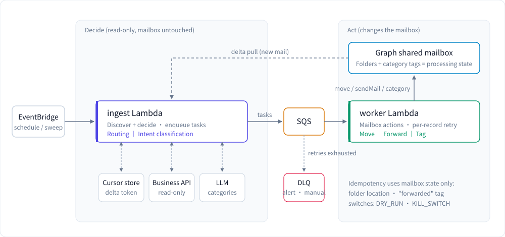

> Keywords: email triage, Graph delta, AWS Lambda, SQS, idempotency, failure isolation, LLM classification

Many business processes run on email: customers, partners and colleagues send mail to a shared mailbox, and a team triages, follows up and replies based on the content. Once volume grows, two things are worth automating:

- **Routing**: move each email into the folder for the right business queue, and forward it to the responsible person when someone needs to follow up.
- **Intent classification**: tell whether an email is a status inquiry, a new submission, additional documents or something else, so the person handling it understands it at a glance.

This post describes a near-real-time architecture for that. It doesn't change how the team works — the shared mailbox stays the daily entry point — it just adds a layer of automation on top: Lambda and SQS split processing into a "decide" stage and an "act" stage, and the design is built around routing rules, state management, failure handling and intent classification. At the end, I compare it with other approaches on the market and describe where this one fits.

## 1. Overview

### Design goals

1. **Read business data in real time**: the business attributes and owners needed for routing come straight from the business system's read-only query API.
2. **Avoid databases where possible**: no intermediate state tables. The only thing persisted externally is the Graph delta token; all other processing state lives on the email itself (its folder and category tags), and rules live in static configuration.
3. **Near real time**: EventBridge triggers on a schedule and Graph delta returns only new mail. Freshness is set by the trigger interval, typically minutes.
4. **Separate decision from execution**: ingest only discovers emails, decides and enqueues tasks; only the worker moves, forwards or tags mail.

### Architecture



| Component | Responsibility |
| --- | --- |
| EventBridge + ingest Lambda | Pull the delta on a schedule; make routing and classification decisions per email; enqueue action tasks; save the delta token |
| Business system + static config | The business system provides live business attributes and owners; static config provides the folder mapping, subject/keyword rules and the product category table |
| LLM / translation service | Translate the body and return content categories |
| SQS + worker Lambda + DLQ | Asynchronously move, forward, archive and tag; retry per record, and isolate exhausted records in the DLQ |

Routing and classification are two **independent** decision paths: if the LLM is down, routing still works; if the business system is down, only routing for emails with reference numbers is delayed, and classification is unaffected. Emails without any business reference number are routed purely by subject and keyword rules and never touch the business system.

## 2. Processing flow

### ingest: discover emails, produce actions

1. Read the delta token from the cursor store and call Graph delta to get emails added or changed in the inbox since the last run.
2. Make two decisions for each email:
   - **Routing**: extract business reference numbers and subject/keyword features, query the business system when needed, and determine the target folder and whether to forward (rules in section 3).
   - **Classification**: translate the body and call the LLM to get one or more content categories (section 5).
3. If there is a routing result or a classification result, enqueue one action task on SQS; if there is neither, skip it and leave the email in the inbox for a person.
4. After the whole batch is done, save the new delta token.

ingest **never modifies the mailbox**, so it is always safe to rerun.

### worker: act on the mailbox

The worker is triggered by SQS and can process records in batches. For each task, in order:

1. **Locate the email**: use the message id from the task first; if the email has been moved and its id has changed, relocate it by `(conversationId, receivedDateTime)`.
2. **Move**: if there is a target folder and the email is still in the inbox, move it there.
3. **Forward**: if the target requires forwarding, the email has a reference number and it has no "forwarded" tag yet, look up the owner and their delegate (cc'd when the owner is on leave), rebuild the email (with attachments) and `sendMail`; on success, add the "forwarded" tag, then move the original into the archive folder.
4. **Tag**: if there is a classification result and the email doesn't yet have the matching `AI:` tag, write the category tag.
5. **Handle failures**: return `batchItemFailures` to SQS so only failed records are retried; records that exhaust their retries go to the DLQ.

There are also two operational switches: `DRY_RUN` makes the worker log without acting, for shadow testing; `KILL_SWITCH` stops all mailbox actions in an emergency.

## 3. Routing rules

### Multiple reference numbers and conflicts

An email can contain several business reference numbers. First, tell two cases apart:

- **Several numbers for the same matter**: for example, a case number and the contract number it belongs to. The case object returned by the business system includes the contract number, so both point to the same target — no conflict.
- **Several unrelated cases**: this is only a real conflict when they map to different folders.

The policy is "**route by number only when there is a single candidate**":

```text
set of numbers → query business system → set of candidate folders
  no candidates           → use keyword features; still unclear → leave for a person
  exactly one candidate   → use that folder
  several, different      → don't route by number; fall back to keyword features; still ambiguous → leave for a person
```

Each case is still judged individually by the same rules; the number of reference numbers only affects whether the candidate is unique. Conflicting numbers are deliberately **not ranked by priority** — otherwise an inquiry about case B could be forwarded to the owner of case A.

### Live queries and static configuration

Routing attributes such as type, product, customer segment and owner all come live from the business system. If the API embeds child objects in their parent (for example, a contract lookup also returns its latest case), a single query covers both "route by case if there is one, otherwise by product".

The remaining rules are static configuration, versioned with the code:

| Configuration | Content |
| --- | --- |
| Folder ID mapping | Folder name to folder ID, covering target folders and the archive folder |
| Subject / keyword rules | Intent phrases, keywords and a few special-case overrides |
| Product category table | How to classify by product type when there is no case |

Worth noting: emails without any reference number are not an edge case. They are often a sizeable share, and most can be routed directly by subject patterns.

Two things are deliberately left out:

- **No query cache**: there are almost no repeated lookups within one email, and a cache would only make routing data staler.
- **No decision log for now**: audit and analytics needs will be revisited once processing behaviour is stable.

## 4. State, idempotency and failure handling

### The mailbox as processing state

The only external state is the Graph delta token (a simple key/value store is enough), used for incremental reads. Everything else is expressed by the email itself:

- **Routing progress** is its folder: routed emails leave the inbox, so anything still in the inbox hasn't been fully processed.
- **Forwarded / classified** is its category tags: tags stay with the email when it moves and double as idempotency markers.

So there is no need for an intermediate table recording which step each email has reached. The trade-off is that, for now, there is no separate audit or analytics record.

### Idempotency and retries

Queues redeliver and jobs rerun, so every action must be safe to repeat:

- **Move**: check the email's location first; if it's no longer in the inbox, skip.
- **Forward**: check the "forwarded" tag before forwarding and write it immediately after success. There is a window between `sendMail` and archiving; deduplicating on folder alone would make a rerun inside that window send the owner a duplicate.
- **Ids change after a move**: Graph move returns a new message id. When the worker moves, forwards and archives in sequence, each step uses the id returned by the previous one; if SQS redelivers and the original id is stale, relocate by `(conversationId, receivedDateTime)`.
- **Partial batch failure**: enable `ReportBatchItemFailures` on the event source. Transient errors such as Graph failures are thrown and retried; terminal errors such as "owner not found" are not retried.

### The sweep safety net

Incremental processing has one gap: if an email fails and the delta token has already moved past it, it will never be pulled again.

So a low-frequency sweep job runs as well: it scans the inbox for emails not yet routed, and the managed folders for emails missing an `AI:` tag, and re-runs the decision for them. That way, even if classification failed while routing succeeded and moved the email out of the inbox, classification is still retried. The sweep needs no extra state — where an email is and which tags it has already tell you whether it is done.

### Degradation

| Situation | Handling |
| --- | --- |
| Business system timeout / 5xx | Skip number-based routing; leave the email in the inbox for the sweep to retry |
| Business system 404 (number not found) | Treat that number as having no candidate; continue with subject/keyword rules |
| Business system 429 (rate limited) | Back off as the API requires; if no decision can be made, don't guess — retry later |
| LLM unavailable / timeout | Skip classification this time and add no tag; routing continues, and the sweep fills in classification later |
| Graph throttling / action failure | The worker throws, SQS redelivers; exhausted records go to the DLQ |

Every fallback follows one rule: **leave it for a person rather than guess the target.**

## 5. Intent classification

Classification answers "what does this email want?" It helps the person handling it grasp the request quickly and provides data for later analysis. It is orthogonal to routing: it doesn't choose folders and never triggers a move or forward.

- **Closed set of categories**: for example `Status inquiry / New submission / Additional documents / Chaser / Policy question / Not business / Other`. The category set is static configuration; when the model can't decide, it returns "Other".
- **One call**: send the subject and body; when translation is needed, have the LLM translate and classify in the same call to save round trips.
- **Write the result back to the email**: categories are stored as Graph category tags. They are visible in the mailbox, survive moves, and also act as idempotency markers. The translated text is discarded after use.
- **Optional analytics table**: if category-level aggregates are needed, add a read-only, append-only category table. It sits outside the main routing flow and is off by default.

The LLM is the only heavy dependency in the design, so it sits behind its own interface, making sure a failure there only affects classification and never routing or forwarding.

## 6. Alternatives and when to use this

"Email arrives → understand it → dispatch it" is a common need. The market offers roughly three kinds of solution:

| Category | Examples | Characteristics |
| --- | --- | --- |
| Ticketing / customer-service platforms | Salesforce Email-to-Case, ServiceNow Inbound Email, Dynamics 365 Unified Routing, Zendesk Intelligent Triage, Amazon Connect Email | Emails become tickets or records in the platform, with SLAs, dispatching and reporting built in |
| RPA / IDP | UiPath Communications Mining, ABBYY, Hyperscience, Power Automate + AI Builder | Focus on classifying emails and attachments, extracting fields, and process automation |
| Assemble from cloud services | Graph + Azure Functions + Azure OpenAI; SES + S3 + Lambda + Comprehend / Bedrock; n8n, Zapier + LLM | Highly flexible; suits teams with special rule or integration needs |

The design in this post belongs to the third category. Compared with the other two:

| Dimension | Ticketing / CS platform | RPA / IDP | This design (Lambda + SQS) |
| --- | --- | --- | --- |
| Where work happens | Platform tickets | Mailbox + RPA flows | **The existing shared mailbox** |
| Where state lives | Platform database | Platform + flow logs | Email folders + category tags + delta token |
| Business system lookup | Connectors or integration | Called inside the flow | Read-only API called in the decision stage |
| Classification | Built in, limited customisation | Trainable custom models | Rules + closed-set LLM classification |
| Adoption cost | Licences + process migration | Licences + platform operations | A few cloud resources, pay per use |
| Built-in features | SLAs, agent UI, reports | Orchestration, human review | None — add as needed |

**How to choose:**

- Teams already on a ticketing or customer-service platform should first evaluate its built-in email routing rather than build their own.
- If daily work happens in an Outlook shared mailbox, there's no plan to move to a ticketing system, and dispatching depends on internal business data — that is exactly where this design fits: it keeps the team's habits and adds automation on top of the mailbox.
- If the main need is extracting data from large volumes of forms and documents in attachments, plug IDP capabilities into the decision stage instead of replacing the whole platform.
