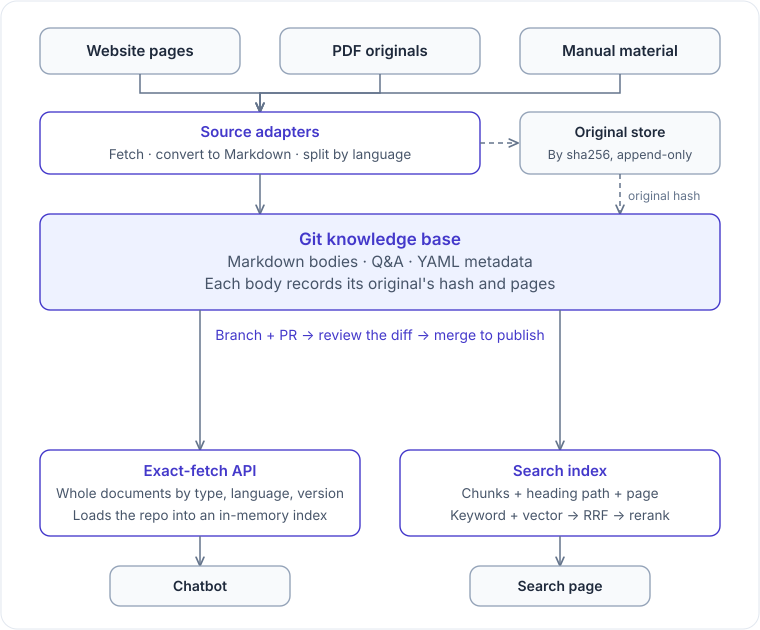

Many knowledge base projects start by uploading every PDF and web page into a vector store and wiring it to a chatbot. The demo usually goes well. The problems show up after launch:

- Three versions of the same contract all come back, and the answer cites the one that is no longer in force.
- A user types a document number, and vector search returns a few unrelated clauses that "mean something similar".
- Someone finds a conversion error but cannot tell which original and which page it came from, or what else the fix affects.
- Business reviewers want to see what the knowledge base actually contains, and the only place to look is the vector store.

None of these are retrieval problems. They happen because **the content itself is not managed as a product**.

We treat the knowledge base like a library, or a dictionary: categories first, then books and their editions, a table of contents inside each book, and only then the actual passages. The chat model doesn't need "the whole knowledge base", only enough to answer the question. The structure exists to **narrow the context level by level** and hand the chat model accurate knowledge.

This post draws on a bilingual (English and Chinese) knowledge base project: about 1,800 Markdown documents and 800-plus Q&A entries, with long, clause-heavy PDFs as the main originals. It covers the content model, the publishing flow and the retrieval choices. How every source becomes Markdown and how it is chunked by heading is the subject of the [next post](../pdf-to-markdown-chunking/).

## 1. Reference practices

The reference architectures from the major cloud and model vendors are clear about what has to happen before retrieval:

| Source | Main practice |
| --- | --- |
| Azure Architecture Center, *RAG solution* series | A preparation phase first: understand document types, strip headers, footers and watermarks, then chunk by document structure; hybrid queries and reranking at retrieval time |
| Amazon Bedrock Knowledge Bases | Parsing, chunking and metadata filtering are separate settings; a foundation-model parser for documents with tables and figures |
| Google Document AI Layout Parser | Detect layout elements first, then create chunks whose text all comes from one layout element |
| Anthropic, *Contextual Retrieval* | Combine embeddings with BM25, then rerank; retrieval failures drop clearly compared with embeddings alone |
| Write the Docs, *Docs as Code* | Docs in plain-text markup, under version control, through code review and automated tests |

What they share: parsing, chunking and indexing are **steps you can inspect separately**. Sections 2–6 are our design. Section 7 compares it with ready-made platforms (RAGFlow, WeKnora, Azure AI Search) and explains why we didn't adopt them wholesale.

## 2. Like a library: narrow the context level by level

| Level | In a library | In the knowledge base |
| --- | --- | --- |
| Category | Shelf section | Catalog: customer segment › product line › product |
| Document | An edition of a book | One Markdown file with type, language, version, status |
| Section | The book's table of contents | The Markdown heading tree and heading path |
| Chunk | A passage in a section | The body under one heading |
| Q&A | A dictionary entry | One Q&A entry, belonging to one level |

The context the chat model receives is narrowed down through these levels, in one of two ways, each with its own interface:

- **You know the shelf and the book**: exact fetch by metadata. The chatbot already knows the product and language and fetches "the full current terms for this product" and "all Q&A for this product", with no wrong version and no half a clause.
- **You only have a question**: look it up in the index. Search indexes chunks and returns them with heading path and page, grouped by document; when more context is needed, walk up the heading path to fetch the whole section or document.

### The context changes as the conversation goes on

The context isn't fixed up front. The further the conversation goes, the more is known, and the narrower the scope can get:

| Conversation stage | What is known | What goes into the context | Structure it relies on |
| --- | --- | --- | --- |
| Start | Only a question | General rules, an overview of each product line, general Q&A | The top level of the catalog; this part is fixed and can sit in the prompt cache |
| A product line comes up | The product line | Introductions and Q&A for the products in that line | Catalog: product line › product |
| A specific product is settled | Product, language, maybe a signing date | The full terms of the matching version, or the relevant sections | Document version and status |
| A specific clause is asked about | The exact question | Retrieved chunks, plus the whole section via the heading path when needed | Heading tree and heading path |
| The topic changes | A new product or question | Replace the previous level's content instead of piling it up | As above |

Today our chatbot detects the product line by keywords and would rather load too much than miss something; later the model could decide through tool calls which level to fetch next. Whoever decides, the precondition is the same: every level has a stable, accurate structure to locate content by. Without it, every turn can only search the whole library or stuff everything into the context.

A mistake at any level gives the chat model the wrong context: a wrong category finds the wrong book, a wrong version cites terms no longer in force, a wrong heading tree cuts half a clause. So the content model (section 3) and the heading tree ([next post](../pdf-to-markdown-chunking/)) matter as much as retrieval. When the caller already knows which book it needs, skip retrieval.

## 3. Content model: one source, one Markdown document

Whether it started as a web page, a PDF or a manually supplied file, everything becomes "Markdown with metadata":

1. **One source, one document.** Metadata covers type, language, place in the hierarchy (customer segment, product line, product), version, status (current or historical) and source address.
2. **Traceable to the original.** Each Markdown file records the original's sha256, and text converted from PDF keeps page markers, so any passage leads back to a page.
3. **Old versions are kept.** A contract signed under older terms still needs those terms; they are marked historical, and search covers current versions by default.
4. **Bilingual files are split by language.** Conversion tags each block with its language, then splits the file into two documents; line-by-line bilingual covers and tables go to both.

**Q&A is not a document** and has its own model: one question and answer is one record and belongs to exactly one level (a product, a product line or a customer segment); scraped and hand-written Q&A share the model and are told apart by a source field; the FAQ section is removed from product pages so each Q&A is stored once. The chatbot can then fetch "all Q&A for this product" in one call, and the search page treats each Q&A as one chunk.

## 4. Store and publish with Git

Bodies and metadata live in Git, not in a database.

- **Git holds only Markdown bodies, Q&A and a little YAML metadata.** PDFs, page originals and OCR intermediates (about 1.2 GB) live in an original store outside the repository, keyed by sha256 and append-only.
- **Every sync is a branch and a pull request.** The website sync and internal-system sync are just source adapters that produce pull requests instead of writing to a database. Reviewers read the diff of the converted text, and merging to main publishes it.
- **People write only their decisions.** Each level has one hand-maintained file recording what no source provides, such as which product a file belongs to. Sources merge into one effective catalog, and conflicts go into a report.
- **The service reads the repository at startup** and builds an in-memory index that serves every exact-fetch endpoint.

Git provides versions, history and audit, so no revision tables are needed, and when a conversion rule changes the pull request shows exactly which lines of which documents changed. It fits thousands of documents, batch updates and no per-user access control. Beyond that, metadata belongs in a database, but the body should stay diffable and reviewable.

## 5. Search: pair hybrid with a reranker

In the index, **one record is one chunk**, with document-level fields (type, product, language, status) copied onto every chunk for filtering and facets. Three more points:

- The embedding input is "document title + heading path + chunk body", not the body alone.
- Exact strings such as document numbers go into a separate field with a keyword analyzer, matched whole and weighted higher.
- Each chunk carries its page and position in the source, so the preview jumps straight to it.

We compared methods on the same 48 questions (English, Traditional Chinese, colloquial Simplified Chinese, number lookups):

| Method | R@5 | MRR@10 |
| --- | ---: | ---: |
| Keyword (BM25) | 77–79% | 0.68–0.71 |
| Vector | 96% | 0.918 |
| Hybrid (RRF, no reranking) | 94–96% | 0.846–0.878 |
| Hybrid + managed semantic ranker | **100%** | **0.936** |
| Hybrid + standalone reranking model | 100% | 0.905–0.911 |

1. **Hybrid without reranking did worse than vector alone.** The keyword side ranked poorly, and RRF pushed good vector results down; a reranker recovered the loss and then beat vector alone.
2. **Keyword search cannot be dropped.** Only it finds document numbers; vector search misses them entirely. Azure's hybrid search docs say the same about product codes, jargon, dates and names.
3. **No conversion across languages or Chinese scripts.** The knowledge base is in Traditional Chinese and users often ask in Simplified. Keyword matching fails, but embeddings map Simplified questions to Traditional clauses and English questions to Chinese passages. So the search page defaults to hybrid plus reranking.
4. **The search page does not generate answers.** The managed service's "answer" is a sentence extracted from the source, shown only when the query looks like a question and scores high enough; for number lookups it is usually irrelevant.

## 6. The evaluation set decides, and has blind spots

The evaluation set decides the retrieval method:

- Questions follow how people actually ask: formal, casual, Simplified and Traditional, mixed languages, numbers.
- Each question marks the documents that count as correct, narrowed to a section or a specific Q&A where needed.
- Every method gets the same questions and scoring rules, measured with R@1, R@5, R@10 and MRR.
- **No tuning on a small set.** With 48 questions, one question is 2 percentage points. Keyword weights of 1.0, 0.7, 0.5 and 0.3 and RRF k of 60 and 20 all stayed within 1–2 questions, so we kept default equal-weight RRF.

Ranking metrics only ask whether the right document is near the top, not whether a chunk is complete or its heading path is right. The next post shows many chunking improvements that barely move the ranking but directly affect how results display and how well clauses are cited. The next step is 150–200 real questions and an answer-level metric, such as "does the top chunk contain the complete answering clause".

## 7. Why we ended up with this approach

RAGFlow, WeKnora and Azure AI Search turn parsing, chunking and retrieval into product features. We borrowed a lot from them but did not adopt any of them wholesale:

| Option | What it does well | Why we didn't use it directly |
| --- | --- | --- |
| RAGFlow | Parsing templates per document type (Q&A, manual, laws and more), one Q&A pair per chunk; chunk results visualized and editable against the source; a retrieval testing page for keyword weight and reranker | Manual fixes land on chunks, so re-parsing needs extra care to reconcile them with the body; review is chunk by chunk, not a whole-document diff in a pull request; the focus is retrieval and chat, while our main caller wants whole documents by metadata |
| WeKnora | Automatic sync from Confluence, Notion, Feishu and others; a separate FAQ library; chunk edits with revision history, diff and rollback; parent-child chunks, hybrid retrieval | Same as above: the source of truth is the chunk, and exact fetch by metadata is not its focus |
| Azure AI Search built-in indexers and skillsets | Automatic parsing, chunking and vectorization; hybrid search, semantic ranking, extracted answers | The built-in layout skill runs layout OCR again, exactly where we had trouble with two-column pages and split tables; skills only run inside an indexer, with no standalone API; vectorization couldn't reach our own model gateway |
| **Own content layer + Azure AI Search for retrieval only** (chosen) | Reviewable, traceable, versioned content; conversion and chunking rules can be iterated and rerun in full | We maintain conversion, chunking and push code ourselves, and there is no ready-made chunk editor |

The key difference is which layer holds the source of truth. On these platforms, manual fixes happen on chunks, so chunks become the source of truth. We fix the Markdown body; chunks are derived, chunk IDs come from content, every chunk can be regenerated when the rules change, and embeddings are recomputed only where content changed. Retrieval goes to Azure AI Search through its push API, using only hybrid search and semantic ranking.

To be clear: we did not benchmark RAGFlow or WeKnora on our data, so the table reflects design trade-offs. The problems with Azure's built-in skills are ones we actually hit in the POC.

## References

- Microsoft, [Develop a RAG Solution on Azure: Preparation Phase](https://learn.microsoft.com/en-us/azure/architecture/ai-ml/guide/rag/rag-preparation-phase)
- Microsoft, [Develop a RAG Solution on Azure: Information Retrieval Phase](https://learn.microsoft.com/en-us/azure/architecture/ai-ml/guide/rag/rag-information-retrieval)
- Microsoft, [Develop a RAG Solution on Azure: LLM End-to-End Evaluation Phase](https://learn.microsoft.com/en-us/azure/architecture/ai-ml/guide/rag/rag-llm-evaluation-phase)
- Microsoft, [Hybrid search using vectors and full text in Azure AI Search](https://learn.microsoft.com/en-us/azure/search/hybrid-search-overview)
- Microsoft, [Relevance scoring in hybrid search using Reciprocal Rank Fusion (RRF)](https://learn.microsoft.com/en-us/azure/search/hybrid-search-ranking)
- Microsoft, [Semantic ranking in Azure AI Search](https://learn.microsoft.com/en-us/azure/search/semantic-search-overview)
- Cormack, Clarke, Büttcher, [Reciprocal Rank Fusion outperforms Condorcet and individual Rank Learning Methods](https://plg.uwaterloo.ca/~gvcormac/cormacksigir09-rrf.pdf) (SIGIR 2009)
- Amazon Web Services, [How content chunking works for knowledge bases](https://docs.aws.amazon.com/bedrock/latest/userguide/kb-chunking.html)
- Google Cloud, [Use Document AI layout parser with RAG Engine](https://cloud.google.com/vertex-ai/generative-ai/docs/rag-engine/layout-parser-integration)
- Anthropic, [Contextual Retrieval](https://www.anthropic.com/engineering/contextual-retrieval)
- RAGFlow, [repository](https://github.com/infiniflow/ragflow); guides *Configuration*, *Retrieval Testing* and *Chunk: Parsing Results and Knowledge Fragment Management* (under `docs/guides/dataset/`)
- Tencent, [WeKnora](https://github.com/Tencent/WeKnora)
- Cohere, [Rerank Overview](https://docs.cohere.com/docs/rerank-overview)
- Thakur et al., [BEIR: A Heterogenous Benchmark for Zero-shot Evaluation of Information Retrieval Models](https://arxiv.org/abs/2104.08663)
- Write the Docs, [Docs as Code](https://www.writethedocs.org/guide/docs-as-code/)
