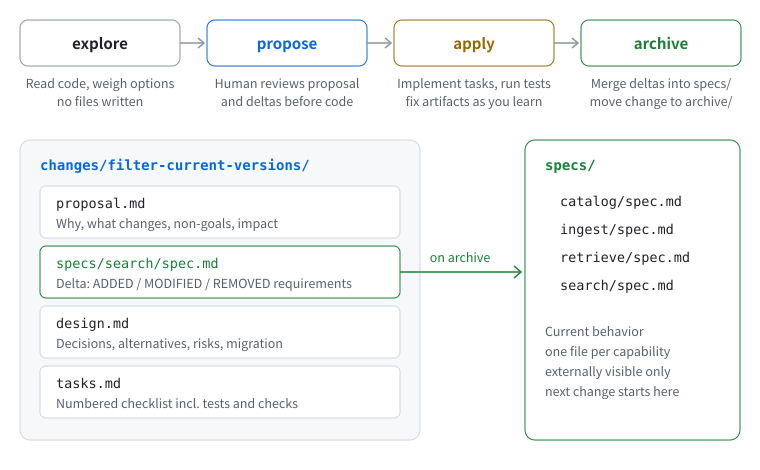

After coding with AI for a while, the same problems keep coming back:

- Edge cases you settled with the AI last week get rewritten its own way this week, because it's a new session;
- The AI says "all done", but nobody can say what was tested and what was merely written;
- A PR touches thirty files, and you still can't tell what **behavior** changed;
- A new teammate asks "does search still return old versions?", and the answer is buried in code and months-old chats.

The problem isn't model capability. It's that **requirements only exist in the conversation**. Conversations get truncated, get cleared, and never go through code review. Spec-driven development (SDD) is a simple idea: write down "what it should do" as files in the repo, have a human review them, then let the AI implement.

There are many tools, and they differ a lot. We compared the main ones and chose OpenSpec. We now use it in more than a dozen repos, with over a hundred changes. This post covers why we chose it and how we use it.

## 1. How the industry does it

Birgitta Böckeler of Thoughtworks, writing on martinfowler.com, splits SDD into three levels:

- **Spec-first**: write the spec before the code, but nobody maintains it once the feature ships;
- **Spec-anchored**: the spec stays after the feature ships and is updated whenever that feature changes;
- **Spec-as-source**: the spec is the only maintained source; code is generated from it and humans don't edit code.

Her observation: every tool does spec-first, but most are vague about how the spec is maintained afterwards. That is the question to ask when choosing.

| Tool | Approach | Where the spec lives after the feature | Limits |
| --- | --- | --- | --- |
| GitHub Spec Kit | A project "constitution", then specify → plan → tasks → implement per feature, with phase gates | Per feature branch in `specs/NNN-feature/`, never merged into a whole | Seven or eight files per feature; needs Python |
| AWS Kiro | requirements (EARS) → design → tasks, plus steering files and hooks | Stays in the feature folder; no clear story across features | Commercial product; some features IDE-only |
| Tessl | The spec is the source; code is marked "generated from spec, do not edit" | The spec is the source | One spec per file; product direction still shifting |
| BMAD Method | Role-based agents (analyst, architect, developer…) in an agile flow | Process artifacts, not a spec library | More a process framework |
| OpenSpec | `specs/` holds current behavior; each change writes only a delta in `changes/`, merged on archive | Merged into `specs/`, one file per capability | Nothing enforces that code matches the spec |

## 2. The objections

SDD has plenty of critics, and some carry real weight:

1. **Too much Markdown to review.** Trying Spec Kit, Böckeler got a lot of repetitive Markdown: "I'd rather review code than all these markdown files."
2. **A sledgehammer to crack a nut.** Fixing a small bug with Kiro produced 4 user stories and 16 acceptance criteria. A good tool should scale the process to the size of the change.
3. **Waterfall strikes back.** That's the title of Marmelab's article: lots of up-front specs, reviewed twice (specs already contain code, so you review spec and code). And most coding agents already have a plan mode and a task list, so SDD adds little.
4. **Hand-written rules don't scale.** The Thoughtworks Technology Radar puts SDD in "Assess", calls the workflows "elaborate and opinionated", and warns "we may be relearning a bitter lesson — that handcrafting detailed rules for AI ultimately doesn't scale."
5. **The AI doesn't always follow the spec.** Agents may ignore it, or overdo a single rule.

We agree with all of these. So the question we asked wasn't "should we write specs?" but **can we write only what's necessary, and will it still be useful afterwards?** Point 3 is right that plan mode is enough for planning, but plan mode's output doesn't stay. What we wanted is exactly the part that stays, merges, and can be read next time.

## 3. Why OpenSpec



### Specs split into "now" and "what this change does"

Take a feature from the [knowledge base post](../knowledge-base-architecture/): a contract has several versions, old versions are kept but marked historical, and search returns only the current version by default. Here is how OpenSpec records that change.

The repo has two folders:

- `openspec/specs/`: what the system does **now**, one file per capability, e.g. `ingest/spec.md`, `retrieve/spec.md` (exact fetch), `search/spec.md`;
- `openspec/changes/<change-name>/`: the proposal, delta specs, design and tasks for one change, here `changes/filter-current-versions/`.

The delta spec records only what's different, in three sections:

```markdown
## ADDED Requirements
### Requirement: Search current versions only
Search SHALL return only document versions whose status is current,
unless the caller explicitly asks to include historical versions.

#### Scenario: A contract has three versions
- **WHEN** a user searches for a clause in that contract
- **THEN** only the current version is returned; historical ones are not

#### Scenario: Looking up a contract signed under old terms
- **WHEN** the caller asks to include historical versions
- **THEN** passages from each version are returned, each labelled with version and status

## MODIFIED Requirements
### Requirement: Group results by document
… (the full new wording: each document keeps only its current version when grouped)

## REMOVED Requirements
### Requirement: Return all versions
```

Which table holds the status field and how it's indexed don't go here. They go in design.md.

On archive, ADDED is appended to `specs/search/spec.md`, MODIFIED replaces the existing requirement, and REMOVED deletes it. The change folder moves to `changes/archive/<date>-filter-current-versions/` with the whole discussion intact.

This answers the earlier questions directly:

- **What to review**: the delta, not the whole spec. Change one requirement and the delta is a few lines.
- **Where the spec goes afterwards**: into `specs/`, which is the first thing the next person (or agent) touching search reads. In Böckeler's terms, this is spec-anchored.
- **Does it rot over time**: MODIFIED and REMOVED force the writer to find the existing requirement first, which makes the agent look at current behavior before acting.

### Built for existing projects

The OpenSpec docs are blunt: you don't document the whole codebase to start; **you write specs only for what you're about to change**. `specs/` starts nearly empty and grows as changes are archived.

Most of our repos are existing projects, and this decided whether we could adopt it at all. Having to backfill every spec first would put us right back into up-front waterfall documentation.

### Light by default, no phase gates

A change is 3 to 4 Markdown files, and small changes can skip design. You can revise the proposal and specs at any time; there's no "spec must pass before the next phase" gate. The docs say lite specs are the default and "most changes should stay in Lite mode"; full specs are for cross-team, API, migration and security changes.

### No tool lock-in

Specs are plain Markdown, the CLI is an npm package, and the workflow installs as skills into twenty-odd coding tools, including Claude Code, Codex, Cursor and Copilot. People on the team use different agents but read the same specs, and switching tools doesn't require migrating anything.

### Configurable per project

`openspec/config.yaml` takes three things: project context for the AI, rules per artifact, and guidance for apply and archive. It's the feature we use most; see the next section.

### Compared with the alternatives

| What we care about | OpenSpec | Spec Kit | Kiro |
| --- | --- | --- | --- |
| Specs merge into "current system" after the feature | Yes, on archive | No, one folder per feature | No clear mechanism |
| Existing projects: spec only what changes | Explicitly supported | Has a guide; higher adoption cost | Not stated |
| Overhead for a small change | 3–4 files, design optional | Seven or eight files, phase gates | Tends to inflate small changes |
| Switching coding tools | Twenty-odd tools | Several agents supported | Tied to its own product |

Tessl goes furthest, but "humans don't edit code" isn't realistic for us, and it repeats model-driven development's old problem: generate twice from the same spec and you get different code. BMAD solves multi-role process, which is a different problem from "one continuously updated spec library".

## 4. How we use it

These practices come from more than a dozen repos and over a hundred archived changes. In five of those repos, 87 changes hold about 1,700 tasks, roughly 20 per change; most changes are archived within 1 to 3 days.

### Specs describe externally visible behavior only

This is the most common rule in our `config.yaml` files:

```yaml
rules:
  specs:
    - Describe externally observable behaviour only;
      table layouts and SQL belong in design.md.
```

Specs say what the system does; table layouts, class names and library choices go in design. OpenSpec's docs give the same test: if the implementation can change without changing externally visible behavior, it doesn't belong in the spec. This also answers Marmelab's "double review": with no code in the spec, reviewing the spec and reviewing the code check two different things.

Requirement titles are behavioral sentences, such as "Search current versions only" or "Invalid parameters fall back to defaults", not "version filter module". Each requirement has one to three scenarios using only WHEN / THEN. Across the five repos we counted, 367 requirements have 700 scenarios, about two each.

### Proposals must say what's out of scope

```yaml
rules:
  proposal:
    - Include a "Non-goals" section.
    - When shared code changes, say which workflows are affected.
```

The AI's most common failure isn't doing too little but doing too much. A Non-goals section shows reviewers the scope at a glance and gives the agent a clear boundary. When several workflows share code, the proposal must also name which ones are affected.

### Be honest about verified versus unverified

```yaml
rules:
  tasks:
    - Call out any DB migration as its own task, and mark it
      unverified when it cannot be run locally.
operations:
  apply:
    guidance:
      - Say what was verified and what was not.
  archive:
    guidance:
      - Confirm migrations and env changes are done before archiving;
        note anything left unverified.
```

AI readily reports "written" as "done". Every task list must include test and check items (about a quarter of tasks involve tests, lint or type checks). Database migrations that can't run locally get their own task and are marked unverified, then confirmed again before archiving.

### Put project background in `context`, don't restate design docs

`context` holds the tech stack, test command, commit conventions, environment limits, and which design document is authoritative for database naming. The design rule is to reference documents in `docs/` rather than restate them. The agent gets the same background every time it writes an artifact, and there are never two conflicting descriptions.

### Commit specs with code

A feature commit usually contains source, tests, API definitions, the `specs/` change (e.g. +296 lines), and the change folder renamed into archive. A PR reviewer reads the delta spec first, then checks that the code does it.

### One change, one thing

Change names are verb-first kebab-case, such as `add-`, `fix-`, `replace-`. The delta types show what really happens: across archived delta specs there are 108 ADDED, 50 MODIFIED and 6 REMOVED sections, so most changes grow new capabilities. A change with more than 40 tasks should usually be split.

## 5. Unsolved problems

- **Nothing enforces that code matches the spec.** `openspec validate` checks format only; `verify` is optional and judged by AI. If the spec is wrong, the agent will follow it.
- **Changes get forgotten.** Some repos have changes one task from done that nobody touched for weeks; some have only in-progress changes and were never archived, so `specs/` is empty. Someone has to own archiving.
- **Specs grow.** Once one capability's spec passes a few hundred lines, review and agent reads both slow down; split it by capability.
- **Small changes still cost something.** A typo fix isn't worth a change folder; we use OpenSpec only for changes that alter behavior.

OpenSpec doesn't make the AI write better code. What it does is plainer: it gives "how the system should behave" a place to be written, reviewed and merged, which survives new sessions, new tools and new people.

## References

- [OpenSpec website](https://openspec.dev), [GitHub repo](https://github.com/Fission-AI/OpenSpec)
- [OpenSpec Concepts](https://github.com/Fission-AI/OpenSpec/blob/main/docs/concepts.md)
- [OpenSpec: Existing Projects](https://github.com/Fission-AI/OpenSpec/blob/main/docs/existing-projects.md)
- [OpenSpec Customization](https://github.com/Fission-AI/OpenSpec/blob/main/docs/customization.md)
- [GitHub Spec Kit](https://github.com/github/spec-kit), [spec-driven.md](https://raw.githubusercontent.com/github/spec-kit/main/spec-driven.md)
- [Kiro Specs docs](https://kiro.dev/docs/specs/)
- [BMAD Method](https://github.com/bmad-code-org/BMAD-METHOD)
- Birgitta Böckeler, [Understanding Spec-Driven-Development: Kiro, spec-kit, and Tessl](https://martinfowler.com/articles/exploring-gen-ai/sdd-3-tools.html)
- Thoughtworks Technology Radar, [Spec-driven development](https://www.thoughtworks.com/radar/techniques/spec-driven-development)
- Marmelab, [Spec-Driven Development: The Waterfall Strikes Back](https://marmelab.com/blog/2025/11/12/spec-driven-development-waterfall-strikes-back.html)
