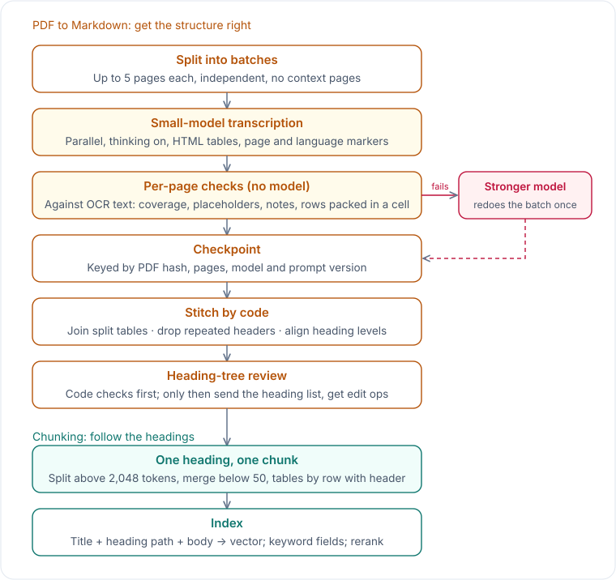

What the knowledge base actually maintains is **Markdown**. PDFs, web pages and manually supplied material are all converted to one Markdown convention, and Q&A is kept as Markdown files too. The chunker doesn't care where content came from. It reads only the Markdown structure: **the heading tree sets chunk boundaries, and paragraphs, lists and tables set where a chunk can be split inside**.

If the knowledge base is a library, the Markdown heading tree is each book's table of contents: it decides which sections a book splits into and which section each passage belongs to. The chunker follows that table of contents, so every chunk carries its full heading path. When retrieval hits a chunk, the chat model knows which chapter and clause it came from, and can walk up the heading path to fetch the whole section when it needs more context. A wrong table of contents cuts chunks in the middle of clauses or files them under the wrong section, so **the structure has to be correct when the Markdown is produced**.

How fine to cut along the table of contents was decided by evaluation. On the same 50 questions and documents (hybrid search, MRR@10), one heading per chunk beat packing several headings into one chunk:

| Chunking | MRR |
| --- | ---: |
| Whole heading subtree in one large chunk (cap 2,048 tokens) | 0.793 |
| Heading-tree packing to about 512 tokens | 0.864 |
| **One heading per chunk** (split only above 2,048 tokens) | **0.889** |

On top of that, making PDF transcription put each untitled numbered clause in its own paragraph, plus a heading review, raised vector-search MRR from 0.899 to 0.918 and R@10 to 100%. The chunking rules stayed the same; only the Markdown going into them changed.

The documents are mostly long, clause-heavy material such as contracts, terms and prospectuses, bilingual (English and Chinese), and the PDFs often have two-column layouts, tables across pages and merged cells. The overall knowledge base design is in the [previous post](../knowledge-base-architecture/).

## 1. Reference practices

| Source | Recommendation |
| --- | --- |
| Microsoft Learn, *Chunk large documents* | For fixed-size chunks, start at 512 tokens with 25% overlap; 10–15% overlap is also common |
| Azure, *RAG solution: chunking phase* | Chunk structured documents by structure; also covers semantic chunking and model-generated chunks |
| Amazon Bedrock Knowledge Bases | Fixed-size, hierarchical and semantic chunking; a foundation-model parser for documents with tables and figures |
| Google Document AI Layout Parser | All text in a chunk comes from one layout element (heading, subheading, list) |
| Paper: *Financial Report Chunking for Effective RAG* | Chunking by structural elements beats paragraph chunking and needs no chunk-size tuning |
| Paper: *Is Semantic Chunking Worth the Computational Cost?* | Semantic chunking's extra cost does not buy consistent gains |

Fixed 512 tokens is a starting point for unknown documents. For documents with clear headings and numbered clauses, structural chunking usually wins, on one condition: **the structure in the text you chunk has to be correct**. So structure is part of the Markdown convention, and whichever step produces the Markdown is responsible for it.

## 2. One Markdown, one convention

Each source has its own way into Markdown, but all follow the same convention:

| Source | How it becomes Markdown |
| --- | --- |
| PDF | Batch transcription by a vision model, checked and stitched by code, then a heading-tree review (sections 3 and 4) |
| Web pages | Converted from the page's component data; FAQ accordions on the page move into Q&A files and are removed from the body |
| Manual material | Written as Markdown, or converted from DOCX and similar files, reviewed in a pull request |
| Q&A | One Q&A file per level, one heading per question with the answer below |

What the convention says:

- **Headings**: only `#`–`######`, no skipped levels; `#` only for the document title (one per language in bilingual files); parts, sections and titled clauses are all headings; untitled numbered clauses each get their own paragraph, with no invented headings.
- **Tables**: always HTML. More than half the tables have merged cells and multi-row headers that pipe tables can't express; short column labels go in the header. Pipe tables that already exist in web pages are still treated as tables.
- **Lists and paragraphs**: CommonMark lists, with sub-items indented to the parent's text column; paragraphs broken across pages are rejoined.
- **Markers**: page and language are HTML comments (`<!-- page: 12 -->`, `<!-- lang: en -->`), invisible when rendered but readable by the chunker; a generated table of contents sits inside a comment-delimited block and never enters a chunk.
- **No clutter**: headers, footers, logo text and navigation buttons stay out of the body; metadata such as ownership and version lives in a YAML file alongside.

The payoff: **the chunker depends only on Markdown, not on the source**. A new source only has to emit Markdown that follows the convention, and the convention itself can be checked by code (skipped heading levels, closed tables, continuous page numbers), with the same checks for every source.

An invented example:

```markdown
# Bond Prospectus
## Section 3 Redemption
### 3.1 Conditions for redemption
The issuer may redeem the bonds early if …
1. a change in interest rates …
2. a change in tax rules …
### 3.2 Redemption price
<table>…</table>
## Section 4 Events of default
```

The resulting chunks (heading path › content):

- `Bond Prospectus › Section 3 Redemption › 3.1 Conditions for redemption`: the full conditions, with the two numbered clauses as separate paragraphs;
- `Bond Prospectus › Section 3 Redemption › 3.2 Redemption price`: the whole price table;
- `Section 3 Redemption` itself is a single heading line under 50 tokens, so it merges into a neighbour;
- `Section 4 Events of default` and each heading below it become their own chunks.

## 3. PDF to Markdown: let a vision model read the PDF

PDFs are most of the knowledge base, and the hardest source to bring up to the convention.

Markdown from a layout-analysis (layout OCR) service has several kinds of errors on these documents that rules can't repair:

- **Two columns merged into one table**: each column is a "term | definition" list, and they come out as one four-column table, splitting a sentence across rows.
- **Tables across pages split apart**: the second page's table has no header and starts with a continuation row.
- **Data rows marked as headers**: the first entry of a definitions table becomes the header and is repeated in every split chunk.
- **Cover background images read as text**, bullets not turned into lists, and the italics that mark defined terms lost.

No setting fixes these; re-analysis with more options was still 0.999 similar to the original. Two other routes fail as well: PDF text layers are often out of order or overlapping, and full-page images have none; giving OCR text to an LLM to tidy up only lets it correct someone else's errors, with no fewer input tokens than sending the PDF.

So **send PDF pages directly to a vision model for transcription**. It sees the layout, which is what gets columns, tables and images right. Research such as olmOCR and Bedrock's foundation-model parser take the same route.



### Five pages per batch, batches independent

- **Don't transcribe whole documents.** The small model refuses outputs of a dozen-plus pages or switches to "(remainder omitted)"; the large model hit its output limit at page 106 of a 133-page document.
- **Five pages per batch.** Four to six pages are stable, ten sometimes fail; cost is driven by output, so batch size barely matters.
- **No context pages.** Put the previous page in the PDF and the model transcribes it too, shifting every page number; text context misleads the model when the previous page is an image with an empty text layer. Code handles every seam.
- **Turn thinking on for the small model.** On a 21-page sample, all five batches failed with thinking off and all passed first time with it on, at a lower total cost.

### Per-page checks, no model calls

The reference is the OCR text of the same page (OCR structure is unreliable, but it reads nearly every character):

| Check | Fails when |
| --- | --- |
| Coverage | Letters, digits and CJK characters cover less than 90%, as a character multiset so reading order doesn't matter; neighbouring pages can be combined |
| Placeholders and refusals | Text like "remainder omitted" or "I am unable" appears |
| The model's own notes | A line says something like "this page continues the table" and is not printed on the page |
| Rows packed into a cell | Two or more cells in a row each hold several line breaks: names in one cell and values in another, paired only by position |
| Truncation and page markers | Output did not finish normally; a page marker is missing or duplicated |
| Markdown rules | A pipe table outside HTML; a standalone "Article n" or "Section n" line not written as a heading |

If any page fails, **the whole batch goes to a stronger model once**. Batches are never split, so a batch's pages stay in one request and tables aren't cut. The small model gets one attempt; a second usually stalls on the same page.

### Checkpoints and code-based stitching

- **Checkpoint each passing batch**, keyed by PDF hash, page range, model and prompt version. A failed batch doesn't affect the others, and a rerun fills in only the missing ones.
- **When rules change, re-check saved outputs first.** Of 48 failed documents in the library, 34 passed under the new rules without a new request.
- **Stitching is code**: close unclosed tables; drop headers and footers repeated across batches; join a batch that starts with table rows, or with the same header or column count, onto the previous table; align heading levels across batches by numbering pattern ("Part n", "Section n", "(a)", "1.1"); turn bullets and line breaks into valid Markdown.

### Prompt lessons

- **Examples are the strongest signal.** The model copies an example's format, mistakes included. Keep examples invented, varied and labelled "for illustration only".
- **Keep "write long pages in full".** Without it, the model writes dense table pages as blank.
- **Don't say output "will be compared word for word".** The model gives up on whole pages rather than risk mistakes.

## 4. Heading-tree review

Chunking by heading needs a correct heading tree. After batch transcription a few headings still sit at the wrong level, such as one heading a level too high in a run of sibling clauses. The process:

1. **Code checks first**: skipped levels; headings of the same kind (same numbering style or ending text) at different levels; a heading whose predecessor in the numbering sits at another level; printed table-of-contents entries that are not headings in the body.
2. **Only if a check fails, call the model once**, with the heading list (page and body length for each), the check results and the printed contents page. No body text, so the request is 2–10% of the document.
3. **The model returns only edit instructions**: "set this heading to level n", "this line is not a heading", "this candidate line is a heading". Code applies them, and the body is untouched.
4. **The table of contents is generated by code** from the headings, with a hash of the heading list; unchanged headings are not reviewed again.

On seven sample documents the model proposed 66 edits, and issues found by code fell from 19 to 11; the remainder were false positives.

## 5. Chunking rules: cut by heading level

The chunker reads only Markdown, in four steps:

1. **Split into blocks.** Break the body into headings, paragraphs, lists and tables (HTML and pipe), and read page and language from the comments; drop printed table-of-contents pages, headers and footers repeated on every page, and decorative lines; rejoin paragraphs broken across pages.
2. **Build the heading tree.** Build the tree from the number of `#`, allowing skipped levels (`####` directly under `##`); each block hangs under the nearest preceding heading, which gives it a full heading path.
3. **One heading per chunk.** A heading at any level plus its own body (up to the next heading) is one chunk; child headings get their own chunks and are not merged into the parent. Deeper levels are more specific, so chunks are "purer".
4. **Adjust size by blocks:**
   - **Split only when too long**: above 2,048 tokens, split between paragraphs and numbered clauses first, and by sentence only when a single paragraph is too long. Split points are chosen by dynamic programming: pieces as even as possible, no penalty at the start of a clause, a high cost inside a sub-item, list or sentence.
   - **Tables** within the cap stay whole; larger ones split only between whole rows, with the header repeated. Only short rows without sentence punctuation count as headers, because both transcription and OCR mislabel the first entry of a definitions table as a header.
   - **Merge when too short**: chunks under 50 tokens (a heading alone, or a line or two) merge into a neighbour; heading-only chunks embed poorly.

Q&A files have one more rule: **one Q&A entry per chunk**, with the question as the chunk title and no further splitting.

Every chunk carries its heading path, page and position in the source:

- **Embedding input** is "document title + heading path + chunk body", with tables as plain "cell | cell" text; the heading path is also its own field for keyword search and reranking.
- **Chunk IDs come from source, heading path and content.** Unchanged content keeps its ID, so only new chunks are embedded; each chunk file records the rule version, and a rule upgrade re-chunks everything.
- **You can walk back up from a chunk.** After a small chunk is hit, the heading path lets you fetch the whole section or document for the chat model; the index already holds heading paths and positions, so no index change is needed.

**Why a cap.** Across about 100,000 headings, the median body is 118 tokens and P99 is 1,867. Only 0.8% exceed 2,048, mostly large tables, but a few dozen exceed the embedding model's input limit. Another 21.8% are under 50 tokens and need merging. Almost every heading is already one chunk, and the cap only affects a few large tables. Caps of 2,048 and 6,000 scored nearly the same, so we kept 2,048 for headroom.

**Finer structure is handled when producing the Markdown.** Untitled numbered sub-clauses ("1. …", "2. …") don't get invented headings; each just goes in its own paragraph. They stay in one chunk, and when it exceeds the cap it can be split between clauses. This is one source of the 0.899 to 0.918 gain at the top.

## 6. Implementation: library or our own

On the same Markdown we compared common chunking libraries. The metrics look at content, not output format, and measure whether structure was broken (five sample documents combined):

| Method | Table rows cut | Sections that fit but were split | Fragments under 50 tokens |
| --- | ---: | ---: | ---: |
| Our heading-based chunker | 0 | 0 | 0 |
| chonkie (configured properly) | 0 | 4 | 13 |
| LangChain (configured properly) | 0 | 6 | 36 |
| Docling HybridChunker | 40 | 18 | 19 |
| Splitter from Microsoft's sample app | 16 | 95 | 12 |

- **Check the configuration before drawing conclusions.** With defaults, chonkie's Markdown rules can fail to download and fall back to defaults, and LangChain splits HTML tables as plain text, badly damaging tables. Configured properly (chonkie with its table chunker, LangChain with tables pulled out first), both leave every table intact.
- **Docling doesn't suit Markdown with embedded HTML tables**; content from different rows gets merged.
- **16–18% of the libraries' output tokens are HTML tags**, so tables are converted to plain text before embedding.
- The implementation follows chonkie's interfaces and uses its components to split tables and sentences; we only maintain what it lacks: heading paths, page numbers and HTML header detection.

## 7. Why we ended up with this approach

RAGFlow, WeKnora and Azure AI Search share our direction: chunk by structure. The differences are four specific choices:

| Choice | Ready-made platforms | What we do, and why |
| --- | --- | --- |
| Who parses | RAGFlow uses its built-in DeepDoc (layout analysis, OCR, table recognition), or Docling, MinerU or a vision model; WeKnora uses a document-reader service with OCR and MinerU; Azure's Document Layout skill uses layout OCR to output Markdown with headings. Parser output goes straight to chunking | A vision model transcribes, wrapped in per-page checks, whole-batch retries and code-based stitching. Layout OCR's problems were measured (section 2); a parser without checks can't tell you which page lost content |
| Where structure is decided | At chunk time: RAGFlow's Title Chunker matches headings by regex; WeKnora looks for Markdown headings, then numbering and page-break cues, then splits recursively by length, with a validator judging each tier | When the Markdown is produced, with a heading review for PDFs; the chunker only reads Markdown headings and never guesses. When structure is wrong, we fix conversion rules or the prompt, and the result is reviewable in a pull request |
| How fine | WeKnora splits at the document's dominant heading level and keeps lower headings in the same chunk; RAGFlow's Title Chunker defaults to a 512-token cap; Azure splits by Markdown section, then by length | Every heading level gets its own chunk, capped at 2,048. In our evaluation that beat heading-tree packing by 0.025 MRR and large chunks by almost 0.1 (the table at the top), probably because every clause has its own heading and purer chunks give more precise vectors |
| Tables | RAGFlow can attach surrounding context to tables; WeKnora adds headers to continuation chunks | HTML tables in the source, split on whole rows with the real header repeated; plain text for embedding |

The cost is maintaining each source's conversion and chunking ourselves, with tests for both; in return every step can be checked and rerun on its own. We did not benchmark RAGFlow or WeKnora on our data, and the "how fine" conclusion comes from our own evaluation. On these platforms, try splitting at deeper heading levels with a larger cap, then check against your own evaluation set.

Approaches we did not adopt:

| Approach | Why not |
| --- | --- |
| Fixed-size chunking | Dozens of tables cut, and the most sections split that would have fit |
| Semantic chunking | Headings are the best topic boundaries in these documents; per-sentence embeddings cost several times more, and research shows inconsistent gains |
| Letting an LLM pick split points or write chunks | Results can differ per run, changing chunk IDs breaks incremental updates, and code can't easily confirm nothing was dropped or rewritten |
| Late Chunking | Needs a long-context embedding model with token-level vectors; switching models means rebuilding the whole index |
| A model-written table of contents for the chunker | Structure would have two sources, plus the question of staleness; the headings already are the structure |
| Contextual Retrieval | Backed by published results and independent of chunking; planned once the evaluation set is larger |

## 8. What retrieval metrics can't see

Ranking barely moved before and after fixing the chunking rules and reviewing headings. Their value isn't "the right document ranks higher" but "the top chunk is a complete clause with the right heading path", which directly affects how results display and how well answers cite clauses.

So our rule is: **ranking metrics choose the retrieval method, structural metrics choose the chunking rules**. Whether table rows are cut and whether sections that fit are split are automated tests that run on a dozen real documents every time. An answer-level metric comes with the larger evaluation set.

## References

- Microsoft, [Chunk large documents for vector search solutions in Azure AI Search](https://learn.microsoft.com/en-us/azure/search/vector-search-how-to-chunk-documents)
- Microsoft, [Develop a RAG Solution on Azure: Chunking Phase](https://learn.microsoft.com/en-us/azure/architecture/ai-ml/guide/rag/rag-chunking-phase)
- Microsoft, [Document Layout skill](https://learn.microsoft.com/en-us/azure/search/cognitive-search-skill-document-intelligence-layout), [Chunk and vectorize by document layout](https://learn.microsoft.com/en-us/azure/search/search-how-to-semantic-chunking)
- RAGFlow, [repository](https://github.com/infiniflow/ragflow); guides *Configure the Chunker Component*, *Configure the Parser Component* and *Configuration* (under `docs/guides/`)
- Tencent, [WeKnora](https://github.com/Tencent/WeKnora); chunker in `internal/infrastructure/chunker/`
- Amazon Web Services, [How content chunking works for knowledge bases](https://docs.aws.amazon.com/bedrock/latest/userguide/kb-chunking.html)
- Amazon Web Services, [Parsing options for your data source](https://docs.aws.amazon.com/bedrock/latest/userguide/kb-advanced-parsing.html)
- Google Cloud, [Use Document AI layout parser with RAG Engine](https://cloud.google.com/vertex-ai/generative-ai/docs/rag-engine/layout-parser-integration)
- Jimeno Yepes et al., [Financial Report Chunking for Effective Retrieval Augmented Generation](https://arxiv.org/abs/2402.05131)
- Qu, Tu, Bao, [Is Semantic Chunking Worth the Computational Cost?](https://arxiv.org/abs/2410.13070)
- Günther et al., [Late Chunking: Contextual Chunk Embeddings Using Long-Context Embedding Models](https://arxiv.org/abs/2409.04701)
- Poznanski et al., [olmOCR: Unlocking Trillions of Tokens in PDFs with Vision Language Models](https://arxiv.org/abs/2502.18443)
- Auer et al., [Docling Technical Report](https://arxiv.org/abs/2408.09869)
- Anthropic, [Contextual Retrieval](https://www.anthropic.com/engineering/contextual-retrieval)
- [chonkie](https://github.com/chonkie-inc/chonkie), [LangChain Markdown header splitter](https://python.langchain.com/docs/how_to/markdown_header_metadata_splitter/), [azure-search-openai-demo](https://github.com/Azure-Samples/azure-search-openai-demo)
- [CommonMark Spec](https://spec.commonmark.org/0.31.2/), [GitHub Flavored Markdown Spec](https://github.github.com/gfm/)
