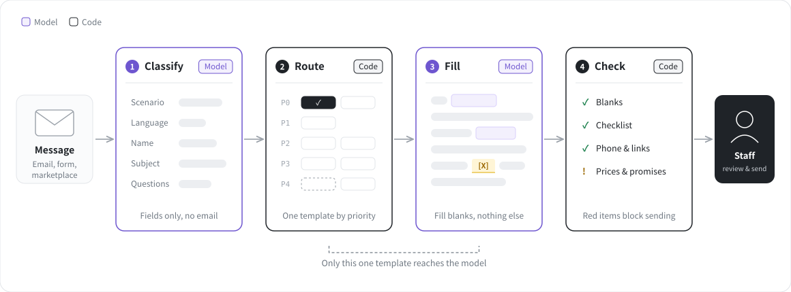

Many teams do the same thing all day: a message comes in, they work out which case it is, find the matching standard reply, fill in the sender's details and send it. Sales answering inquiries, support answering questions, admissions answering applicants, property managers answering repair requests, HR answering candidates: it's all the same job.

These replies share two traits: **there are only so many cases, and each has a written template; yet one wrong sentence is expensive.** The checklist in a template can't lose an item, phone numbers and links are fixed, and prices, lead times and promises can't be improvised.

Take an export sales inquiry:

> We need 5000 pcs of the LP-series panel with our own logo on the frame and the box. What is your best price?

Ask a model to write the reply and it will be eager to help: a rough unit price, free shipping thrown in, maybe "delivery within 30 days". Every sentence reads well, and none of them was ever approved by anyone.

The part that takes real thinking is small: which case is this, which language should the reply use, and what is the sender's name and question? So the agent splits the work simply: **the model reads the message and fills the blanks, code picks the template and checks the draft, and staff review and send it.**

The example below is a lighting exporter's inquiry inbox, but nothing in the approach depends on the industry.

## Try it first

The prototype is embedded below. Each slide switches it to the matching scene, and red outlines show what the slide is about. You can also [open it in a new tab](/demos/inquiry-reply/?lang=en).


### ① The inbox and four steps
Messages come from a B2B marketplace, the website form and plain email. Open one and the agent runs four steps (classify, route, fill, check) before showing a draft.
<!-- step: layout -->
---
### ② A price question still starts with details
Jonas only asks for the "best price", but wants his own logo, so this is a custom product. A custom quote outranks a general quote, so the reply collects the specs first.
<!-- step: priority -->
---
### ③ One template out of nine
Code matches top-down by priority and stops at the first hit. Only the chosen template is passed to the model.
<!-- step: route -->
---
### ④ The model only fills blanks
Purple marks what the model filled in: the sender's name and the product. Every other word comes from the template.
<!-- step: fill -->
---
### ⑤ A blank left for a person
How many working days a quote takes is something the model doesn't know and shouldn't guess. Staff fill it right in the text, and the draft can't be sent until they do.
<!-- step: blank -->
---
### ⑥ The form wins
The message is in Chinese, but the sender picked English on the form. An explicit choice beats detection, so the reply is English only.
<!-- step: language -->
---
### ⑦ Not in the template, not answered
"Do you offer exclusive territory rights?" is a business decision. The model adds one line saying a colleague will confirm, plus a phone number.
<!-- step: redirect -->
---
### ⑧ Fallback and bilingual
No name, no message, just a product: it falls through to the catalog template with a generic greeting. The language can't be detected either, so the template's bilingual rule applies.
<!-- step: bilingual -->
---
### ⑨ Every edit is re-checked
The draft gets a line promising "free shipping", and the check flags it right away: that promise isn't in the template and needs a manager.
<!-- step: checks -->
---
### ⑩ When the agent is wrong, a person corrects it
The scenario menu is grouped by priority and shows which other templates also matched. Changes are marked "Adjusted" and can be reset in one click.
<!-- step: override -->


## Why not let the model write the reply?

The easiest approach is to put every template in the prompt and ask the model to "write a reply based on these". It's also the one with the most problems:

- **Invented terms.** Trying to help, the model answers questions the templates don't cover: prices, lead times, discounts.
- **Shortened checklists.** Eight required details get squeezed into three sentences, and staff have to ask again after the sender replies.
- **Mixed-up numbers and links.** Templates have similar phone numbers and links, and the model swaps them.
- **Unstable language.** A bilingual reply sometimes drops a language or flips the order.

Two root causes sit underneath: too many templates in the context dilute the model's attention, and the model can't tell whether it is completing a template or answering a question.

## Four steps: which ones use the model?

- **Classify (model):** reads the message and returns a few fields: scenario, language, sender name, the product or matter involved, and specific questions. It writes no email.
- **Route (code):** picks exactly one template by priority, decides single-language or bilingual, and fills in the phone number and link. No model here.
- **Fill (model):** sees only that one template, fills in the name and similar details, and adds at most one line for questions the template doesn't cover.
- **Check (code):** verifies the draft before sending, and again after every edit.

The model shows up twice, but each job is narrow: once it only returns fields, once it only fills blanks.

## What if a message matches several scenarios?

Jonas's inquiry is both "custom" and "asking for a price". Reply with the general quote template ("we will send a quotation soon") and someone has to chase the specs in another round.

So scenarios need priorities. Matching goes top-down and stops at the first hit. The order isn't set by industry but by **the cost of a wrong reply**:

| Priority | Kind of scenario | In the example |
|---|---|---|
| P0 | Details must be collected before anything else; missing them costs the most | OEM and project quotes |
| P1 | Requests with their own process | Sample request |
| P2 | From a specific channel; the reply carries a dedicated page or code | Distributors, trade fair follow-up |
| P3 | The next step of existing business | PO received, quote declined |
| P4 | The fallback when nothing else matches | General quote, catalog |

In customer support, P0 might be complaints and claims; in admissions, missing documents. The order is a business rule, not a model judgment, so it lives in code where it can be tested and changed.

## Which language?

- **If the sender chose one, use it.** A language picked on a form beats everything, even when the message is in another language.
- **Otherwise, read the content.** Detect it from the message text.
- **If that fails, use the default.** English in the example.
- **The template decides single or bilingual.** If the sender chose a language, use only that one. If not, some templates ask for two languages, English first.

Names and company names are used as written, never translated or rewritten.

## Questions the model can't answer

Messages often carry specific questions: "Is shipping free?", "Do you offer exclusive rights?" The model has only two ways to handle each one:

- **The template covers it.** "Three models, two pieces each" fits the sample rules, so nothing extra is needed.
- **The template doesn't.** Add one line that acknowledges the question, says a colleague will confirm, and gives a phone number. No answer, and no "roughly".

Prices, lead times, discounts and eligibility are commitments someone has to own. The model shouldn't be the one making them.

## What gets checked before sending?

Code runs the checks and shows the result next to the draft:

- **Blanks:** "within [X] working days" can't go out unfilled.
- **Checklist:** eight items in the template means eight items in the draft.
- **Phone numbers and links:** only the ones in this template.
- **Prices and promises:** any price, discount, "free shipping" or "guarantee" not in the template is flagged for a manager.
- **Language:** no Chinese inside an English reply.

Red items block sending; yellow items are reminders. The person who presses "Send" is always a member of staff.

## When does this approach fit?

It's worth considering whenever three things are true:

- incoming messages fall into **a limited set of scenarios**;
- each scenario has **a written standard reply**;
- **a wrong commitment** is expensive.

When they aren't, for example when questions vary endlessly and answers must be found in a large body of documents, a [customer service copilot](/en/posts/agent-assist-design/) that drafts from retrieved knowledge fits better. For how emails arrive and get routed in the first place, see [an email-driven business processing model](/en/posts/email-triage-realtime/).

## Closing thoughts

In this agent, the model does very little: it reads a message and fills a few blanks. That is exactly why it can be trusted.

Writing good templates and getting the priorities right matters more than tuning prompts. The rest is for code to check and for people to decide.
