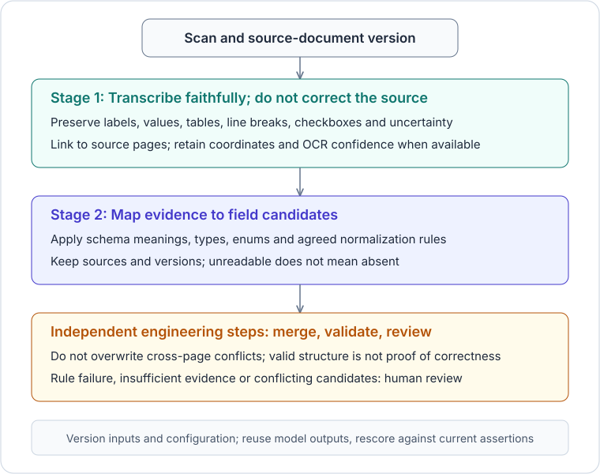
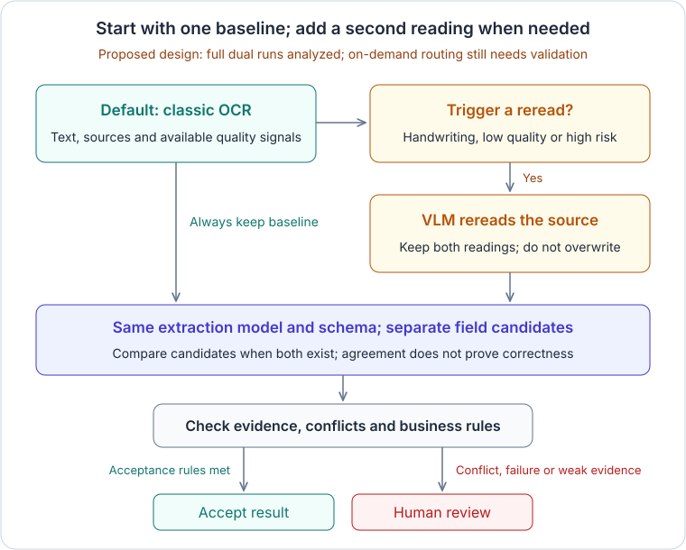

In one full-document benchmark, the highest-scoring pipeline passed **4,452 of 4,732 field assertions: a 94.08% field pass rate**.

That sounds promising. But ask a different question, "How many documents had every tested field correct?", and the answer is **6 out of 38**.

The model did not suddenly get worse. The two metrics answer different questions. Field pass rate helps compare systems; whether a payment instruction can move to the next step depends on whether the error affects an amount, an account number or an authorization checkbox. A single wrong character can send the entire document back for review.

That is why we stopped treating "give a multimodal model a PDF and ask for JSON" as the whole solution. Parseable JSON tells us the format is usable. To deliver a trustworthy result, we also need to know:

- Is the value actually present in the source, and was it read correctly?
- If the text was read correctly, was it mapped to the right field without losing qualifiers?
- Which results can be accepted automatically, and which require checking the original?

This article draws on VLM_Playground's page-level tests, extraction tests, cached full-document results and schema compatibility experiments. **The goal is not to crown a model. It is to make errors traceable, reproducible and testable against acceptance criteria.**

> **Scope**
>
> These are engineering experiments on specific finance, insurance and related business forms, not a general OCR leaderboard. Model names follow the labels used by the test platform at the time. Results reflect the model, serving platform, input route and prompts together; they do not describe every API available today. Only aggregate data is shown, and all examples are fictional.

## 1. Separate the experiments and their metrics

The documents include trade confirmations, insurance applications, financial needs analyses, payment-method forms and risk questionnaires. They contain mixed Chinese and English, handwriting, tables, signatures and checkboxes. The project ran several experiments at different scales; they should not be combined into a single leaderboard.

| Experiment | Sample and input | What it actually measures |
|---|---|---|
| Page transcription | July 2026 report: 7 vision models, 18 single-page cases, 500+ content assertions | Were the page's important details preserved? |
| Text extraction | Report from the same period: 4 text models, 15 cases, using a fixed source of transcription text | How do models map the same text to fields? |
| Full documents | Cached calls from August-September 2026, rescored against current expected values: 38 fully comparable PDFs, 4,732 assertions | How do final field results change when the OCR stage changes? |
| Large-schema compatibility | July 2026 experiment: 11 models and a schema of roughly 384 KB | Is the request accepted, and are the expected top-level fields present? |

This article uses three levels of measurement:

1. **Field assertion pass rate:** passed assertions divided by all assertions scored. The full-document experiment pools fields across documents, so documents with more fields carry more weight.
2. **Page or case pass rate:** a page or case passes only when all its critical assertions pass.
3. **Whole-document pass rate:** every tested assertion in the document passes. This still does not mean every detail in the source is correct, because assertions cover only what was checked.

In particular, **page-content assertion pass rates are not character recognition accuracy, and complete top-level schema fields do not imply correct values.**

## 2. Full-document results: classic OCR remains a strong baseline

This round included four pipelines we assembled: Azure Document Intelligence and three vision-language models. All four fed their outputs to the same extraction model, GPT-5.5, using the same extraction prompt and the appropriate schema for each document.

An existing all-in-one service provided a business baseline. It retained its own internal pipeline; **it did not use our shared extraction stage**. Differences between it and the other pipelines therefore cannot be attributed entirely to OCR.

There are currently 40 document cases, of which 38 have valid extraction results from all five pipelines. The table below compares only those 38 shared cases; two incomplete cases are excluded. This keeps the comparison aligned, but also means **the table does not measure request success rate. Production evaluation must record failures, missing results and timeouts separately.**

### 2.1 The best field score does not mean the most fully correct documents

| Pipeline | Field assertions passed | Field pass rate | Documents passing every check | Mean stage time per document |
|---|---:|---:|---:|---:|
| Azure Document Intelligence + shared extraction | 4,452 / 4,732 | **94.08%** | 6 / 38 | **58.4 s** |
| Claude Opus 4.8 + shared extraction | 4,407 / 4,732 | 93.13% | 9 / 38 | 112.3 s |
| Claude Sonnet 5 + shared extraction | 4,330 / 4,732 | 91.50% | 9 / 38 | 135.1 s |
| Existing all-in-one service | 4,295 / 4,732 | 90.77% | 8 / 38 | 129.9 s |
| Gemini 2.5 Pro + shared extraction | 3,740 / 4,732 | 79.04% | 3 / 38 | 143.7 s |

Timing is the sum of cached OCR and extraction stage durations, not production end-to-end latency. The all-in-one service also reports timing from a different source. These numbers indicate scale, but do not replace load testing under the same concurrency, retry and queuing conditions.

Document Intelligence leads on total fields, with a recorded mean stage time roughly half that of Opus. Yet Opus and Sonnet each have more fully passing documents. There is no contradiction: one pipeline may make a few errors across many documents, while another concentrates its errors in fewer documents.

**Model selection should consider total fields, complete documents and critical fields together, not one average.** The two leading pipelines differ by less than one percentage point, and this sample does not establish a universal ranking.

### 2.2 Empty fields change how the overall score should be read

Of the 4,732 assertions, **1,524 expect an empty value: 32.2% of the total**. Correctly leaving fields empty matters because it checks for invented content. But empty and populated fields have different difficulty profiles and should be reported separately.

For the Document Intelligence pipeline:

| Expected-value category | Passed | Pass rate |
|---|---:|---:|
| Non-empty fields | 2,968 / 3,208 | 92.52% |
| Empty fields | 1,484 / 1,524 | 97.38% |
| Combined | 4,452 / 4,732 | 94.08% |

The overall 94.08% does not mean "94.08% of the filled-in content was read correctly." Empty-field errors also matter: extracting "authorized" when no authorization was given can be more serious than missing an ordinary text field.

### 2.3 Document type is more useful than a universal winner

Overall scores also hide differences between forms:

| Document category | Documents / assertions | Document Intelligence | Claude Opus 4.8 | Gemini 2.5 Pro |
|---|---:|---:|---:|---:|
| Trade confirmations | 9 / 1,087 | 98.5% | 99.1% | 98.0% |
| One category of longer insurance applications | 7 / 1,381 | 93.6% | 93.0% | 74.1% |
| Payment-method forms | 4 / 77 | 80.5% | 92.2% | 90.9% |

This suggests a practical starting point: **do not remove classic OCR just to introduce a VLM.** On this batch, classic OCR is a reliable, relatively fast default candidate. Forms with handwritten critical content, such as payment-method forms, are worth evaluating separately for a second pass with a vision model.

But that last row contains only four documents and 77 assertions. It does not establish that one model is "best at all handwriting." It helps define the next experiment, not settle model selection.

## 3. Stage-level tests: where are the errors coming from?

### 3.1 Transcription failures are often local but consequential

The 18-page transcription test produced the following page-level results. A pass means all tested critical content assertions passed, not that every character was correct.

| Model label | Pages passed |
|---|---:|
| Gemini 3.1 Pro Preview | 16 / 18 |
| Claude Opus 4.8 | 15 / 18 |
| Claude Sonnet 5 | 15 / 18 |
| Gemini 2.5 Pro | 14 / 18 |
| GPT-5.4 | 12 / 18 |
| Qwen3 VL 235B | 10 / 18 |
| GPT-4.1 | 7 / 18 |

The failure patterns are more useful than the ranking:

- **All seven models failed** one dense-checkbox page. Option text survived, but selection states were missing or misaligned.
- **Four models misread** a page containing a long handwritten number. Models that were strong on printed text still got one or two digits wrong.
- Similar-looking Chinese characters, qualifiers beside amounts, and the separation of signatures from adjacent stamps all produced results that looked reasonable at paragraph level but were wrong in a critical field.

The tests used different input routes: some models received PDFs, others used image fallback, and even PDF routes had occasional fallback records. **This table does not prove that PDF input is better than images, nor that an integration-layer behavior is an inherent limitation of an entire model family.**

Similarly, Gemini 2.5 Pro passed 14/18 in the page test and 79.04% of field assertions in the full-document test. These are different samples and different metrics, not a measured "drop from page accuracy to full-document accuracy." Omissions in long forms deserve investigation, but quantifying the benefit of chunking requires paired tests on the same documents.

### 3.2 Fix the transcription input before comparing extraction models

The extraction experiment used a fixed set of transcriptions generated by Claude Sonnet 5, so all four text models read the same content. The report recorded:

| Extraction model | Approximate field assertion pass rate | Cases passing every check |
|---|---:|---:|
| Gemini 2.5 Pro | 97% | 11 / 14 |
| Claude Sonnet 5 | 95% | 10 / 14 |
| GPT-4.1 | 97% | 10 / 15 |
| GPT-4.1 Mini | 96% | 9 / 15 |

The experiment planned to cover 15 cases, but the first two models have a reported denominator of 14. Those original denominators are retained here: missing records are not silently counted as successes, and this is not treated as a fully paired comparison.

The results make a smaller model worth considering for extraction. They **do not establish that extraction almost never fails once transcription is correct**. The fixed transcriptions still contained errors, and the tests also showed genuine extraction problems: collapsed address lines, inconsistent field boundaries and ignored cleanup rules.

To separate these error sources more rigorously, run two sets of tests:

- **Real transcription input:** measure actual pipeline behavior and upstream error propagation.
- **Manually corrected transcription input:** isolate reading errors as far as possible and examine the extraction model itself.

Given the current evidence, the safer conclusion is: **before assuming that a stronger extraction model will fix the pipeline, inspect the text it received.** If a digit has already been misread, a text model cannot recover the source value from information it never received.

## 4. Two-stage architecture: the intermediate text is an inspectable contract

"Two-stage" refers to two model tasks: transcription, then extraction. Validation, cross-page merging and human review are subsequent engineering steps, not something solved simply by asking another model to "check the answer."



Separation does not guarantee a higher score. It makes each step inspectable and replaceable:

| Step | What to retain | How to investigate an error |
|---|---|---|
| Transcription | Raw response, page numbers, text and table relationships; coordinates and confidence where available | Return to the source page and check for misreads or omissions |
| Extraction | Field candidates, transcription version, schema version and prompt version | Compare the input text with mapping and normalization rules |
| Merge and validation | Sources, conflicts, validation results and review status | Check cross-page attribution and why the result was accepted or blocked |

When a field definition changes, the transcription can be reused and only extraction rerun, provided the transcription contains the necessary evidence. If a new field depends on layout, a stamp or a checkbox state that was discarded, recognition must run again.

That boundary matters: **Markdown is a convenient intermediate representation, not a lossless replacement for the source document.** Fluent text without page references and a link back to the original remains difficult to audit.

### 4.1 Preserve relationships instead of beautifying the source

Here is a fictional transcription fragment:

```markdown
## Page 2: Payment details

| Field | Source text |
|---|---|
| Payment amount | HK$12,800; minimum payment HK$1,500 |
| Payment method | [x] Bank transfer; [ ] Cheque |
| Mailing address | 8/F, Example Building<br>10 Example Road |
| Authorization reference | AB[unclear]7 |
```

The next stage must distinguish the payment amount from the minimum payment, not arbitrarily pick one of the two numbers. It must recognize that bank transfer is selected, rather than merely seeing two possible payment methods.

Transcription rules should therefore be specific:

- **Keep labels associated with values:** preserve table columns, units and qualifiers.
- **Preserve meaningful line breaks:** use `<br>` for content such as multi-line addresses rather than merging it during transcription.
- **Record selection states explicitly:** do not omit `[x]` or `[ ]`. An unreadable state is uncertain, not automatically unselected.
- **Do not correct the source semantically:** copy similar-looking characters, unusual spelling and long numbers rather than "fixing" them from context.
- **Separate signatures from stamps:** transcribe legible text, but do not expand an illegible fragment into a complete name.
- **Carry uncertainty forward:** `[unclear]` is a review signal, not an invitation for the extraction model to fill in the gap.

These rules define the format contract; they do not guarantee accuracy. Page assertions must still check whether the rules were followed.

### 4.2 Whole documents, pages and chunks need not follow one universal rule

Whole-document input preserves context. Chunking helps control output length, locate failures and rerun only the affected portion. Both can omit content; page-by-page processing does not automatically eliminate omissions.

A testable starting point is to try whole-document input for short documents and pages or logical sections for long ones. Retain page order, section identity and continuation-table relationships explicitly. Reconcile names, addresses and signatures across pages during merging.

**Merging should not simply let the last non-empty value win.** When the same field path has two different values, preserve both sources and flag the conflict. Otherwise, pages can be recognized correctly while the merge step makes the final JSON wrong.

## 5. Extraction rules and schemas: constrain the format without obscuring the facts

Transcription preserves what the source says; extraction decides how a field should represent it. Their rules should remain separate.

| Rule type | Where it belongs | Example |
|---|---|---|
| General extraction conventions | Extraction prompt | Use only input evidence; do not guess uncertain content |
| Field meaning and boundaries | Schema field description | Payment amount excludes the minimum payment; dates use the agreed format |
| Data types and enums | Schema structure | Amount type, allowed currencies and whether `null` is permitted |
| Deterministic checks | Programmatic validation | Valid dates, enum membership and relationships between fields |

Normalization also needs boundaries. An amount may have thousands separators removed under an agreed rule, but account numbers and identifiers should remain strings with leading zeros intact. Establish currency and scale before stripping units. Do not join every set of entities with `/`; preserve structure with arrays where appropriate.

"Not filled in," "illegible" and "not applicable" are not necessarily equivalent. Even if the business JSON uses `null` for each, review metadata should distinguish the reasons. Otherwise, "could not read" becomes indistinguishable from "not present."

### 5.1 Large-schema results are easy to overinterpret

Testing a roughly 384 KB schema across 11 models produced several different kinds of outcomes:

| Request mode or route | Observation at the time | What it does not establish |
|---|---|---|
| `json_schema` routes for GPT-4.1, GPT-4o and GPT-4.1 Mini | Passed the large-schema test | Not proof that `strict: true` worked; strict-mode failures were recorded separately |
| Large-schema routes for o3 and o4-mini | Produced output but omitted top-level fields | Returning JSON does not mean the complete structure is satisfied |
| Large-schema routes for Gemini | Rejected during schema validation | Size alone is not necessarily the cause; schema declarations may be incompatible |
| Claude through the Bedrock integration used then | The integration did not accept the `json_schema` parameter | Not a statement about other Claude endpoints or later versions |
| Schema in the prompt with JSON mode | All 11 models returned the 12 expected top-level fields | Values were not checked field by field, nor was every nested structure thereby proven correct |

There are four separate acceptance checks: **request accepted, JSON parseable, structure schema-compliant, and values faithful to the source.** Passing one does not replace the next.

In that experiment, GPT-4.1 recorded 40,144 input tokens with `json_schema`, versus 52,543 with the schema inline: about 23.6% fewer. This is an observation about that serving route, not a claim that schemas outside the prompt are unbilled or that all platforms deliver the same saving.

### 5.2 Reduce the task before expanding the schema indefinitely

For large schemas, work in this order:

1. **Validate the schema itself:** for example, ensure fields listed in `required` exist in the corresponding `properties`.
2. **Test the supported subset on the actual endpoint:** check nesting, combined types, nullable fields and strict mode separately; do not infer support from a model name.
3. **Split by business section:** send only the relevant fields while retaining the context needed for global fields and cross-page relationships.
4. **Validate output independently:** even with constrained generation, handle refusals, truncation, type errors and semantic errors.

"Required but nullable" is appropriate for some strict-output contracts, but it is not a universal schema-reduction technique. Removing constraints or making every field nullable should not change the business meaning.

Splitting reduces complexity but does not guarantee platform support. If fields span pages, also test page-to-section mapping, missed routing and merge conflicts. This introduces engineering work; it is not a free optimization.

## 6. Agreement can help reduce review, but two pipelines can be wrong together

A natural idea is to have classic OCR and a VLM each read the document, then automatically accept matching results.

On the same 38 full documents, we compared the **Document Intelligence and Claude Opus 4.8 pipelines** after shared extraction, using exact string comparison of their field results:

| Metric | Result |
|---|---:|
| Comparable fields | 4,732 |
| Matching outputs | 4,241, or 89.62% |
| Matching and consistent with the expected value | 4,232 |
| Matching but both inconsistent with the expected value | **9** |
| Assertion pass rate within the matching set | 99.79% |

Among the 3,208 fields with non-empty expected values, 2,792 matched across the pipelines, and five of those were still wrong together. This is not merely an artifact of many empty fields.

Agreement is a useful screening signal. The results also directly show that **agreement is not proof of correctness**.

This is an offline analysis on the same sample, without an independent holdout set. Both pipelines share the extraction model, schema and field definitions, so their errors may be correlated; expected values may also be imperfect. The 99.79% is not a production accuracy promise, and 89.62% is not an automatic acceptance rate.

### 6.1 Routing needs its own evaluation

The results suggest an incremental design:



1. Establish a classic OCR plus shared-extraction baseline.
2. Trigger a VLM reread for handwriting, low-quality regions or high-risk fields.
3. Preserve both candidates and their sources rather than overwriting one before comparison.
4. Review disagreements, insufficient evidence and rule failures; matching fields must still meet acceptance rules.

**The complete on-demand routing design has not been validated by these experiments.** Agreement when both pipelines process every document does not establish the same performance when only selected pages are reread. Evaluate the new pipeline together with its trigger rules, measuring missed errors, false acceptance, added latency and cost.

### 6.2 Confidence scores and business rules each have limits

OCR confidence scores can support routing, but not every field has a score. Scores from different services, granularities and document types are not directly interchangeable. A model saying "I am 95% confident" is not a calibrated field confidence score.

Choose thresholds using a validation set: measure the fraction automatically accepted and the actual error rate within that fraction. Amounts, ordinary addresses and auxiliary descriptions may need different standards; do not copy a universal threshold of 0.9.

Business rules check constraints that can be determined explicitly:

- Are dates valid, and do they meet the required ordering?
- Do line items sum to the total under the same currency and calculation basis?
- Are mutually exclusive options both selected?
- **For identifiers to which it applies**, is the check digit valid? Some payment card numbers use Luhn; arbitrary bank account numbers do not.

These checks catch some errors but cannot establish that a value came from the source. If two numbers are misread in a way that still adds up, a total check can pass.

## 7. The evaluation system also needs safeguards

### 7.1 Use field assertions, not text similarity alone

A single wrong digit in a long number may barely affect document-level similarity. Asking whether a field equals its expected value is closer to business acceptance. The fact-based approach in olmOCR-Bench likewise shows why edit distance can underweight small but consequential errors.[1]

Transcription and extraction need different assertions:

- **Transcription assertions** check content presence, selection states and local relationships. Finding a string does not establish that it appears in the right place.
- **Extraction assertions** check field paths, values and match rules. Account numbers call for exact matching, not fuzzy similarity.
- **Business assertions** check cross-field relationships and prohibited conditions beyond individual field pass rates.

All **4,732 assertions in this 38-document comparison use exact matching and are labeled `critical`**. That is a test configuration, not a claim that every field carries equal business risk.

The comparison logic converts both `null` and empty strings to an empty value. This helps align existing representations but hides their semantic difference; whether production schemas should allow that equivalence is a separate decision. Formatting normalization in the page-transcription tests should not be described as a universal step in full-document scoring.

### 7.2 When expected values change, recompute the scores

The project's assertions were initially drafted from the existing system's output, then manually corrected. This reduces initial annotation work, but system output is a draft, not a source of truth.

The existing all-in-one service scores 90.77% against the current expected values, not 100%. **The baseline is a system under test, not the authority on correctness.**

One easy-to-miss engineering problem is stale scoring:

```text
An expected value is corrected
    |
The model's raw output is unchanged and can be reused
    |
The old passed / failed result is stale and must be recomputed
```

The full-document figures in this article were recomputed from cached raw extraction results and current assertions, not obtained by adding up old pass/fail snapshots.

Version annotations and record why they change. The source document is the reference: fix incorrect expected values, and revise unclear field definitions. Do not delete hard cases to improve the score, or keep calling a repeatedly tuned prompt-development sample an independent acceptance set.

### 7.3 Production metrics must include what cannot be automated

A production-oriented evaluation should also record:

- Request failures, refusals, truncation, timeouts and missing field results.
- Pass rates for populated fields, empty fields, critical fields and document categories.
- Whole-document pass rates and the distribution of errors across documents.
- Automatic acceptance rate, error rate after acceptance and human-review rate.
- Latency percentiles under the same conditions, and total cost per acceptable result.

A useful cost model is:

```text
Total cost = initial recognition + extraction + rereads and retries + human review
```

A cheaper model call does not necessarily mean cheaper processing. If it sends more documents to a human queue, token savings may quickly disappear. We do not have enough production review data to promise overall cost savings.

## 8. Implementation: make each failure explainable and reproducible

**Bind caches to the full input.** The project already ties extraction caches to fingerprints of the transcription, extraction prompt and schema. A production system should also explicitly account for document version, model configuration, preprocessing parameters and output mode, so configuration changes do not silently reuse old results.

**Retain raw responses, not just cleaned JSON.** Keep transcription text, field candidates, finish reasons and versions together so errors can be located. Source documents and intermediate results containing sensitive data should follow the same access-control and retention policies.

**Do not treat truncation as success or retry it unchanged indefinitely.** Handle signals such as `finish_reason=length` explicitly: inspect output limits and reasoning budgets, then make bounded retries with smaller document chunks or a narrower task where needed. Network failures and exhausted output budgets are different problems and should not share one retry strategy.

**Distinguish characters, visible output tokens and reasoning tokens.** Whether a long document fits must be measured against the endpoint's actual context and output limits. Raising the budget alone does not guarantee a complete transcription.

**Verify model capabilities through endpoint configuration and contract tests.** PDF input, `json_schema` support, strict-mode activation, output limits and refusal behavior should be tested on the actual deployment, not inferred from model names.

**Start with a simple baseline, then add routing.** Every classifier, reread trigger and merge step creates another potential failure mode. Keep it only when evaluation by category shows fewer critical errors at acceptable latency and review cost.

## Conclusion: returning JSON is not the finish line

These experiments did not identify a permanently superior model. They suggest a more useful engineering sequence:

1. **Separate transcription from extraction** and retain intermediate evidence linked to the source.
2. **Build a measurable baseline with classic OCR and a smaller extraction model**, then decide where stronger vision models are worth using.
3. **Measure fields, documents and critical errors together**, rather than replacing acceptance criteria with one score.
4. **Treat agreement as a signal and validation and review as separate steps**, not format correctness or matching outputs as proof of factual correctness.

Getting 94% of fields right is a result worth improving. Knowing where the remaining errors are, why they occur and how to stop them is what takes the system beyond a demo.

## References and data notes

- Internal experimental sources: VLM_Playground's July 2026 page and extraction reports, large-schema experiment records, and current full-document assertions with cached raw outputs. Full-document and agreement figures were recomputed while preparing this article. This was rescoring, not a fresh round of model calls, and may differ from older summary reports.
- [1] [olmOCR-Bench: fact-based evaluation of document OCR](https://github.com/allenai/olmocr/blob/main/olmocr/bench/README.md).
- [2] [Microsoft: interpreting Document Intelligence accuracy and confidence](https://learn.microsoft.com/en-us/azure/ai-services/document-intelligence/concept/accuracy-confidence?view=doc-intel-4.0.0), covering score granularity, applicability and human review.
- [3] [Google Cloud: structured output](https://cloud.google.com/vertex-ai/generative-ai/docs/multimodal/control-generated-output). Check the supported schema subset and limits for the endpoint in use.
- [4] [JSONSchemaBench](https://arxiv.org/abs/2501.10868), evaluating constraint coverage, generation efficiency and output quality separately. "Supports structured output" is not a sufficiently precise binary label.
