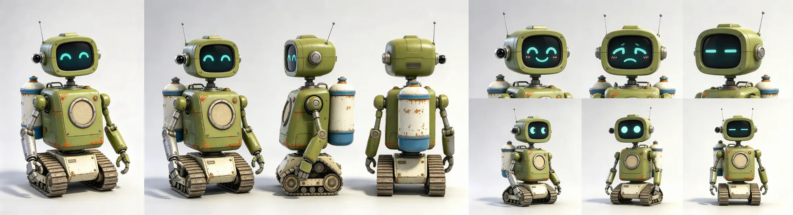
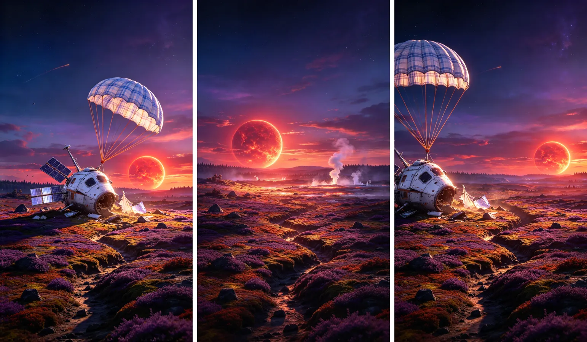
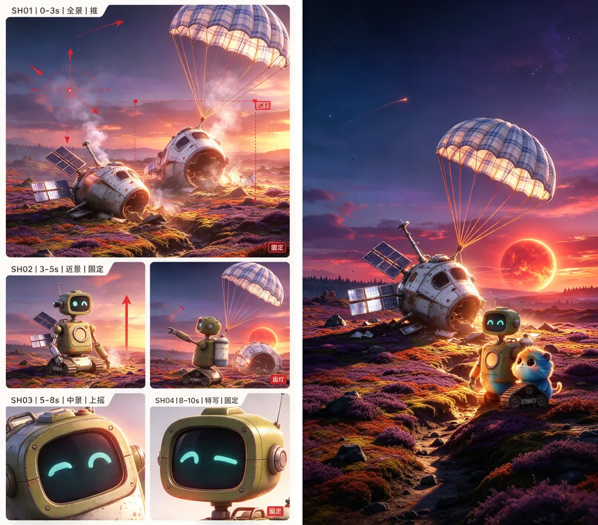

先看几个实测结果。这些都来自原创动画《歇脚星》第一集的资产制作，图片用 Seedream 4.0 生成：

- **把两个角色放进场景试拍，身份没守住。** 只给了角色参考板和场景空镜，结果主角嗡的机身偏黄；搭档绒绒长到了嗡胸口那么高，左橙右蓝的双色毛变成了大半身蓝。
- **反打空镜里冒出了太阳。** 按机位，红矮星"老灯"应该在摄影机身后，提示词也写了。这一轮 4 张派生空镜，4 张都把它画进了画面。
- **版式能控，数量和位置难控。** 要求一张 2×2 故事板，第一格却占满了一整行；要 6 个色块，画了 12 个。
- **参考图里有的东西，文字改不掉。** 定妆图里多出一条项链，之后的每张图都带着它，在提示词里写"没有项链"也拉不回来。

所以一致性不是写一句"保持角色一致"就能解决的。能控制的只有两样东西：**喂给模型的参考图**，和**每次原样复用的文字**。本文讲怎么把这两样东西组织起来。

## 业界怎么做？

| 来源 | 做法 | 对只用 API 的团队意味着什么 |
|---|---|---|
| 动画行业的 model sheet | 开拍前先画转面图、表情、道具、场景布局，所有镜头都对照它画 | 设定图要在分镜之前做完，而且要分步做 |
| [Google Veo：参考图生视频](https://docs.cloud.google.com/gemini-enterprise-agent-platform/models/video/generate-videos-from-references) | 每张参考图是单个人物、角色或产品，模型在视频里保持它的外观；动作由文字描述 | 参考图只放一个主体，外观交给图，动作交给文字 |
| [Seedream API](https://www.volcengine.com/docs/82379/1541523)、[Seedream 4.0 技术报告](https://arxiv.org/abs/2509.20427) | 文生图、单图编辑和多图参考合成在同一个模型里完成 | 同一个模型就能从定妆图派生三视图、表情和空镜 |
| [drama-skills](https://github.com/zenstory-ai/drama-skills) 的出图和分镜 Skill | 每张参考图写明角色、管什么、不管什么；连戏锁的短语原样写进提示词；参考图里自带的水印和字幕用负面提示词去不掉 | 和本文的做法基本一致，可以直接参考 |
| [StoryDiffusion](https://arxiv.org/abs/2405.01434)、[ConsiStory](https://arxiv.org/abs/2402.03286)、[The Chosen One](https://arxiv.org/abs/2311.10093) | 改模型内部的注意力，或者迭代训练出一致的角色 | 要能动模型，只调 API 用不上 |

研究上的方法大多要改模型，商用 API 留给用户的只有参考图和提示词。剩下的问题是工程问题：参考图从哪来，按什么顺序出，每张管什么，出完怎么检查。

## 先玩一下

演示里的资产库是这套做法的界面：每个资产一条产物链，每一步出 4 张候选并标出违反了哪条锁。角色和道具的图是实际生成的，其余是占位图。也可以[在新窗口打开](/demos/ai-drama/asset.html?k=char&e=EP01&id=weng)。


### ① 每个资产一条产物链
角色：定妆图 → 三视图（人审）→ 单视图 → 参考板 → 细节板（人审）→ 表情板。每一步都从上一步已批准的图派生。
<!-- step: char-chain -->
---
### ② 连续性锁
每条锁是一句固定的话，加一块证据区域，标出它在参考图上的位置。锁是永久的，跨集的变化记成"各集状态"。
<!-- step: locks -->
---
### ③ 提示词按固定顺序写
用途 → 身份 → 版式 → 光线 → 排除。身份一栏就是锁的原文，以标签的形式插进去。
<!-- step: prompt -->
---
### ④ 道具也有状态
反射板有散件、拼好待用、翻车之后三种状态，每种一张图。分镜里用到哪种状态，就引用哪张。
<!-- step: prop-states -->
---
### ⑤ 场景按机位出空镜
一张空镜只能锁住一个方向。主空镜、反打、侧向、背景近景各一张，每张写清光从哪里来、用在哪些镜头。
<!-- step: scene-geo -->
---
### ⑥ 一段一张故事板
每段的 4 个镜头对应一张 2×2 故事板的 4 格，这张图直接作为这一段视频的参考。
<!-- step: board -->
---
### ⑦ 逐镜检查
镜头 × 锁的矩阵：✅ 一致，⚠ 偏离，? 看不清。SH07 里光伏板挡住了左臂，左臂被画成了橄榄绿。
<!-- step: appear -->
---
### ⑧ 样片对照故事板
审片时把样片和批准过的故事板并排放，看构图有没有跑偏。
<!-- step: compare -->


## 图分两种：给人看的和给模型用的

| | 给人看 | 给模型用 |
|---|---|---|
| 例子 | 三视图、细节板、俯视布局、标注过的故事板 | 定妆图、单视图、参考板、空镜、关键帧 |
| 版式 | 可以多格，可以带文字标签 | 单一主体、干净背景、没有任何文字 |
| 用途 | 人审，确认结构和细节 | 作为参考图喂给模型 |

带文字的图不要喂给视频模型，标签、箭头和尺寸线会被画进画面。drama-skills 也提醒过：参考图里自带的水印、角标、字幕，靠负面提示词去不掉，只能裁掉或者换一张图。

故事板是唯一的例外：它带镜号和运镜标记，同时作为参考图喂给视频模型。这一点放到后面单独讲。

## 产物链：先定源头，再往下派生

| 资产 | 产物链（加粗的步骤要人审） |
|---|---|
| 角色 | **定妆图** → **三视图** → 单视图（正、侧、背各一张）→ 参考板 → **细节板** → 表情板 |
| 道具 | **定稿图** → 三视图 → 和角色的比例 → 状态图 → 特效参考 → **设定板** |
| 场景 | **主空镜** → 反打空镜 → 侧向空镜 → 背景近景板 → **俯视布局** → 试拍 |

规则只有一条：**源头图审过了，才往下走。** 定妆图、道具定稿图和主空镜是后面所有图的母图。母图有瑕疵（多出一件配饰、颜色方向反了），后面几十张图都会继承，而且越往后越难改。前面的项链就是这样：要么把它写进锁，要么回头重出定妆图，没有第三条路。

每一步出 4 张候选，标出每张违反了哪条锁，人选一张。被选中的那张才成为下一步的参考。

## 连续性锁：写死，原样复用

不要指望模型"记住"一个角色。把不允许变的属性写成固定短语，每次生成都原样贴进提示词：

> **LOCK-WENG-TANK**：背部白色搪瓷缸形能源罐，蓝色缸沿，缸身有磕碰掉漆，缸上无文字

写锁的几条经验：

- **锁必须和参考图一致。** 参考图的分量比文字重。图里有的东西，文字改不掉；两者矛盾时，模型通常听图的。
- **每条锁带一块证据区域。** 标出它在参考图上的位置，检查时直接对照这一块。
- **小心左右。** 锁里写的"左前臂"指角色自己的左边，但在正面图里，它出现在画面右侧。实测出来的正面图里，银灰色的手臂在画面左边，也就是角色的右臂。写锁时要说清楚是角色的左还是画面的左，检查时也要照这个标准看。
- **锁是永久的。** 某一集里拆掉了外壳、失去了冷却模块，写成这一集的状态，按集追加到提示词里，不改锁。
- **不写质量词。** "8K、顶级、大师级"这些和身份无关的词不要加，画风交给全片共用的一段风格描述。

提示词的顺序固定为：**用途 → 身份（锁原文）→ 造型 → 版式 → 光线 → 排除。**

## 参考图要写明分工

一次生成往往带好几张参考图，要在提示词里写清每张管什么、不管什么：

> 图1 是角色参考板，只用于保持人物身份和造型，不决定构图和姿态；图2 是场景空镜，只决定场景地理和光线方向，不决定景别。

drama-skills 把参考图的角色归成一组固定类别：外貌、主体、造型状态、空间布局、构图、尺度、效果、起始帧、结束帧、风格，每张图都要写明作用范围。

试拍失败之后，我们把参考补全了：单视图负责正、侧、背的结构，身高对比图负责两个角色的比例，参考板负责身份。少了任何一种，模型就会在那一项上自由发挥。

## 场景：一张空镜只锁一个方向

参考图只管得住画面里出现过的东西。反打镜头看到的是空镜里没有的那一面；近景的背景是空镜里的一小块，放大以后细节由模型自己补。所以每个场景要做一组空镜，有几个机位方向就出几张：

- **先审主空镜，其余都从它派生。** 提示词写"同一地点，摄影机转向 X"，地理和材质才对得上。
- **方位用相对说法写进场景锁。** 写"面朝残骸时，降落伞在右侧"，不写"画面一侧"。
- **光向按机位改写。** 主空镜是逆光，反打就变成顺光，侧向是侧光。不想让光源入画，要在机位、光线、排除三处都写"不出现太阳圆盘"。上图中间的反打就是只写了一处的结果。
- **俯视布局图用手画。** 让模型画带标签的俯视图，画出来的是带透视的插画，标签还会重复、指错位置。站位和轴线这种要求精确的东西，人画草图更快。

## 一段一张故事板

视频按段生成，每段十秒左右、包含 4 个镜头。每段配一张 2×2 故事板，4 格对应 4 个镜头，整张图直接作为这一段视频的参考。这是 AI 短剧创作者常用的宫格分镜法：

- **好处**：一次生成，四格里的人物和场景天然一致；视频模型一次只读一张图，不用在大图里找对应的行。
- **代价**：每格分辨率低；版式不一定照办（上图第一格就占了整行），格子的顺序要靠镜号标签来兜底。
- **每格只画起点那一瞬间。** 动作交给视频提示词。没有参考图的变体（比如尾毛烧焦）不画进故事板，留给视频去做。
- **标签只写镜号、时间、景别和运镜。** 台词不写进格子，长中文容易写错字。

一段只有一个镜头时，故事板就只有一格，直接当首帧用。简单的段也可以不出故事板，只带资产参考图和镜头表。

## 逐镜检查：镜头 × 锁

生成完不是看"像不像"，而是逐镜对照每一条锁。第一集主角的检查结果：10 个镜头 × 6 条锁，1 处偏离，8 处看不清。

- **偏离**：SH07 里光伏板挡住了身体，左前臂被画成了橄榄绿。被遮挡之后重新露出来的部位最容易出错。
- **看不清**：特写只露出屏幕下缘，全景太远看不清肩上的摄像球。看不清不算通过，要在相邻的镜头里确认。
- **同样的问题会重复出现**：绒绒在 SH10 被画到嗡胸口那么高，和试拍时一样。试拍发现的问题要写进锁，或者补一张参考图，不能指望下一次碰巧没事。

检查交给一个没参与生成的 Agent 来做，只给它设定卡、锁和抽帧图。偏离的镜头交给视频 Agent 修补，或者回到资产库补参考图。

## 为什么是这个方案？

| 做法 | 适合 | 问题 |
|---|---|---|
| 只写文字描述 | 单张图、风格探索 | 每次理解都不一样，跨镜头必然漂移 |
| 一张角色图走到底 | 单人、正面、近景多的段子 | 侧面、背面、反打全靠模型猜；道具和场景没有参考 |
| 为角色训练专属模型 | 写实真人、长期连载 | 要训练和托管模型，每改一次造型就要重训 |
| 产物链 + 连续性锁 + 逐镜检查（本文） | 风格化连续剧，只用 API | 前期出图多；锁要写准、要和参考图一致 |

产物链的出图量看起来不小，但都是图片，比视频便宜得多。把一致性问题压在出图阶段，预算就能留给"每段多出几条视频再挑一条"。

## 参考

- Google Cloud, [Generate videos from references](https://docs.cloud.google.com/gemini-enterprise-agent-platform/models/video/generate-videos-from-references)
- 火山引擎, [Seedream 图片生成 API](https://www.volcengine.com/docs/82379/1541523)
- [Seedream 4.0: Toward Next-generation Multimodal Image Generation](https://arxiv.org/abs/2509.20427)
- [Seedance 1.0: Exploring the Boundaries of Video Generation Models](https://arxiv.org/abs/2506.09113)
- zenstory-ai, [drama-skills](https://github.com/zenstory-ai/drama-skills)：`short-drama-image-prompts`、`short-drama-storyboard`
- [StoryDiffusion: Consistent Self-Attention for Long-Range Image and Video Generation](https://arxiv.org/abs/2405.01434)
- [Training-Free Consistent Text-to-Image Generation](https://arxiv.org/abs/2402.03286)
- [The Chosen One: Consistent Characters in Text-to-Image Diffusion Models](https://arxiv.org/abs/2311.10093)
