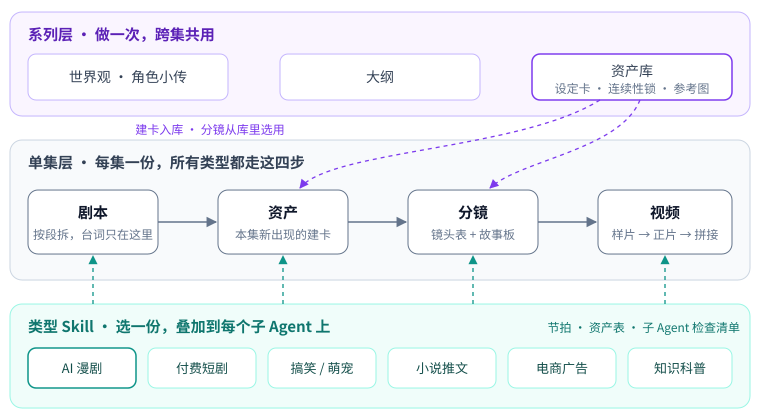

用 AI 做短剧，模型调用并不难，难的是两件事。

第一是管理产物。一集 30 秒的漫剧有两个角色、五个道具、一个场景，每个资产要出五六张参考图；3 段视频，每段一张故事板、一条样片，加起来四五十个产物，每个都要花钱生成，都可能被返工。

第二是不同类型的片子要的东西不一样：

- **付费短剧**：3 秒内要有冲突，特写和近景占多数，每 15 秒左右一个情绪点。
- **小说推文**：画外音推着故事走，画面以缓推、缓拉为主，动作越少越稳。
- **电商广告**：15 秒讲完，产品的外观、Logo 和配色一帧都不能变。

同一套提示词和检查规则套不住所有类型，但每种类型各做一条流水线，阶段、资产库和工具又要重复建设。

所以这个原型的做法是：**阶段和资产库是固定的骨架，所有类型共用；类型之间的差异写成一份类型 Skill，导演 Agent 选定后叠加到每个子 Agent 上。**

## 先玩一下

下面嵌入的是原型本身，演示项目是原创动画《歇脚星》：一个机器人迫降在一颗红矮星行星上，八集里第一集做到一半。资产库里的角色、道具图是用 Seedream 实际生成的；剧本、Agent 回复和视频生成都是模拟的。也可以[在新窗口打开](/demos/ai-drama/)。


### ① 画布和阶段条
顶栏是剧本、资产、分镜、视频四个阶段。画布是只读的：节点和连线都从项目文件生成，双击节点进入对应阶段的工作室。右边是导演 Agent，它诊断项目进度，给出下一步。
<!-- step: canvas -->
---
### ② 类型 Skill 库
原型内置六种类型：付费短剧、AI 漫剧、搞笑萌宠、小说推文、电商广告、知识科普。每张卡写明画幅、时长和成本档位。本项目用的是 AI 漫剧。
<!-- step: skills -->
---
### ③ 一份类型 Skill 里有什么
以付费短剧为例：结构节拍、最佳实践、常见坑、要建的资产，以及叠加到各个子 Agent 上的检查规则，最后附一份可以直接跑的示例分镜。
<!-- step: skill-drama -->
---
### ④ 系列层：八集 × 阶段
总览是一张进度矩阵，费用按集计算。第一集剧本已经定稿，后面几集只有大纲。
<!-- step: series -->
---
### ⑤ 资产库跨集共用
角色、道具和场景只建一次，每个资产都标出用在哪几集。右边一列是大纲里首次出现、还没有资产卡的东西，要在写分镜之前补上。
<!-- step: library -->
---
### ⑥ 待你处理
需要人拍板的事都集中在这里：待审的三视图、要重出的空镜和故事板、偏离锁的镜头。每条都直接跳到要处理的地方。
<!-- step: inbox -->
---
### ⑦ 改一句台词
在剧本行尾点 ✨，改写候选会显示在原句下面。采用之后只有这一段的视频要重出，故事板不受影响。
<!-- step: script-ai -->
---
### ⑧ 审片室
先看低成本的样片，确认后才出正片。右边是问题清单：出镜检查发现的偏离，可以交给视频 Agent 修补，也可以回到资产库处理。
<!-- step: review -->


## 开源项目和论文怎么做？

AI 短剧工具这一两年冒出来很多，流程大同小异，都是剧本、角色场景、分镜、视频、合成。这里只看一件事：不同类型的片子怎么区分。

| 项目 | 流程组织 | 不同类型怎么区分 |
|---|---|---|
| [Toonflow](https://github.com/HBAI-Ltd/Toonflow-app) | 无限画布：文本、资产、图像、视频都是节点 | 面向短剧、漫剧和短视频；没有按类型的模板，提示词和 Agent 行为可以自己改 |
| [LocalMiniDrama](https://github.com/xuanyustudio/LocalMiniDrama) | 列表和画布两种视图，同一份数据 | 一条固定流程，输入梗概和风格，选画幅 |
| [火宝短剧](https://github.com/chatfire-AI/huobao-drama) | 阶段进度条，每阶段手动标记完成 | 四个固定 Agent，只切换画面风格和比例 |
| [MediaGo Drama](https://github.com/mediago-dev/mediago-drama) | 每个阶段产出一份文档，后续阶段引用 | 按职能分 Skill，内置真人写实、2D、3D、Q 版画风；说明里提到不同题材可以组合不同的 Skill 和模板，但没有预置 |
| [shortdrama-pipeline](https://github.com/drasstry/shortdrama-pipeline) | 命令行流水线 | 输入主题、时长、集数和风格，流程固定 |
| [drama-skills](https://github.com/zenstory-ai/drama-skills) | 12 个 Agent Skill，产物是五份 Markdown | 按阶段分 Skill；剧本开发带一份题材与钩子手册，静态漫剧跳过视频提示词 |
| [ViMax](https://github.com/HKUDS/ViMax) | 想法、剧本、小说各一条流程 | 按输入形态分流程，不按内容类型 |
| [FilmAgent](https://arxiv.org/abs/2501.12909)、[MovieAgent](https://arxiv.org/abs/2503.07314) 等论文 | 导演、编剧、摄影等角色的多 Agent 协作 | 一条固定流程，不涉及类型差异 |

能看出两点：

- **差异大多停在画风。** 真人写实、2D、3D 这类风格预设，加上画幅选择，改变的是画面长什么样，不是片子怎么讲。
- **按内容类型区分的很少。** 只有 drama-skills 在剧本开发里带了题材手册。付费短剧、广告、科普这几类的节拍和检查规则差别很大，在这些项目里都没有预置方案。

## 四个阶段，资产在分镜之前



阶段顺序是：**剧本 → 资产 → 分镜 → 视频。** 所有类型都走这四步。

- **剧本**：一集按生成段拆，每段十秒左右，标出钩子、反转和卡点。台词只存在剧本里，分镜里的声音从剧本推出来。
- **资产**：从剧本里抽出角色、道具、场景，先建设定卡，再按各自的产物链出参考图。具体做法见下一篇[角色一致性](/posts/ai-drama-consistency/)。
- **分镜**：每段一张镜头表加一张故事板。分镜直接从资产库里选用资产；需要库里没有的机位或状态，比如反打空镜、道具烧焦后的样子，就回头向资产 Agent 补。
- **视频**：先出低成本的样片，确认后才出正片，最后按段拼接。

资产放在分镜之前，是因为分镜要引用具体的资产。先画分镜再找资产，故事板里的角色就是模型临时发挥的，和后面的参考图对不上。

不做后期也是一个决定：对白、音效、画外音都写进视频提示词，由模型直出，成片只按段拼接。这样"改一句台词"只影响这一段的视频，不会连带字幕、配音、混音一起返工。

## 不同类型用不同的 Skill

阶段不变，变的是每一步按什么标准做。原型里一份类型 Skill 包括：

- **规格**：画幅、时长、成本档位。
- **结构节拍**：每个时间段要做什么，剧本和分镜 Agent 按它检查。
- **最佳实践和常见坑**：写给每个子 Agent 看的经验。
- **资产表**：这类片子通常要建哪些角色、道具和场景。
- **子 Agent 规则**：按剧本、分镜、角色、视频等子 Agent 分别给出检查清单。
- **示例**：一份可以直接跑的剧本和分镜。

六种类型的差别主要在这几处：

| 类型 | 时长 | 节拍主线 | 资产重点 | 分镜和视频的规则 |
|---|---|---|---|---|
| 付费短剧 | 每集 60–120s | 钩子 → 处境 → 反转铺垫 → 爽点 → 悬念 | 主角的脸，服装变体单独出图 | 特写和近景不少于 60%，爽点之后接反派反应镜头 |
| AI 漫剧 | 每集 30–90s | 钩子 → 问题 → 凑合翻车 → 代价和下集钩子 | 角色板先行：定妆、三视图、参考板 | 一段一张 2×2 故事板加一条视频，动作幅度小 |
| 搞笑 / 萌宠 | 15–30s | 反常开头 → 铺垫 → 反转 → 补刀 | 动物和道具 | 每镜只有一个动作，笑点前留停顿，结尾能接回开头 |
| 小说推文 | 60–180s | 金句开头，旁白推进，结尾断在悬念 | 人物同样要过角色板 | 镜头时长跟旁白走（约 4.5 字/秒），非高潮镜头只用缓推、缓拉、固定 |
| 电商广告 | 15s | 痛点 → 产品亮相 → 卖点 → 行动指令 | 产品板：多角度和细节图，锁外观、Logo、配色 | 每镜都能认出产品，卖点不超过 3 个，Logo 不让模型重写 |
| 知识科普 | 45–90s | 反常识提问 → 讲解 → 互动问题 | 讲解员形象 | 口播镜头不超过 10 秒，每 3–5 秒换一次画面，抽象概念配图示 |

几条做法：

- **叠加，不替换。** 每个子 Agent 有自己的 Agent Skill，写的是通用职责，比如分镜 Agent 怎么写镜头表。类型 Skill 只补充这类片子的标准，叠在上面。新增一种类型，只写一份类型 Skill，不改子 Agent。
- **导演负责选。** 用户说"做一条榨汁杯的种草视频"，导演 Agent 匹配到电商广告，按它的节拍出执行计划，再分派给子 Agent。
- **检查也按类型。** 导演让子 Agent 自查时，用的是类型 Skill 里的清单。同样是检查分镜，付费短剧看特写比例，小说推文看画面和旁白是否对得上。
- **换类型就是新项目。** 节拍、资产表和示例都跟着类型走，中途换类型等于重来，原型里会提示新建项目。

## 系列层和单集层

一部漫剧有八集，大部分东西是跨集共用的：

- **系列层**：世界观、大纲、资产库，只做一次。每个资产记录用在哪几集。
- **单集层**：剧本、分镜、样片和成片，每集一份，费用按集计算。

从第二集起，大部分资产已经在库里，只为大纲里首次出现的东西建卡。

**连续性锁是永久的。** 锁写的是不允许变的属性，比如主角的屏幕脸、背后的搪瓷能源罐、银灰色的左前臂。某一集里坏了什么、少了什么（拆掉耐热外壳、失去冷却模块），记成这个资产在这一集的状态，生成时按集追加到提示词里，不改锁。改锁就是另一回事了：所有用到这个资产的集都要重新检查。

广告、段子这类单条作品就是只有一集的系列，结构完全一样，界面上收起系列层就行。

## 人只和一个导演 Agent 对话

流程里有七个子 Agent：剧本、分镜、故事板、角色、道具、场景、视频。但人不用记住谁负责什么：

- **导演 Agent 诊断项目，给出下一步。** 没选中任何东西时，它按阶段推进；选中了画布上的节点，就针对这些节点给建议，分给对应的子 Agent。它可以连续执行建议的下一步，但碰到费用确认或需要选择的地方就停下来等人。
- **哪里不满意就在哪里改。** 剧本行尾、镜头行尾、资产板上都有 ✨，常用改法加一句"直接说"，结果原地给出，可以采用、再来一版或者不要。调用记进对应 Agent 的对话里，但不弹浮窗。
- **浮窗只留给要人拍板的事。** 定稿确认、费用确认、开放式的问题，才会弹出 Agent 面板。

评审 Agent 只看磁盘上的文件：设定卡、分镜和抽帧图，不依赖生成时的对话上下文。工具支持的话，最好在一个干净的会话里跑。生成图片的 Agent 往往觉得自己画得没问题，换一个不知道过程的 Agent 来对照锁检查，更容易发现偏离。

## 项目就是一个文件夹

所有状态都存在项目文件里，Agent 和界面读写的是同一份。结构就在这些文件里：哪个资产用在哪几集、哪张故事板引用了哪些参考图，都是文件之间的引用。

```
project.yaml  outline.yaml  workflow.yaml   项目、大纲、阶段和产物链
bible/                                       世界观、角色小传
assets/<类型>/<名字>.yaml                    设定卡：属性、连续性锁、各集状态、各步候选
episodes/ep01/                               剧本、分镜、定稿记录、费用流水、审片记录
media.yaml                                   媒体索引：路径、哈希、模型、生成请求、归属
media/                                       图片和视频，不进 Git
```

- **画布是只读的视图。** 画布从项目文件生成：节点是产物，连线是产物之间的引用，按阶段自动排版。人和 Agent 都不在画布上连线改结构；要改内容，就进对应阶段的工作室，或者让 Agent 改项目文件，画布跟着重画。
- **文本进 Git，媒体不进。** 设定、剧本、分镜都是可读的 YAML 和 Markdown，可以审 diff，也可以回滚。图片和视频体积大，只在索引里记录路径、哈希、模型和当时的生成请求。
- **不绑定任何 AI 工具。** 子 Agent 的职责和类型 Skill 都是 Skill 文件，Claude Code、Codex、Copilot 这些工具都能读。生成和记账交给命令行，结果是确定的。
- **改动保留历史。** 修改、换参考图、续拍都生成新版本，原来的版本留在媒体库里。
- **同一份请求不付两次钱。** 提示词和参考图都没变时，直接复用已有的图；视频任务的句柄存在本地，进程中断后重跑只取回结果，不会重新提交。

## 为什么是这个方案？

| 做法 | 适合 | 问题 |
|---|---|---|
| 自由画布，节点随手连 | 单条作品、探索风格 | 画布就是结构，依赖靠人连线；做到多集，没人说得清哪些产物引用了谁 |
| 一条流程，只换画风 | 只做一种类型 | 换成广告或推文，节拍和检查规则都不对 |
| 每种类型一条独立流水线 | 类型少、彼此差别极大 | 阶段、资产库和工具重复建设，一处改进不能共享 |
| 共用阶段和资产库，按类型换 Skill（本文） | 多种类型、多集连续剧、要求跨集一致 | 每种类型要写一份 Skill；节拍和清单要在样片里验证 |

画布依然有用，它让人一眼看到整集的进度和依赖。但在这个原型里，结构在项目文件里，由阶段和类型 Skill 决定；画布只负责把它画出来。

## 参考

- HBAI-Ltd, [Toonflow-app](https://github.com/HBAI-Ltd/Toonflow-app)
- xuanyustudio, [LocalMiniDrama](https://github.com/xuanyustudio/LocalMiniDrama)
- chatfire-AI, [huobao-drama](https://github.com/chatfire-AI/huobao-drama)
- mediago-dev, [mediago-drama](https://github.com/mediago-dev/mediago-drama)
- drasstry, [shortdrama-pipeline](https://github.com/drasstry/shortdrama-pipeline)
- zenstory-ai, [drama-skills](https://github.com/zenstory-ai/drama-skills)
- HKUDS, [ViMax](https://github.com/HKUDS/ViMax)
- [FilmAgent: A Multi-Agent Framework for End-to-End Film Automation in Virtual 3D Spaces](https://arxiv.org/abs/2501.12909)
- [Automated Movie Generation via Multi-Agent CoT Planning](https://arxiv.org/abs/2503.07314)
- [StoryAgent: Customized Storytelling Video Generation via Multi-Agent Collaboration](https://arxiv.org/abs/2411.04925)
- Anthropic, [Building effective agents](https://www.anthropic.com/research/building-effective-agents)
