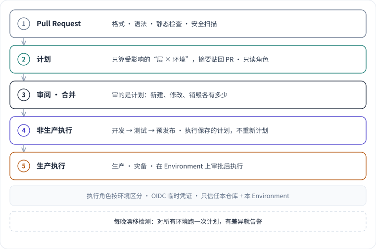
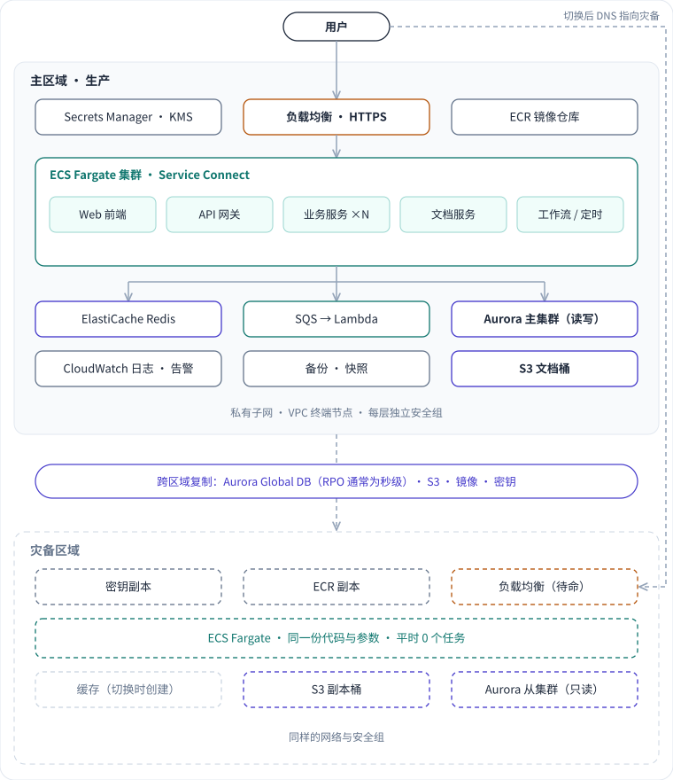

一个典型的业务系统：一个 Web 前端，十来个容器化的微服务，一个关系型数据库，一层缓存，一个存放业务文档的对象存储，再加几个靠队列触发的异步任务。它要跑在开发、测试、预发布、生产四套环境里，生产还要在另一个区域准备灾备。

用 Terraform 把这些资源建出来并不难，第一周就能跑通。难的是两年以后：

- 你只想改一个安全组，plan 里却出现了 `destroy` 数据库集群，你盯着屏幕，不敢按回车。
- 生产出了故障，查了半天才发现，半年前有人在控制台改过一个参数，代码里没有。
- 预发布验证过的变更，上了生产还是失败。原来生产那份目录早就和预发布不一样了。
- 审批时看的是代码 diff，执行时 plan 又重新算了一遍，中间有人合进了别的改动。
- 灾备文档写着“RTO 30 分钟”，可从来没有人真正切过一次。
- 新同事问“这个子网 ID 是从哪来的”，没有人答得上来。

这些问题都不是 Terraform 写得不够好，而是几个早期的选择没想清楚。下面是七个关键选择，每个都列出常见做法、它们会在哪里出问题，以及最后怎么选。

## 选择一：用什么工具写？

| 工具 | 写法 | 适合 | 要注意 |
|---|---|---|---|
| CloudFormation / AWS CDK | YAML 或通用编程语言，AWS 托管状态 | 只用 AWS，团队熟悉 CDK | 只管 AWS；监控、DNS、SaaS 资源要另想办法 |
| **Terraform** | HCL，声明式 | 大多数团队，生态最大 | 2023 年起改为 BSL 许可证 |
| OpenTofu | 和 Terraform 兼容的 HCL | 介意许可证，想要社区治理 | Linux 基金会托管，新特性和 Terraform 开始分叉 |
| Pulumi | 通用编程语言 | 喜欢写代码、需要复杂逻辑 | 审阅者要读懂程序，才知道会建出什么 |
| CDK for Terraform | 通用编程语言生成 HCL | —— | 2025 年 12 月 10 日已停止维护、归档，不要再用于新项目 |

**选 Terraform（或 OpenTofu，二者可以互换）。** 理由不在功能上，而在审阅上：HCL 表达能力有限，这反而是优点。资源写在哪里、长什么样，审阅者一眼就能看明白。用通用编程语言写的基础设施，循环和条件一多，就只有作者自己知道它会建出什么。

## 选择二：多个环境怎么组织？

这是最容易出问题、也最难回头的选择。

| 做法 | 谁在用 | 问题出在哪 |
|---|---|---|
| 每个环境复制一整套代码 | 很多项目的起点 | **环境一定会走样**：第一天很直观，到第三个月，五份代码各改各的 |
| CLI workspaces | 官方不推荐 | 所有环境共用一个后端和一套凭证 |
| 一个根模块 + 每个环境一个参数文件 | AWS 规范指南 | 所有环境必须结构相同；模块一升级，所有环境同时变 |
| **每个环境一个“薄”目录，只调用共享模块** | Google Cloud 指南 | 每个目录里有少量重复的调用代码 |
| 同上，再用 Terragrunt 去掉重复 | Gruntwork | 多学一个工具，调试时要看两层 |
| Terraform Stacks | HashiCorp | 只能在 HCP Terraform 上运行，按资源数计费 |

workspaces 看起来正好用来分环境，但 HashiCorp 和 Google Cloud 的文档都明确说过：不同环境需要不同的凭证和访问控制，而 CLI workspaces 共用同一个后端，**不适合用来隔离环境**。

“复制一整套代码”和“薄目录”看起来很像，都是每个环境一个目录，区别在目录里放什么。复制的是全部资源定义，每次“先在开发环境试一下”，改动只进了一份，另外四份就慢慢走了样。薄目录里只有三样东西：状态存在哪、调用哪个模块的哪个版本、这个环境的参数。资源怎么定义，全在共享模块里，只有一份。

**这个系统选“薄目录 + 版本化模块”，** 原因有三个：

- **每个环境本来就在不同的账号里**，后端、凭证天然不同，一个环境一个目录最直接。
- **灾备区域本来就和生产不一样**：数据库是从集群，服务实例数是 0。薄目录可以如实表达这种差异，不用在一个根模块里堆条件判断。
- **模块升级可以逐个环境走**：先把开发环境目录里的版本号改上去，验证后再改测试、预发布、生产。这正是“先在开发环境试一下”该有的样子。

如果所有环境在同一个账号、结构完全一样，“一个根模块 + 参数文件”更简单，也完全够用。等状态数量涨到几十个、目录间的重复开始烦人时，再引入 Terragrunt。

## 选择三：状态切多大？

| 切法 | 一次改错的影响面 | plan 速度 | 问题出在哪 |
|---|---|---|---|
| 每个环境一个大状态 | 整个环境 | 慢 | 改一个标签也要锁住整个环境；一次 plan 好几分钟 |
| 按 AWS 服务切（ECS、RDS、S3……） | 一类服务 | 快 | 看起来很整齐，但一个目录里混着负载均衡、IAM、密钥和服务，变更频率完全不同 |
| **按生命周期分层** | 一层 | 快 | 层与层之间要约定好怎么传值 |

按服务切是很常见的“半步”：比一个大状态好，但切的维度不对。真正该分开的，是**变更频率**和**改错的代价**：

| 层 | 管什么 | 多久改一次 |
|---|---|---|
| 引导 | 状态桶、加密密钥、CI 角色 | 几乎不改，手工执行一次 |
| 网络 | 终端节点、各层安全组 | 很少 |
| 数据 | 数据库、缓存、文档桶 | 少，但最怕误删 |
| 平台 | 镜像仓库、集群、负载均衡、服务发现、日志组 | 偶尔 |
| 服务 | 每个服务的任务定义、伸缩、路由、密钥授权、队列和函数 | 经常 |

这样分以后，每天改的服务层碰不到数据库，开头那个不敢按回车的 `destroy`，从结构上就不会出现。

**层与层之间怎么传值？** 有三种做法：

- **写死 ID**：最省事，也最危险。网络一重建，要全仓库搜索替换；开发环境的子网 ID 很容易被复制进生产。
- **`terraform_remote_state`**：直接读上一层的状态。问题是要读状态，就得有整份状态的读权限，状态里可能有敏感值；而且上下层被绑死在同一种后端上。
- **参数存储（推荐）**：下层把子网、安全组、集群这些输出写进 SSM Parameter Store，上层按名字去读。权限可以细到单个参数，非 Terraform 的工具也能读。

状态放在 S3，开启版本控制和加密，用 S3 原生的锁文件。DynamoDB 锁已被官方标记为废弃，不需要再建锁表。

## 选择四：账号怎么分？

| 做法 | 隔离 | 改错的影响面 | 代价 |
|---|---|---|---|
| 一个账号，按 VPC 或命名区分环境 | 弱，全靠 IAM 写得对 | 整个账号 | 管理简单，费用要靠标签拆 |
| 生产一个账号，其他环境共用一个 | 生产隔离了 | 非生产互相影响 | 管理简单，非生产的费用混在一起 |
| **每个环境一个账号，另设共享账号** | 强，账号就是边界 | 一个环境 | 需要 AWS Organizations；费用按账号一目了然 |

AWS 的多账号指南推荐用组织单元（OU）来分：安全类账号（日志归档、安全审计）、基础设施类账号（网络、共享服务）、工作负载账号（每个环境一个）。多数大型团队都是这样分的。

**选每个环境一个账号。** 镜像仓库和 CI 放在共享服务账号，灾备放在生产账号的另一个区域。团队还小的话，可以从“生产 / 非生产”两个账号起步，但目录和命名一开始就按每个环境一个账号来设计，以后拆起来不用改代码。

## 选择五：谁来执行 apply？

| 做法 | 执行审过的计划？ | 审计与锁 | 代价 |
|---|---|---|---|
| 开发者在本机执行 | 不一定 | 没有审计，锁靠自觉 | 免费，但凭证散落在每个人的电脑上 |
| **GitHub Actions 自建流水线** | 要自己保证 | 有审计，锁要自己配 | 低 |
| Atlantis | 是 | 记录在 PR 里，按 PR 自动加锁 | 要自己运维一个服务 |
| HCP Terraform / Spacelift / env0 | 是 | 完整，自带 | 按资源或用户收费，策略和漂移检测开箱即用 |

本机执行是一切漂移的源头。真正的分界线在于：**执行的，是不是审过的那份计划。**

**选 GitHub Actions，但要补齐四件事：**

1. **PR 阶段出计划。** 只对改动涉及的“层 × 环境”生成计划，把摘要贴回 PR，这一步用只读角色。
2. **执行保存下来的计划文件。** 合并后不重新计划，审完之后就混不进别的改动。
3. **同一份状态同一时间只跑一个任务**，用并发组排队。
4. **每个环境一个执行角色。** 通过 OIDC 换取临时凭证，信任关系只限定“这个仓库 + 这个 Environment”；生产和灾备在 Environment 上再加一道人工审批。

再加一个每晚的定时任务：对所有环境跑一次计划，发现有人在控制台改过就告警。开头那个“半年前有人改过参数”的问题，第二天早上就会被发现。

如果团队需要策略即代码、成本预估和完整的运行历史，又不想自己维护，那么买 Spacelift 或 HCP Terraform，比自己拼一套更划算。



## 选择六：密钥放在哪？

先记住一个事实：**凡是经过 Terraform 变量传进去的值，都会以明文写进状态文件。** `sensitive = true` 只会让它不显示在命令行输出里，状态文件里还是明文。

| 做法 | 会不会进状态 | 轮换 | 问题出在哪 |
|---|---|---|---|
| 写在 tfvars 或 CI 变量里传给 Terraform | **会** | 要改代码 | 状态文件成了密码本 |
| 用 SOPS 加密后放进仓库 | 会 | 要改代码 | 仓库里不再是明文，状态里依然是 |
| **Terraform 只建“壳”，值另外写入** | 不会 | 自动轮换或由负责人更新 | 第一次部署要多一步 |
| Vault 动态凭证 | 不会 | 每次都是新凭证 | 要运维 Vault |

**选“只建壳”。** Terraform 负责创建 Secrets Manager 条目、加密密钥和访问授权；值由负责人写入，或者交给自动轮换；数据库主密码直接让 RDS 托管。新版 Terraform 的 write-only 参数也能做到值不落进状态，可以用在必须由 Terraform 传值的地方。

每个服务的执行角色只能读自己的那几条密钥，不要给 `secret:*` 这样的通配权限。

## 选择七：灾备做到哪一级？

AWS 的灾备白皮书把方案分成四级：

| 方案 | 灾备区域平时有什么 | RPO | RTO | 成本 |
|---|---|---|---|---|
| 备份恢复 | 只有备份 | 小时级 | 小时级 | 最低 |
| Pilot light | 数据实时复制，计算资源“关着” | 秒到分钟 | 几十分钟 | 低 |
| Warm standby | 一套缩小规格、一直在跑的完整环境 | 秒到分钟 | 分钟级 | 中 |
| 多活 | 两个区域同时承接流量 | 接近零 | 接近零 | 最高 |

白皮书里有一句话，正好说清了 pilot light 和 warm standby 的区别：**pilot light 要先做一些操作才能处理请求，warm standby 可以立刻承接流量，只是容量小一些。**

很多“灾备”其实只做到了第一级半：数据库复制过去了，计算、网络、负载均衡都没有。真出事时，要在故障当晚从零搭一套环境，那就不叫 pilot light，叫备份。

**这个系统选 pilot light，入口和核心服务可以提升到 warm standby：**

- **数据**：Aurora Global Database 把生产数据库复制到灾备区域，RPO 通常是秒级；S3 文档桶跨区域复制；镜像和密钥同步复制。
- **计算**：灾备区域用同一份代码、自己的参数文件，部署完整的网络、平台和服务层，只是服务的实例数平时为 0。
- **切换**：计划内的演练用托管的 switchover，不丢数据；真正故障时，把灾备集群提升为主库，把服务实例数调上去，再把 DNS 指过去。
- **切换之后**：把代码里的主备角色同步过来，否则下一次执行会想把它“改回去”。



最关键的一条：**定期演练。** 没切过的灾备，RTO 只是写在文档里的数字。

## 落到仓库里是什么样？

参考 Google Cloud 的目录建议和 Gruntwork 的 `infrastructure-live` 示例，按“账号 / 区域 / 层”三级组织：

```text
infrastructure/
├── modules/                  可复用模块，见下表
├── live/
│   ├── shared-services/
│   │   └── primary/          registry/  ci-roles/
│   ├── development/
│   │   └── primary/          network/  data/  platform/  services/
│   ├── test/                 （结构同上）
│   ├── staging/              （结构同上）
│   └── production/
│       ├── primary/          network/  data/  platform/  services/
│       └── recovery/         network/  data/  platform/  services/
├── bootstrap/
├── policies/
├── runbooks/
└── .github/                  workflows/  CODEOWNERS
```

`live/` 下面的每一个叶子目录就是一份状态，里面只有几个文件：

```text
live/production/primary/services/
├── backend.tf            状态存在生产账号的哪个桶
├── main.tf               调用模块，写明版本
├── terraform.tfvars      服务清单、规格、实例数
├── versions.tf           Terraform 和 Provider 的版本
└── .terraform.lock.hcl
```

| 目录 | 放什么 | 谁来审 |
|---|---|---|
| `modules/` | 可复用模块，每个对应架构里的一块：网络基线、Aurora 集群、文档桶、ECS 平台、ECS 服务、异步任务 | 平台组 |
| `live/<账号>/<区域>/<层>/` | 一份状态；只调用模块、填参数，不直接定义资源 | 服务层由应用团队审；数据层和生产由平台组审 |
| `bootstrap/` | 状态桶、KMS、OIDC 角色，每个账号手工执行一次 | 平台组 |
| `policies/` | 静态检查和安全扫描的规则 | 安全团队 |
| `runbooks/` | 灾备切换与回切步骤，每次演练后更新 | 平台组 |

几个关键点：

- **路径就是地址。** 看路径就知道这份状态管什么、在哪个账号、哪个区域。CI 根据 PR 改动了哪些路径，决定对哪些目录出计划。
- **区域用目录区分。** 实际项目里用 AWS 区域名命名目录；灾备区域和主区域并列在生产账号下，用同样的模块、不同的参数。
- **模块起步时放在同一个仓库里。** 团队多了以后，拆到独立仓库或私有 Registry，按版本号引用，这就是 Gruntwork 说的 catalog 和 live 分离。
- **CODEOWNERS 按路径设闸。** `live/production/**` 和 `**/data/**` 必须有平台组的人批准。误删数据库之前，至少还要再过一个人。

## 剩下几条底线

这些不用每次都讨论，直接写进模块的默认值，想关闭要显式写出来：

- **安全组按层串联。** 负载均衡只接受 443；服务只接受负载均衡和彼此的流量；数据库和缓存只接受服务的流量。不同层不共用一个安全组。
- **出网走终端节点。** 所有资源都在私有子网，拉镜像、读密钥、写日志都走 VPC 终端节点。
- **生产数据有保护。** 开删除保护，删除前强制留最终快照，自动小版本升级关闭。数据库不记录全部语句，避免把业务数据写进日志。
- **镜像只构建一次。** 打不可变的版本标签，从开发一路晋升到生产。Terraform 管服务长什么样，应用流水线决定跑哪个版本。
- **版本全部锁住。** Terraform、Provider、模块都写死版本，锁文件进仓库。
- **标签和日志不靠人记。** 默认标签设在 Provider 上；每个日志组都设好保留期；转发到外部监控平台的订阅关系也用 Terraform 管。

## 如果只能做三件事

1. **资源定义只有一份，环境只差参数和模块版本。** 这一条解决了一半的“预发布明明没问题”。
2. **执行的永远是审过的计划。** 再加上每晚的漂移检测，控制台里偷偷改过的东西藏不过一天。
3. **真的切一次灾备。** 切过一次，你才知道 RTO 到底是多少。

工具可以换，Terraform 也可以写得很朴素。真正决定两年后好不好维护的，是一开始的这几个选择。

## 参考

- AWS Prescriptive Guidance：[Terraform AWS Provider 最佳实践：代码结构](https://docs.aws.amazon.com/prescriptive-guidance/latest/terraform-aws-provider-best-practices/structure.html)
- Google Cloud：[Terraform 根模块最佳实践](https://cloud.google.com/docs/terraform/best-practices/root-modules)
- HashiCorp：[CLI workspaces](https://developer.hashicorp.com/terraform/cli/workspaces)、[S3 后端](https://developer.hashicorp.com/terraform/language/backend/s3)、[Stacks](https://developer.hashicorp.com/terraform/cloud-docs/stacks)
- Gruntwork：[terragrunt-infrastructure-live-stacks-example](https://github.com/gruntwork-io/terragrunt-infrastructure-live-stacks-example)
- Anton Babenko：[terraform-best-practices.com 代码结构](https://www.terraform-best-practices.com/code-structure)
- AWS 白皮书：[灾备方案](https://docs.aws.amazon.com/whitepapers/latest/disaster-recovery-workloads-on-aws/disaster-recovery-options-in-the-cloud.html)、[多账号组织](https://docs.aws.amazon.com/whitepapers/latest/organizing-your-aws-environment/recommended-ous-and-accounts.html)
- Amazon Aurora：[Global Database 切换与故障转移](https://docs.aws.amazon.com/AmazonRDS/latest/AuroraUserGuide/aurora-global-database-disaster-recovery.html)
- CDK for Terraform：[停止维护公告](https://github.com/hashicorp/terraform-cdk)
