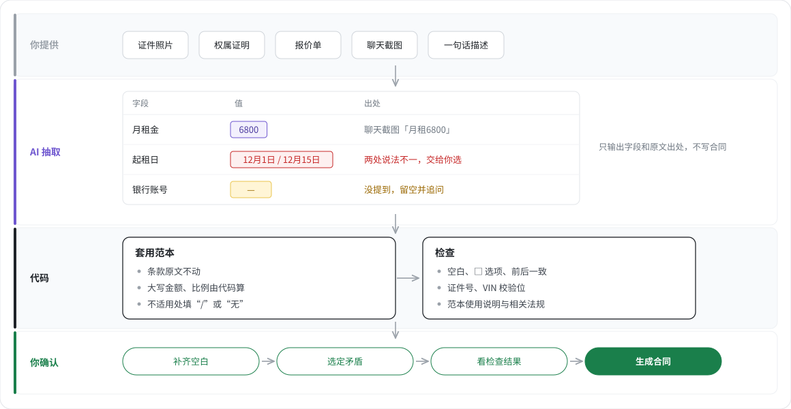

租房、卖二手车、请装修公司，很多人签合同时会用国家市场监管总局[合同示范文本库](https://htsfwb.samr.gov.cn/)里的范本。范本的条款都已经写好了，要做的只是把空白填上、把 □ 勾上。

难就难在填。信息散在身份证、房产证、报价单和几十条聊天记录里；几十处空白，哪些必须填，哪些可以划掉，各个范本的说法还不一样；大写金额要和小写对上，订金加余款要等于总价，租期不能超过二十年。

把这些材料丢给模型，让它“生成一份合同”，结果往往很像样，但不能用：条款被改写过，没谈过的违约金被编了一个数，两种说法里被悄悄选了一种。

所以这个 Agent 的分工是：**AI 只负责从材料里整理事实，并注明每个事实出自哪里；条款、计算和检查交给代码；没谈过的、说法不一的，交给人。**

这套做法不只适用于合同。只要是“照着标准格式填一份正式文书”，比如申请表、报关单、投保单，都可以这样拆。

## 先玩一下

下面嵌入的是原型本身，内置了三份示范文本：城镇房屋租赁合同（2025 版）、二手车买卖合同（2015 版）、家庭居室装饰装修工程施工合同（2000 版）。翻页时原型会切到对应场景，红框标出这一页讲的内容；也可以[在新窗口打开](/demos/contract-fill/)，自己发文件、说约定。


### ① 发材料，像聊天一样
左边是对话。用户发来两张身份证和房产证，再补一句电话和邮箱。中间是范本原文，右边是检查结果。
<!-- step: layout -->
---
### ② 文件也是输入
点开房产证：左边是原件，右边是 AI 读出的内容，以及它填进合同的 6 项。
<!-- step: files -->
---
### ③ 每个值都有出处
点合同里的任意一个值，都能看到它出自哪份文件、哪句话，对话里的原文也会高亮。
<!-- step: source -->
---
### ④ 大写金额由代码生成
AI 只填了“6800”，“陆仟捌佰元整”是代码换算出来的，不能手改。改了小写，大写跟着变。
<!-- step: code -->
---
### ⑤ 没说的，问你
材料里没提到的空白，AI 不会替你编。它按条款列出来，你直接回复就行。
<!-- step: ask -->
---
### ⑥ 前后说法不一，你来选
截图里说 12 月 1 日起租，后来又说改到 15 日。两种说法都保留，并各自注明出处，由你来选。
<!-- step: conflict -->
---
### ⑦ 数字对不上，拦下来
二手车：订金 5000 加余款 80000，和价款 86000 对不上。AI 只是如实照抄了聊天记录，是代码发现了问题。
<!-- step: checks -->
---
### ⑧ 规则来自范本和法规
家装：报价单写的工期是 60 天，可开工到竣工实际有 62 天；保修只有一年，低于《住宅室内装饰装修管理办法》规定的两年。
<!-- step: law -->
---
### ⑨ 划“/”还是写“无”
二手车范本的使用说明要求：没有内容的空白写“无”；租赁范本习惯划“/”。不适用或没约定的选填项，都由代码按各自的规矩来填。
<!-- step: na -->
---
### ⑩ 全部通过，才能生成
补齐违约条款，把价款定为 85000，检查全部变绿，“生成合同”才能点。
<!-- step: done -->


## 为什么不让模型直接写合同？

最省事的做法，是把范本和材料一起交给模型，让它输出一份填好的合同。这样做会出四种问题：

- **改条款。** 模型会把条款“润色”一下，或者顺手加一句。示范文本的意义就在于条款没人动过。
- **编数字。** 违约金比例、通知天数这些双方没谈过的内容，模型会填一个“常见值”。
- **替人做决定。** 聊天里说过两个起租日，它会挑一个，而且不告诉你。
- **算错。** 大写金额、比例分摊、份数合计，模型算错了也不会提醒你。

这四种问题，根源都是同一个：模型分不清自己是在“抄写事实”，还是在“替人做决定”。

## 四步：每一步谁来做？

- **抽取（AI）**：读消息和文件，只输出“字段 + 值 + 原文”。材料里没有的不填，说法不一的两种都交出来。
- **套用范本（代码）**：把值写进固定的条款，条款原文一个字都不改。大写金额、比例金额、不适用处的“/”或“无”，都由代码生成。
- **检查（代码）**：逐条核对，每改一处就重新检查一次。
- **确认（人）**：补齐空白，选定矛盾，看过检查结果再生成。

模型只出现在第一步，而且任务很窄：从材料里摘录，不下判断。

## 材料从哪来？

签合同时手上的东西，通常不是一张表，而是这些：

- **证件**：身份证、营业执照；
- **权属和标的**：房产证、行驶证、报价单；
- **谈好的条件**：聊天截图、邮件，或者用户随口说的一句“押一付三，物业费房东出”。

所以 Agent 的入口是对话，文件和文字都可以发。每发一次，它都会说清三件事：从哪份文件里读到了什么，哪些说法和之前不一样，还缺什么。缺的部分按条款分组列出来，用户直接回复就行。

不管值来自哪份文件、哪句话，合同里每个值都能点回原文。用户审合同时不用猜，可以直接对照。

## 什么交给人？

两种情况，AI 不替人决定：

- **没谈过的。** 违约金标准、通知期限、争议去哪个法院，材料里没有，就留空，列进“需要双方确认”的问题清单。清单可以复制出来发给对方。
- **说法不一的。** 合同里显示红色的“待定”，两种说法和各自的出处并排放着，由人来选。

范本的条款本身也不交给模型改。双方要加的约定，只能写进范本留出来的“其他约定”那一条。

## 检查从哪来？

检查规则不是凭空定的，大多来自范本自己的使用说明和风险提示，少数来自相关法规：

| 范本 | 规则 | 依据 |
|---|---|---|
| 城镇房屋租赁 | 租期不超过 20 年；甲乙双方承担的费用不重叠 | 使用说明、风险提示 |
| 二手车买卖 | 空白写“无”；车架号校验位正确；订金加余款等于价款 | 使用说明、GB 16735 |
| 家装施工 | 工期天数与起止日期一致；三次付款合计等于造价；保修期不少于两年 | 《住宅室内装饰装修管理办法》 |

除此之外，三份范本还有一些共用的检查：每个必填空白都已填写，每组 □ 都已勾选，前后说法没有矛盾，身份证号和统一社会信用代码的校验位正确。红色项会挡住生成，黄色项只是提醒，比如出租人不是房屋所有权人。

## 一个范本，一份配置

三份范本共用同一套流程，每份范本只需要描述自己的内容：

- 有哪些空白，各是什么类型（日期、金额、选项、证件号）；
- 条款原文，以及每个空白在条款里的位置；
- 什么时候不适用，比如没有车位，车位租金这一项就划掉；
- 哪些值由代码计算；
- 这份范本特有的检查规则和风险提示。

新增一份范本，就是新增一份这样的配置。原型里 2000 年的家装范本还写着“BP 机号”，引用的也是已经废止的《合同法》。原型保留了原文，只在风险提示里提醒修订，因为改条款这件事，同样不该由 Agent 来做。

## 什么时候适合这样做？

同时满足这三个条件，就值得考虑：

- 有**固定的范本或格式**，条款本身不需要谈；
- 要填的信息**散在多份材料里**，人工整理费时又容易漏；
- **填错的代价高**，需要逐项核对、留出处。

如果连格式都要从头起草，那是另一类问题。如果只是按场景回复一封邮件，可以参考[基于分类路由的模板回复 Agent](/posts/template-reply-agent/)。

## 写在最后

AI 在这里只做一件事：把散落在材料里的事实，一条一条摘出来，并注明出处。

条款交给范本，计算和检查交给代码，决定交给人。AI 做的事越少，越容易被检查；越容易被检查，越可靠。
