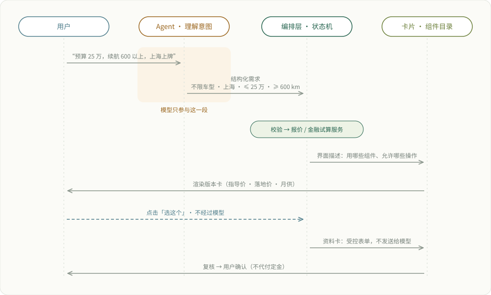
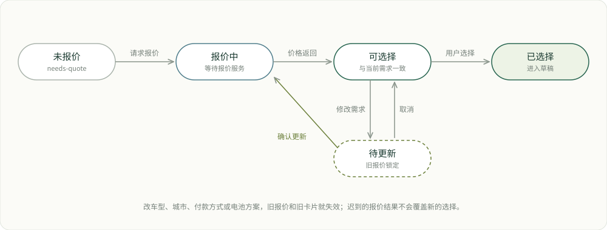

先看一段很常见的对话：

> **用户**：预算 25 万，想要续航长一点的，分期每个月多少？
>
> **机器人**：推荐蔚来 ET5 租电版，只要 22.8 万，月供大概 3,000 出头，我帮你下定吧？

一句回答错了三处：租电的 22.8 万不含电池，每个月还要另付电池月租，不能说成“只要 22.8 万”；月供应该由金融试算给出，而不是“大概”；下定金这种事，更不能由机器人替用户决定。

模型并不是“算错了”，它压根就不该算。

这篇文章以新能源汽车的线上询价为例，介绍一个对话式询价 Agent 的 UI 设计。核心思路只有一句：**模型负责听懂和解释，报价和金融服务负责价格，卡片负责选择和确认。** 原型里用了小米 SU7、蔚来 ET5、比亚迪海豹几款车，价格是公开资料的近似示例，以各品牌官网为准。

## 借鉴了谁

这个方向已经有不少公开案例。我关心的不是它们的聊天气泡长什么样，而是**决策怎么在对话里完成**：

| 案例 | 官方描述 | 在原型里的转译 |
|---|---|---|
| Expedia in ChatGPT | 按目的地、价格等约束，在聊天中给出酒店、航班和地图，展示动态价格与可用性 | 条件变成可编辑的需求摘要；用明确预算筛选候选；价格始终带着单位；不默认选最贵的方案 |
| Uber Eats Cart Assistant | 把文字或图片意图转成可复核、可修改的购物篮，由用户决定下单 | 不凭空补全条件，只追问缺的那一项；选定方案后直接生成可修改的草稿 |
| DoorDash in ChatGPT | 把食谱转成可购买清单，用户到购物车复核、调整并完成购买 | 聊天负责发现与解释；资料、复核和确认交给受控卡片；复杂比较留在弹层 |
| Shopify Agentic Storefronts | 商品进入 AI 对话，Catalog 提供结构化信息，交易走统一 Checkout | 价格来源与 AI 的解释分开；旧报价不进入新需求；结果页明确写“未下单” |
| OpenAI Apps SDK UI guidelines | 卡片用于单一决策、支持直接编辑，主要操作最多两个，避免嵌套滚动和重复输入 | 一张卡只做一件事；修改先暂存、确认后原地更新；条件太严时用空结果卡说明原因，不编一辆车 |
| 小米汽车 | 官网和 App 提供在线选配、金融试算，下定金后锁单 | 价格和月供来自确定性的服务；定金和锁单由用户显式完成 |
| 蔚来 | 同一辆车可以买断电池，也可以租电（BaaS） | 计价结构变化要明确说出来，不能把租电说成“便宜了 7 万” |
| 比亚迪 | 同一车型有多个续航和驱动版本 | 按预算和续航筛选版本，CLTC 续航和指导价都标明口径 |

界面表达上参考了 [A2UI](https://a2ui.org/) 的思路：Agent 输出一份**声明式的 UI 描述**，客户端只从预先注册的组件目录里挑组件来渲染。原型没有接入 A2UI 的官方协议或 SDK，用的是一个结构类似的自定义消息格式。

## 先玩一下

下面嵌入的是原型本身。翻页时原型会切到对应场景，红框标出这一页讲的内容；也可以[在新窗口打开](/demos/quote-agent/)自由体验。


### ① 从一个选择开始
先选一款车，或者让助手按预算来挑；也可以直接在底部说一句话。
<!-- step: start -->
---
### ② 只问缺的那一项
上牌城市会影响落地价、牌照条件和交付门店，所以只追问这一项，也不会按定位去猜。
<!-- step: ask -->
---
### ③ 全款还是分期
付款方式决定你看到什么数字：全款看落地价，分期还要看首付和月供。
<!-- step: payment -->
---
### ④ 一句话 → 一组卡片
“预算 25 万以内，续航 600 公里以上，上海上牌，分期”被拆成四个条件，直接筛出三个品牌里符合的版本。上海上牌还会提示需要牌照额度。
<!-- step: sentence -->
---
### ⑤ 模糊的话，变成可确认的推断
“经常跑高速，二十来万”被推断成“续航 ≥ 650 km”“指导价 ≤ 25 万”，用虚线标出依据，可以一键确认或删掉。
<!-- step: infer -->
---
### ⑥ 看清口径
CLTC 是工况续航，冬季和高速会更短；指导价不等于落地价。
<!-- step: units -->
---
### ⑦ 基于数据讲清差异
问“SU7 Pro 和海豹 650 有什么区别”，AI 只用服务数据写对比，每个数字都核对过，并标出“引用 12 个数字 · 均与报价服务数据一致”。
<!-- step: explain -->
---
### ⑧ 修改先暂存
把车型改成海豹，修改先停在需求卡里；旧报价变灰、不可选，取消就能恢复。
<!-- step: staged -->
---
### ⑨ 计价方式变了，要说出来
蔚来切到租电：明确提示“不是同一辆车便宜了”，车价不含电池、另付月租；旧报价卡收起并标记已失效。
<!-- step: switch -->
---
### ⑩ 资料走受控表单
联系人、手机号和交付中心在表单里填写，不发送给模型，也不会出现在聊天记录里。
<!-- step: form -->
---
### ⑪ 由用户确认
勾选说明之后，“确认”按钮才可用；定金只是展示，不会支付。
<!-- step: review -->
---
### ⑫ 摘要如实反映状态
只完成了本地复核；定金、锁单和排产都明确标为“未进行”。
<!-- step: summary -->
---
### ⑬ 看得见的 AI 轨迹
“交互机制”里记录了最近一次 AI 处理：原话、工具调用（更新需求、提出推断条件、请求报价）和最终渲染的卡片。
<!-- step: mechanism -->


## 谁来报价？

一次询价里有四个角色，模型只出现在开头那一段：

- **Agent**：把一句话理解成结构化的需求，追问缺少的信息，解释版本之间的差异。
- **编排层**：用状态机管理整个流程，调用报价和金融试算服务，判断现在该给用户看哪些卡片。
- **卡片**：只渲染预先注册好的组件，用户的操作直接回到编排层。
- **用户**：在卡片上选择、填写和确认。

关键在于那条虚线：用户点“选这个”、改车型、填表单，都**不经过模型**。模型能影响的只有“这句话是什么意思”，影响不了价格和流程。

因为客户端只认组件目录里已有的组件，即使模型说错了话，也生成不出一个不该出现的“立即支付定金”按钮。

## AI 具体做了什么

模型不算钱，但它承担了表单做不到的几件事：

- **把一句话翻译成条件。** “预算 25 万以内，续航 600 公里以上，上海上牌，分期”一次填好四个字段，用户不用一个个下拉框去找。
- **把模糊的话变成可确认的推断。** “经常跑高速”“二十来万”不是明确的条件，AI 会推断成“续航 ≥ 650 km”“指导价 ≤ 25 万”，并用虚线标出“AI 推断”和依据。确认之前，它不会被当成用户的明确要求。
- **判断该问什么。** 缺上牌城市就只问城市，缺付款方式就只问付款方式；不按定位猜，也不填默认值。
- **基于数据讲清差异。** 问“SU7 Pro 和海豹 650 有什么区别”，AI 只用报价服务返回的数据来写对比；文中每个数字都要和服务数据核对一致，对不上就整段拦下。
- **选择展示哪些卡片。** AI 只输出意图和工具调用，编排层校验后决定渲染什么。原型的“交互机制”弹层里可以看到一次处理的完整轨迹：原话 → 工具调用 → 渲染了哪些卡片。

原型里的“AI”用本地规则模拟，接口和真实 Agent 一致：输入一句话，输出需求补丁、推断条件或一段带数据核对的解释。

## 价格要带着口径

买车时最容易被误解的，往往不是数字本身，而是数字的口径：

- **指导价不等于落地价。** 落地价还包括购置税（2026 年起新能源车减半征收）和上牌费用，保险另计。卡片上把两者分开写，“落地价怎么算”可以展开看。
- **CLTC 续航是工况值。** 冬季和高速的实际续航会更短，比较弹层里会专门提示。
- **分期要看三个数。** 首付、月供和期数一起出现，月供由金融试算服务计算。
- **筛选不是推荐。** 按预算和续航筛出的版本旁边，会注明“只按条件筛选，不代表推荐”。
- **能报价不等于能上牌。** 选择上海或北京上牌时，卡片会提示需要新能源牌照额度，助手不判断你有没有。

## 用户改主意了怎么办？

聊天里最容易出的错，是旧价格配上新需求。所以报价要当成一个**会过期的对象**来管理，而不是一段可以随时复述的文字：

- 改车型、城市或付款方式，先暂存；确认之前，旧报价变灰、不能选。
- 确认之后旧报价立刻失效，之前的卡片收起来，标记“已失效”。
- 慢一步返回的报价，不会覆盖用户刚做的新选择。
- 计价方式变化要明确说出来。蔚来的租电（BaaS）就是典型例子：车价降低了，但要另付电池月租，不能说成“便宜了 7 万”。

## 谁来按下“确认”？

| 步骤 | AI 可以做什么 |
|---|---|
| 理解需求 | 解释、追问缺项，把识别出的需求写进可见的摘要；推断出的条件需要用户确认 |
| 比较版本 | 解释差异和口径；版本由用户来选 |
| 填写资料 | 不参与，资料只走受控表单 |
| 复核与确认 | 解释当前状态；确认只能由用户完成 |
| 定金与锁单 | 不执行任何由模型生成的支付或提交 |

暂停和结束也是两件事：暂停只是把草稿留在当前页面；结束要再确认一次，会清空草稿，但保留对话记录。两者都不会提交任何东西。

## 写在最后

对话式询价的难点不在“聊”，而在“谁说了算”。价格和规则交给确定性的系统，选择和确认留给用户，模型夹在中间，负责把话听懂、把差异讲清楚。

如果要落地，顺序也很重要：先把产品规则和报价接口定清楚，再设计流程和界面，最后才决定 AI 在每一步能做什么。
