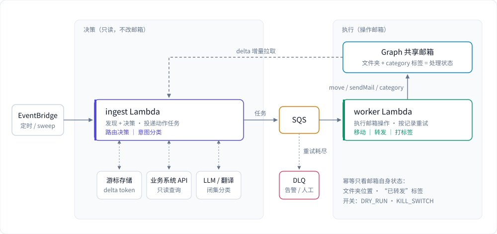

> 关键词：邮件分流、Graph delta、AWS Lambda、SQS、幂等、失败隔离、LLM 分类

很多业务是由邮件驱动的：客户、合作方和内部同事把邮件发到一个共享邮箱，团队再根据内容分派、跟进和回复。邮件量上来以后，有两件事很适合自动化：

- **路由分流**：把邮件放进对应业务队列的文件夹；需要专人跟进的，再转发给负责人。
- **内容意图分类**：识别邮件是在查询进度、提交材料、补充文件，还是别的诉求，让处理人一眼看懂。

本文介绍一种准实时的处理架构。它不改变团队的工作方式——共享邮箱仍然是日常入口——只是在邮箱之上叠加一层自动化：用 Lambda 和 SQS 把处理拆成“决策”和“执行”两段，再围绕路由规则、状态管理、失败处理和意图分类展开设计。最后对比市面上的其他做法，说明这个方案适合什么场景。

## 一、方案概览

### 设计目标

1. **业务数据实时读取**：路由所需的业务属性和负责人，直接通过业务系统的只读接口查询。
2. **尽量不依赖数据库**：不建中间状态表。唯一需要外部保存的是 Graph delta token；其余处理状态记录在邮件本身（所在文件夹、category 标签）上，规则放在静态配置里。
3. **准实时**：EventBridge 定时触发，通过 Graph delta 获取增量邮件。新鲜度由触发间隔决定，通常是分钟级。
4. **决策与执行分离**：ingest 只负责发现邮件、做判断、投递任务；真正移动、转发、打标签的只有 worker。

### 整体架构



| 组件 | 职责 |
| --- | --- |
| EventBridge + ingest Lambda | 定时拉取 delta；逐封做路由和分类决策；投递动作任务；保存 delta token |
| 业务系统 + 静态配置 | 业务系统提供实时业务属性和负责人；静态配置提供文件夹映射、标题 / 关键词规则和产品分类对照 |
| LLM / 翻译服务 | 翻译正文并给出内容类别 |
| SQS + worker Lambda + DLQ | 异步执行移动、转发、归档和打标签；按记录重试，重试耗尽后隔离到 DLQ |

路由和分类是两条**互相独立**的决策线：LLM 不可用时照样能路由；业务系统不可用时，只有带编号的邮件路由会暂缓，分类不受影响。没有业务编号的邮件则完全靠标题和关键词规则判断，根本不需要查询业务系统。

## 二、处理流程

### ingest：发现邮件，生成动作

1. 从游标存储读取 delta token，调用 Graph delta，拿到收件箱自上次以来新增或变更的邮件。
2. 对每封邮件做两项判断：
   - **路由决策**：提取业务编号和标题 / 关键词特征，需要时查询业务系统，得出目标文件夹和是否转发（规则见第三节）。
   - **分类决策**：翻译正文并调用 LLM，得到一个或多个内容类别（见第五节）。
3. 有路由结果或分类结果，就向 SQS 投递一条动作任务；两者都没有，则跳过，邮件留在收件箱等人工处理。
4. 整批处理完成后，保存新的 delta token。

ingest 自始至终**不修改邮箱**，因此可以放心重跑。

### worker：执行邮箱操作

worker 由 SQS 触发，可以批量处理。每条任务依次执行：

1. **定位邮件**：先用任务里的 message id；如果邮件已被移动、id 发生了变化，就按 `(conversationId, receivedDateTime)` 重新定位。
2. **移动**：有目标文件夹、且邮件仍在收件箱时，移到目标文件夹。
3. **转发**：目标需要转发、邮件带业务编号、且还没有“已转发”标签时，查询负责人及代理人（负责人休假时抄送代理人），重建邮件（含附件）并 `sendMail`；成功后打上“已转发”标签，再把原邮件移入归档文件夹。
4. **打标签**：有分类结果、且邮件还没有对应的 `AI:` 标签时，写入 category 标签。
5. **处理失败**：向 SQS 返回 `batchItemFailures`，只重投失败的记录；重试耗尽后进入 DLQ。

另外提供两个运维开关：`DRY_RUN` 让 worker 只记录不执行，便于影子验证；`KILL_SWITCH` 用于紧急停止所有邮箱操作。

## 三、路由规则

### 多编号与冲突

一封邮件里可能出现多个业务编号，要先区分两种情况：

- **同一件事的多个编号**：比如一个案件号和它所属的合同号。业务系统返回的案件对象里带着合同号，两者指向同一个目标，不算冲突。
- **多个互不相关的案件**：只有它们分别对应不同文件夹时，才是真正的冲突。

策略是“**候选唯一才靠编号**”：

```text
编号集合 → 查询业务系统 → 候选文件夹集合
  候选为空        → 按关键词特征判断；仍无法确定 → 留给人工
  候选唯一        → 使用该文件夹
  候选多且不同    → 不按编号路由，退回关键词特征；仍不唯一 → 留给人工
```

每个案件仍按同一套规则单独判断，编号的数量只影响“候选是否唯一”。这里刻意**不给冲突编号排优先级**——否则可能把 B 案件的询问转给 A 案件的负责人。

### 实时查询与静态配置

类型、产品、客户分层、负责人等路由属性都由业务系统实时提供。如果接口支持上级对象内嵌下级对象（例如查合同时一并返回最近一条案件），一次查询就能同时覆盖“有案件按案件路由、无案件按产品路由”两种情况。

其余规则作为静态配置，随代码一起版本管理：

| 配置 | 内容 |
| --- | --- |
| 文件夹 ID 对照 | 文件夹名到文件夹 ID 的映射，包括目标文件夹和归档文件夹 |
| 标题 / 关键词规则集 | 意图短语、关键词，以及少量特例覆盖 |
| 产品分类对照 | 没有案件时，按产品类型归类 |

值得一提的是，没有编号的邮件并不是边缘情况，往往占相当比例，而它们大多可以直接按标题模式归类。

有两件事是刻意不做的：

- **不做查询缓存**：单封邮件内几乎没有重复查询，缓存反而会降低路由数据的新鲜度。
- **暂不记录决策日志**：审计和分析需求等处理行为稳定后再评估。

## 四、状态、幂等与失败处理

### 用邮箱记录处理状态

外部只保存 Graph delta token（放在简单的 key/value 存储里即可），用于增量读取。其他状态都由邮件自己表达：

- **路由进度**看文件夹位置：路由完成的邮件会移出收件箱，仍在收件箱里的就是还没处理完的。
- **是否已转发、是否已分类**看 category 标签：标签会随邮件移动保留，同时充当幂等标记。

这样就不需要中间表来记录每封邮件处理到了哪一步。代价是暂时没有独立的审计和分析记录。

### 幂等与重试

队列会重投、任务会重跑，所以每个动作都必须可以安全地重复执行：

- **移动**：执行前先检查邮件位置，已经不在收件箱就跳过。
- **转发**：转发前检查“已转发”标签，成功后立即写入。`sendMail` 和归档之间有一个时间窗，如果只靠文件夹位置判重，窗口内重跑会给负责人重复发信。
- **移动后 id 变化**：Graph move 会返回新的 message id。worker 连续执行移动、转发、归档时，每一步都使用上一步返回的最新 id；如果 SQS 重投时原 id 已失效，就按 `(conversationId, receivedDateTime)` 重新定位。
- **部分失败重投**：事件源开启 `ReportBatchItemFailures`。Graph 等瞬时错误抛出异常后重试；“找不到负责人”这类终态错误不重试。

### sweep 兜底

增量处理有一个隐患：如果某封邮件处理失败，而 delta token 已经越过了它，它就不会再被拉到。

因此再配一条低频的 sweep 任务：扫描收件箱中尚未路由的邮件，同时检查已管理文件夹中缺少 `AI:` 标签的邮件，重新决策入队。这样即使分类暂时失败、而邮件已经因为路由离开了收件箱，也还能再次尝试分类。sweep 不需要任何额外状态——邮件在哪、有没有标签，本身就说明了它是否处理完。

### 降级策略

| 情况 | 处理 |
| --- | --- |
| 业务系统超时 / 5xx | 暂不做编号路由，邮件留在收件箱，等 sweep 重试 |
| 业务系统 404（编号不存在） | 视为该编号无候选，继续按标题 / 关键词规则判断 |
| 业务系统 429（限流） | 按接口要求退避；仍无法决策时不猜测目标，留待重试 |
| LLM 不可用 / 超时 | 本次跳过分类、不打标签；路由照常，由 sweep 补做分类 |
| Graph 限流 / 执行失败 | worker 抛出异常，由 SQS 重投；耗尽后进入 DLQ |

所有降级都遵循同一条原则：**宁可留给人工，也不猜测目标。**

## 五、内容意图分类

分类回答的是“这封邮件想做什么”，帮助处理人快速了解诉求，也为后续分析提供数据。它和路由正交：不决定文件夹，也不触发移动或转发。

- **闭集类别**：例如 `进度查询 / 新提交 / 补充材料 / 催办 / 规则咨询 / 非业务邮件 / 其他`。类别集合由静态配置管理，模型无法判断时归入“其他”。
- **一次调用完成**：输入标题和正文，需要翻译时让 LLM 在同一次调用里完成翻译和归类，减少往返。
- **结果写回邮件**：类别保存为 Graph category 标签。处理人在邮箱里直接可见，邮件移动后标签仍在，同时也是幂等标记。翻译文本用完即弃。
- **可选的分析表**：如果需要按类别做聚合统计，可以另加一张只读、append-only 的类别表。它在路由的主流程之外，默认不启用。

LLM 是整个方案中唯一的重依赖，因此要通过独立接口接入，确保它出问题时只影响分类，不波及路由和转发。

## 六、其他方案与适用场景

“邮件进来 → 理解 → 分派”是个普遍需求，市面上大致有三类做法：

| 类别 | 示例 | 特点 |
| --- | --- | --- |
| 工单 / 客服平台 | Salesforce Email-to-Case、ServiceNow Inbound Email、Dynamics 365 Unified Routing、Zendesk Intelligent Triage、Amazon Connect Email | 邮件转成平台内的工单或记录，自带 SLA、分派和报表 |
| RPA / IDP | UiPath Communications Mining、ABBYY、Hyperscience、Power Automate + AI Builder | 侧重邮件和附件的分类、字段抽取，以及流程自动化 |
| 云服务自行组装 | Graph + Azure Functions + Azure OpenAI；SES + S3 + Lambda + Comprehend / Bedrock；n8n、Zapier + LLM | 灵活度高，适合规则或集成有特殊要求的团队 |

本文方案属于第三类。和前两类相比：

| 维度 | 工单 / 客服平台 | RPA / IDP | 本文方案（Lambda + SQS） |
| --- | --- | --- | --- |
| 工作载体 | 平台工单 | 邮箱 + RPA 流程 | **原共享邮箱** |
| 状态存放 | 平台数据库 | 平台 + 流程日志 | 邮件文件夹 + category 标签 + delta token |
| 业务系统查询 | 连接器或集成 | 流程中调用 | 决策阶段直接调用只读 API |
| 分类能力 | 平台内置，定制受限 | 可训练专用模型 | 规则 + 闭集 LLM 分类 |
| 引入成本 | 许可证 + 流程迁移 | 许可证 + 平台运维 | 少量云资源，按调用计费 |
| 自带能力 | SLA、坐席界面、报表 | 流程编排、人工复核 | 无，按需补充 |

**怎么选：**

- 已经在用工单 / 客服平台的团队，优先评估平台自带的邮件分派，避免重复建设。
- 日常工作就在 Outlook 共享邮箱里、不打算迁移到工单系统，而分派又依赖内部业务数据——这正是本文方案的适用场景：不改变使用习惯，只在邮箱上叠加自动化。
- 如果重点是大量表单、单据的附件抽取，可以在决策阶段接入 IDP 能力，而不必为此整体更换平台。
