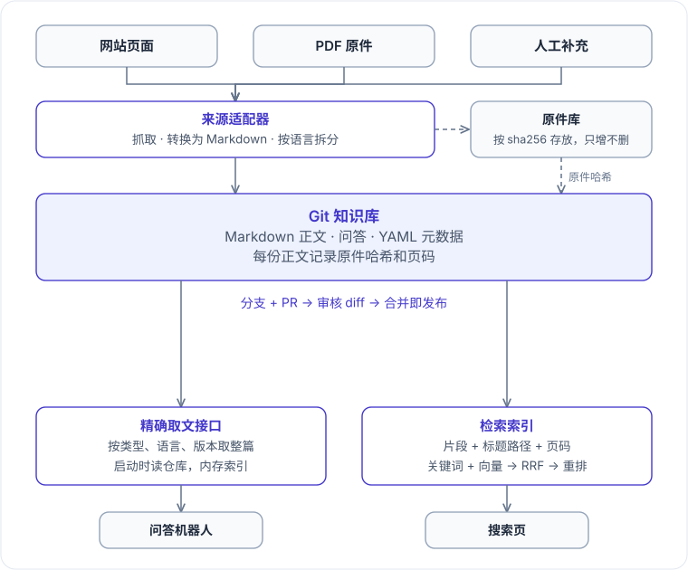

很多知识库项目的第一步，是把手上的 PDF 和网页全部上传到一个向量库，接上聊天机器人。演示通常很顺利。问题出现在上线以后：

- 同一份合同的三个版本都被检索出来，回答引用的是已经失效的那一版；
- 用户输入一个文件编号，向量检索返回的是几段"意思相近"的无关条款；
- 有人发现某段内容转错了，却说不清它来自哪份原件、哪一页，修好以后也不知道还有哪些地方受影响；
- 业务同事想审核知识库里到底有什么，只能去翻向量库的记录。

这些都不是检索算法的问题，而是**内容本身没有被当作一个产品来管理**。

我们的思路是把知识库当成一座图书馆，或者一本字典：先有分类，再有书和版本，书里有目录，目录下才是具体的段落。对话模型要的不是"整个知识库"，而是刚好够回答问题的那一段；知识库的结构，就是为了**一级一级缩小上下文**，把准确的知识交给对话模型。

本文结合一个中英双语知识库项目（约 1,800 份 Markdown 文档、800 多条问答，原件以长篇条款类 PDF 为主），整理我们在内容模型、发布流程和检索方式上的做法。各种来源怎么统一成 Markdown、怎么按标题切块，放在[下一篇](../pdf-to-markdown-chunking/)单独讲。

## 一、参考做法

主流云厂商和模型厂商的参考架构，对"检索之前要做什么"说得很清楚：

| 来源 | 主要做法 |
| --- | --- |
| Azure Architecture Center《RAG 解决方案》系列 | 先做准备阶段：理解文档类型、清洗页眉页脚和水印，再按文档结构切块；检索阶段用混合查询和重排 |
| Amazon Bedrock Knowledge Bases | 解析、切块、元数据过滤是独立的配置项；含表格和图片的文档建议用基础模型解析 |
| Google Document AI Layout Parser | 先识别版面元素，再生成"同一个片段只来自同一个版面元素"的片段 |
| Anthropic《Contextual Retrieval》 | 向量和 BM25 结合，再加重排，检索失败率比单用向量下降明显 |
| Write the Docs《Docs as Code》 | 文档用纯文本标记、放进版本控制、经过代码审查和自动测试 |

共同点是：解析、切块、索引都是**可以单独检查的步骤**。第二到六节是我们的设计，第七节再和 RAGFlow、WeKnora、Azure AI Search 这些现成平台对比，说明为什么最终没有直接用它们。

## 二、像图书馆一样，逐级缩小上下文

| 层级 | 在图书馆里 | 在知识库里 |
| --- | --- | --- |
| 分类 | 书架分区 | 产品目录：客户类别 › 产品线 › 产品 |
| 文档 | 一本书的某个版本 | 一份 Markdown，带类型、语言、版本、状态 |
| 章节 | 书的目录 | Markdown 的标题树和标题路径 |
| 片段 | 某一节里的一段 | 一个标题下的正文 |
| 问答 | 字典里的词条 | 一条问答，只属于一个层级 |

对话模型拿到的上下文，就是沿着这几层缩小出来的。缩小的方式有两种，对应两个接口：

- **知道去哪个书架、哪本书**：按元数据精确取文。问答机器人已经知道产品和语言，直接取"这个产品现行条款的全文"和"这个产品的全部问答"，不会取错版本，也不会只拿到半个条款。
- **只知道问题**：查索引。检索按片段建索引，返回带标题路径和页码的片段，结果按文档分组；需要更多上下文时，再沿标题路径往上取整节或整篇。

### 上下文随对话变化

上下文不是一次定好的。对话越往下走，知道的信息越多，范围就能越缩越小：

| 对话进展 | 已经知道的 | 放进上下文的 | 依赖的结构 |
| --- | --- | --- | --- |
| 刚开始 | 只有一个问题 | 通用规则、各产品线的概览，以及通用问答 | 分类的最上层；这部分固定不变，可以放在提示缓存里 |
| 提到某条产品线 | 产品线 | 这条线下各产品的介绍和问答 | 分类：产品线 › 产品 |
| 确定了具体产品 | 产品、语言，可能还有签约日期 | 对应版本的条款全文，或者相关章节 | 文档的版本和状态 |
| 问到某一条 | 具体问题 | 检索出的片段，必要时沿标题路径取回整节 | 标题树和标题路径 |
| 换了话题 | 新的产品或问题 | 替换上一层的内容，而不是一直往上堆 | 同上 |

目前我们的问答机器人按关键词判断产品线，宁可多加载也不漏；以后可以让模型通过工具调用，自己决定下一步往哪一层取。不管谁来判断，前提都一样：每一层都有稳定、准确的结构可以定位。没有这些结构，每一轮只能在全库里检索，或者把所有内容都塞进上下文。

任何一层出错，对话模型拿到的上下文就是错的：分类错了找错书，版本错了引用失效条款，标题树错了切出半个条款。所以内容模型（第三节）和标题树（[下一篇](../pdf-to-markdown-chunking/)）和检索一样重要。调用方已经知道要哪本书时，不走检索。

## 三、内容模型：一个来源，一份 Markdown

不管原来是网页、PDF 还是人工补充的文件，都统一成"带元数据的 Markdown"：

1. **一个来源对应一份文档**。元数据包括类型、语言、所属层级（客户类别、产品线、具体产品）、版本、状态（现行或历史）和来源地址。
2. **可以追溯到原件**。每份 Markdown 记录原件的 sha256，PDF 转出来的正文保留页码标记，任何一段都能回到原件的第几页。
3. **旧版本不删除**。按旧条款签的合同仍要查得到当时的条款，只是状态标成历史；检索默认只查现行版本。
4. **双语文件按语言拆开**。转换时给每块内容打语言标记，再拆成两份文档；逐行双语的封面、表格两边都放。

**问答不当作文档**，单独建模：一条问答一条记录，只属于一个层级（某个产品、某条产品线或某类客户）；网站抓取的和人工补充的用同一个模型，以来源字段区分；产品页正文去掉问答那一节，同一条问答只存一份。这样机器人能一次取回"这个产品的全部问答"，搜索页也能把每条问答当作一个片段。

## 四、用 Git 存放和发布

正文和元数据放在 Git 里，不放数据库。

- **Git 里只放 Markdown 正文、问答和少量 YAML 元数据**。PDF、网页原件、OCR 中间结果（约 1.2 GB）放在仓库外的原件库，按 sha256 存放，只增不删。
- **每次同步都是一个分支加一个 PR**。网站同步、内部系统同步都只是来源适配器，产出的是 PR 而不是直接写库。审核人看的是转换后正文的 diff，合并到主分支就是发布。
- **人只写自己的决定**。每个层级有一个人工维护的配置文件，只记录来源给不出的信息，例如某份文件属于哪个产品。各来源合并成一份生效的目录，冲突写进报告。
- **服务启动时读取仓库，在内存里建索引**，精确取文接口全部从这里返回。

版本、历史和审计由 Git 提供，不需要另建版本表；转换规则一改，PR 里就能看到哪些文档的哪几行变了。适用条件：文档在几千份以内、以批处理更新、不需要按用户控制权限。超出这些条件时元数据应进数据库，但正文仍应保持可 diff、可审核。

## 五、检索：混合检索要配重排

索引里**一条记录就是一个片段**，文档级字段（类型、产品、语言、状态）在每个片段上冗余一份，用于过滤和分面统计。另外三点：

- 向量化的输入是"文档标题 + 标题路径 + 片段正文"，不只是正文；
- 文件编号这类精确串放进单独字段，用关键词分析器整串匹配，并给较高权重；
- 每个片段带页码和在原文中的位置，点开就能在全文里定位。

用同一套 48 道题（英文、繁体、简体口语、编号查询）比较几种检索方式：

| 检索方式 | R@5 | MRR@10 |
| --- | ---: | ---: |
| 关键词（BM25） | 77–79% | 0.68–0.71 |
| 向量 | 96% | 0.918 |
| 混合（RRF 合并，不重排） | 94–96% | 0.846–0.878 |
| 混合 + 托管的语义重排 | **100%** | **0.936** |
| 混合 + 独立的重排模型 | 100% | 0.905–0.911 |

1. **只做混合、不重排，反而比单用向量差**。关键词一路排名较差，RRF 合并后把好的向量结果挤了下去；加上重排才补回来，并超过单用向量。
2. **关键词检索不能去掉**。编号类查询只有它能查到，向量完全找不到。Azure 的混合检索文档也指出，产品代码、术语、日期、人名更适合关键词检索。
3. **跨语言、跨简繁不需要转换**。知识库是繁体，用户常用简体提问；关键词匹配不上，但向量能把简体问题对到繁体条款，英文问题也能对到中文段落。所以搜索页默认"混合 + 重排"。
4. **搜索页不生成回答**。托管服务的"答案"是从原文摘出的句子，只在查询像问题、分数够高时显示；编号查询的"答案"通常不相关。

## 六、评测集决定方案，也有测不出的东西

检索方式由评测集决定：

- 题目覆盖真实的提问方式：正式写法、口语、简繁、中英混用、编号；
- 每道题标出算作答对的文档，必要时限定到章节或具体问答；
- 所有检索方式用同一套题、同一套判分规则，看 R@1、R@5、R@10 和 MRR；
- **不为小评测集调参**。48 道题里一道题就是 2 个百分点。关键词权重试过 1.0、0.7、0.5、0.3，RRF 的 k 试过 60 和 20，差别都在 1–2 道题以内，所以保持默认的等权重 RRF。

排名指标只看"对的文档是否排在前面"，不看片段是否完整、标题路径是否正确。下一篇会看到，很多切块改进几乎不影响排名，却直接影响结果的显示和引用条款的质量。下一步是把评测集扩到 150–200 道真实提问，并加一个答案级指标，例如"排第一的片段是否包含完整的答案条款"。

## 七、为什么最终是这个方案

RAGFlow、WeKnora 和 Azure AI Search 都把解析、切块、检索做成了产品功能。我们借鉴了它们的不少做法，但没有直接采用整套方案：

| 方案 | 做得好的地方 | 我们没有直接用的原因 |
| --- | --- | --- |
| RAGFlow | 按文档类型选解析模板（问答、手册、法律文书等），一问一答一个片段；切块结果可视化，可对照原文修改片段；检索测试页可以调关键词权重和重排 | 人工修改落在片段上，重新解析时要额外处理修改和正文的关系；审核只能逐个片段看，不能像 PR 那样整份看 diff；重心在检索和对话，而我们的主要调用方要的是按元数据取整篇 |
| WeKnora | 从 Confluence、Notion、飞书等自动同步；问答库单独管理；片段编辑有修改历史、能对比和回滚；父子片段、混合检索 | 同上：事实来源在片段上，按元数据精确取文不是它的重点 |
| Azure AI Search 内置索引器 + 技能集 | 自动解析、切块、向量化；混合检索、语义重排、摘取答案句 | 内置版面技能会再调一次版面 OCR，而这正是我们在双栏、跨页表格上出问题的地方；技能只能在索引器里跑，没有独立接口；向量化接不了我们自己的模型网关 |
| **自建内容层 + Azure AI Search 只做检索**（采用） | 内容可审核、可追溯、有版本；转换和切块规则可以反复迭代、全部重跑 | 代价是自己维护转换、切块和推送的代码，也没有现成的片段编辑界面 |

关键区别在于事实来源放在哪一层。平台里人工修改发生在片段上，片段就成了事实来源。我们在 Markdown 正文上修改，片段只是派生物；片段 ID 由内容决定，规则一改就可以全部重新生成，只有内容变了的片段才重新算向量。检索则交给 Azure AI Search 的推送接口，只用它的混合检索和语义重排。

需要说明：RAGFlow 和 WeKnora 没有在我们的数据上跑过对比，上表是按设计取舍做的判断；Azure 内置技能的问题是 POC 中实际遇到的。

## 参考

- Microsoft, [Develop a RAG Solution on Azure: Preparation Phase](https://learn.microsoft.com/en-us/azure/architecture/ai-ml/guide/rag/rag-preparation-phase)
- Microsoft, [Develop a RAG Solution on Azure: Information Retrieval Phase](https://learn.microsoft.com/en-us/azure/architecture/ai-ml/guide/rag/rag-information-retrieval)
- Microsoft, [Develop a RAG Solution on Azure: LLM End-to-End Evaluation Phase](https://learn.microsoft.com/en-us/azure/architecture/ai-ml/guide/rag/rag-llm-evaluation-phase)
- Microsoft, [Hybrid search using vectors and full text in Azure AI Search](https://learn.microsoft.com/en-us/azure/search/hybrid-search-overview)
- Microsoft, [Relevance scoring in hybrid search using Reciprocal Rank Fusion (RRF)](https://learn.microsoft.com/en-us/azure/search/hybrid-search-ranking)
- Cormack, Clarke, Büttcher, [Reciprocal Rank Fusion outperforms Condorcet and individual Rank Learning Methods](https://plg.uwaterloo.ca/~gvcormac/cormacksigir09-rrf.pdf)（SIGIR 2009）
- Amazon Web Services, [How content chunking works for knowledge bases](https://docs.aws.amazon.com/bedrock/latest/userguide/kb-chunking.html)
- Google Cloud, [Use Document AI layout parser with RAG Engine](https://cloud.google.com/vertex-ai/generative-ai/docs/rag-engine/layout-parser-integration)
- Anthropic, [Contextual Retrieval](https://www.anthropic.com/engineering/contextual-retrieval)
- RAGFlow, [项目主页](https://github.com/infiniflow/ragflow)，文档《Configuration》《Retrieval Testing》《Chunk: Parsing Results and Knowledge Fragment Management》（仓库 `docs/guides/dataset/`）
- Tencent, [WeKnora](https://github.com/Tencent/WeKnora)
- Microsoft, [Semantic ranking in Azure AI Search](https://learn.microsoft.com/en-us/azure/search/semantic-search-overview)
- Cohere, [Rerank Overview](https://docs.cohere.com/docs/rerank-overview)
- Thakur et al., [BEIR: A Heterogenous Benchmark for Zero-shot Evaluation of Information Retrieval Models](https://arxiv.org/abs/2104.08663)
- Write the Docs, [Docs as Code](https://www.writethedocs.org/guide/docs-as-code/)
