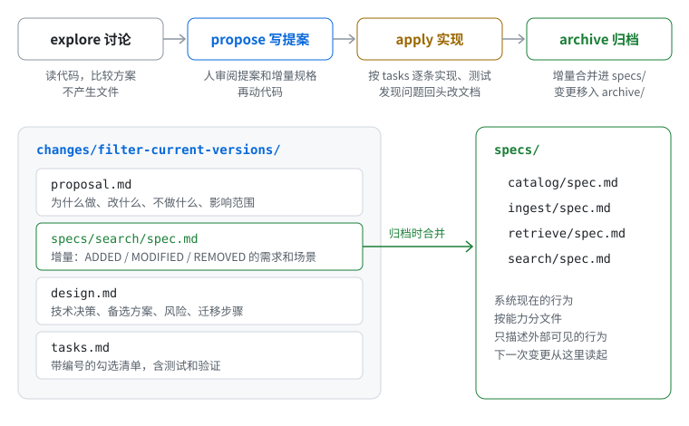

用 AI 写代码一段时间后，下面这些情况会反复出现：

- 上周和 AI 讨论清楚的边界条件，这周换了个会话，它又按自己的理解重写了一遍；
- AI 改完代码说"全部完成"，可哪些测过、哪些只是写了，没人说得清；
- 审 PR 时看到三十个文件的 diff，却看不出系统的**行为**到底改了什么；
- 新人问"检索现在会不会返回旧版本"，答案只能去翻代码和几个月前的聊天记录。

问题不在模型能力，而在**需求只存在于对话里**。对话会被截断、会被清空、不会进代码审查。Spec 驱动开发（Spec-Driven Development，SDD）的思路很简单：先把"要做成什么样"写成文件放进仓库，人审过以后再让 AI 实现。

工具很多，做法差别也很大。我们比较了几种主流方案，最后选了 OpenSpec，目前在十几个仓库里用了一百多次变更。本文讲选型的理由和实际的用法。

## 一、业界怎么做

Thoughtworks 的 Birgitta Böckeler 在 martinfowler.com 上把 SDD 分成三个层次：

- **Spec-first**：先写规格再写代码，但功能做完后规格就没人维护了；
- **Spec-anchored**：功能做完后规格保留下来，以后修改这个功能时继续更新它；
- **Spec-as-source**：规格是唯一被维护的源文件，代码由它生成，人不改代码。

她的观察是：所有工具都做到了 spec-first，但"做完以后规格怎么维护"大多说得很模糊。这正是选型时最该问的问题。

| 工具 | 做法 | 功能做完后规格在哪 | 限制 |
| --- | --- | --- | --- |
| GitHub Spec Kit | 先写项目"宪章"，每个功能走 specify → plan → tasks → implement，有阶段检查 | 按功能分支放在 `specs/编号-功能名/`，不合并成整体 | 每个功能七八个文件；需要 Python 环境 |
| AWS Kiro | requirements（EARS 句式）→ design → tasks，加 steering 文件和 hooks | 留在功能目录下，跨功能怎么维护没有明确说法 | 商业产品，部分功能只在自家 IDE 里有 |
| Tessl | 规格是源文件，代码标注"由规格生成，勿改" | 规格就是源头 | 一份规格对应一个文件；产品方向仍在变化 |
| BMAD Method | 一组角色 Agent（分析、架构、开发等）按敏捷流程协作 | 以流程产物为主，不是规格库 | 更像一套流程框架 |
| OpenSpec | `specs/` 存系统当前行为，每次改动在 `changes/` 里只写增量，归档时合并 | 合并进 `specs/`，按能力分文件 | 规格和代码是否一致，没有强制检查 |

## 二、反对意见

SDD 的批评并不少，而且来自很有分量的来源：

1. **Markdown 太多，审不动**。Böckeler 试用 Spec Kit 时生成了大量重复的 Markdown，她的原话是"我宁愿审代码，也不想审这些 Markdown"。
2. **大锤砸核桃**。她用 Kiro 修一个小 bug，生成了 4 个用户故事、16 条验收标准。好的工具应该能按改动大小调整流程。
3. **瀑布流回潮**。Marmelab 的文章标题就是《The Waterfall Strikes Back》：前期写大量规格、审两遍（规格里已经有代码，审规格再审代码）；而且大多数编码 Agent 已经有计划模式和任务清单，SDD 带来的好处有限。
4. **手写规则不可扩展**。Thoughtworks 技术雷达把 SDD 放在"评估"环，认为流程"繁琐且主观"，并提醒"我们可能在重温一个苦涩的教训：为 AI 手工编写详细规则，最终无法扩展"。
5. **AI 不一定照着规格做**。规格写了，Agent 仍可能忽略，或者在某条规则上用力过猛。

这些批评我们都认同。所以选型时问的不是"要不要写规格"，而是**能不能只写必要的那部分，并且写完以后它还有用**。第 3 条里"计划模式就够了"是对的，但计划模式的产物不会留下来；我们要的恰恰是留下来、能合并、下次能接着读的那部分。

## 三、为什么是 OpenSpec



### 1. 规格分成"现在"和"这次改什么"

以[知识库那篇](../knowledge-base-architecture/)里的一个功能为例：同一份合同有多个版本，旧版本不删除、只标成历史，检索默认只查现行版本。在 OpenSpec 里，这次改动是这样记录的。

仓库里有两个目录：

- `openspec/specs/`：系统**现在**的行为，按能力分文件，例如 `ingest/spec.md`（导入）、`retrieve/spec.md`（精确取文）、`search/spec.md`（检索）；
- `openspec/changes/<变更名>/`：一次改动的提案、增量规格、设计和任务，这次是 `changes/filter-current-versions/`。

增量规格只写这次的差别，分三段：

```markdown
## ADDED Requirements
### Requirement: 默认只检索现行版本
检索 SHALL 只返回状态为现行的文档版本，除非调用方明确要求包含历史版本。

#### Scenario: 同一份合同有三个版本
- **WHEN** 用户搜索这份合同里的某个条款
- **THEN** 只返回状态为现行的那一版，历史版本不出现在结果里

#### Scenario: 查询按旧条款签的合同
- **WHEN** 调用方指定包含历史版本
- **THEN** 返回各版本的片段，每个片段标明版本和状态

## MODIFIED Requirements
### Requirement: 检索结果按文档分组
……（整条需求的新写法：分组时同一文档只保留现行版本）

## REMOVED Requirements
### Requirement: 返回所有历史版本
```

"状态字段放在哪张表、怎么建索引"不写在这里，写在 design.md。

归档时，ADDED 追加进 `specs/search/spec.md`，MODIFIED 替换原有的那一条，REMOVED 删掉；变更目录整体移到 `changes/archive/日期-filter-current-versions/`，讨论过程都留着。

这直接回答了前面几个问题：

- **审什么**：审增量，不是审整份规格。一次只改一条需求，增量就只有几行。
- **规格做完以后在哪**：合并进 `specs/`，下一次改检索的人（或 Agent）先读的就是它。按 Böckeler 的分类，这是 spec-anchored。
- **会不会越积越乱**：MODIFIED 和 REMOVED 要求写的人先找到原有的那条需求，等于逼 Agent 在动手前看一眼现状。

### 2. 为已有项目设计

OpenSpec 的文档写得很直接：开始用的时候不需要把整个代码库写成规格，**只为这次要改的部分写**。`specs/` 一开始几乎是空的，随着变更归档慢慢长出来。

我们的仓库大多是已有项目，这一点决定了能不能用起来。如果先要补齐全部规格，就又回到了"前期写大量文档"的瀑布流。

### 3. 默认轻量，没有阶段关卡

一次变更就是 3 到 4 个 Markdown 文件，小改动可以不写 design。文档允许任何时候回头改提案和规格，没有"规格不通过就不能进入下一阶段"的关卡。官方的说法是"默认用精简规格，大多数改动都应该保持精简"，只有跨团队、接口、迁移、安全类的改动才写完整版。

### 4. 不绑定工具

规格是纯 Markdown，CLI 是一个 npm 包，工作流以 Skill 的形式装进 Claude Code、Codex、Cursor、Copilot 等二三十种编码工具。团队里各人用不同的 Agent，读的是同一份规格；换工具时规格不用迁移。

### 5. 能按项目定制

`openspec/config.yaml` 可以写三类东西：给 AI 的项目背景、每种文档的规则、实现和归档时的操作指引。这是我们用得最多的功能，下一节细说。

### 和其他方案对比

| 我们在意的 | OpenSpec | Spec Kit | Kiro |
| --- | --- | --- | --- |
| 做完后规格合并成"系统现状" | 是，归档时合并 | 否，按功能分目录 | 没有明确机制 |
| 已有项目只写要改的部分 | 文档明确支持 | 有指南，引入成本较高 | 未见明确说法 |
| 小改动的流程开销 | 3–4 个文件，可省 design | 七八个文件，有阶段检查 | 容易把小改动放大 |
| 换编码工具 | 二三十种工具通用 | 支持多种 Agent | 绑定自家产品 |

Tessl 走得最远，但"人不改代码"在我们的场景里不现实，也重复了模型驱动开发当年的问题：同一份规格生成两次，代码并不一样。BMAD 解决的是多角色协作流程，和我们要的"一份持续更新的规格库"不是一个问题。

## 四、我们的用法

下面是十几个仓库、一百多次归档变更里形成的做法。在其中五个仓库里，87 次变更共约 1,700 条任务，平均每次 20 条左右；多数变更 1 到 3 天内归档。

### 规格只写外部可见的行为

这是 `config.yaml` 里出现最多的一条规则：

```yaml
rules:
  specs:
    - Describe externally observable behaviour only;
      table layouts and SQL belong in design.md.
```

规格写"系统做什么"，表结构、类名、选了哪个库放进 design。OpenSpec 的文档也给了同样的判断方法：如果实现可以换掉而外部行为不变，那它就不属于规格。这条规则也回应了 Marmelab 说的"审两遍"——规格里没有代码，审规格和审代码看的是两件不同的事。

需求标题写成一句行为，例如"默认只检索现行版本""非法参数回退到默认值"，而不是"版本过滤模块"。每条需求一到三个场景，只用 WHEN / THEN。我们统计的五个仓库里，367 条需求有 700 个场景，平均每条两个。

### 提案必须写"不做什么"

```yaml
rules:
  proposal:
    - Include a "Non-goals" section.
    - When shared code changes, say which workflows are affected.
```

AI 最常见的问题不是做不到，而是做多了。Non-goals 一节让审阅者一眼看出范围，也给 Agent 一个明确的边界。几个业务流程共用代码时，提案还要写清楚影响哪几个。

### 如实区分"已验证"和"未验证"

```yaml
rules:
  tasks:
    - Call out any DB migration as its own task, and mark it
      unverified when it cannot be run locally.
operations:
  apply:
    guidance:
      - Say what was verified and what was not.
  archive:
    guidance:
      - Confirm migrations and env changes are done before archiving;
        note anything left unverified.
```

AI 很容易把"写了"说成"做完了"。我们要求每个任务清单里有测试和检查项（约四分之一的任务涉及测试、lint 或类型检查），本地跑不了的数据库迁移单独列出、标成未验证，归档前再确认一次。

### 项目背景写在 `context` 里，不要重复设计文档

`context` 写技术栈、测试命令、提交规范、环境限制，以及"数据库命名以哪份设计文档为准"。design 的规则是引用 `docs/` 里的文档，不要复述。这样 Agent 每次生成文档时都带着同样的背景，又不会出现两份互相矛盾的说明。

### 规格和代码一起提交

一次功能提交里，通常同时有源代码、测试、接口定义、`specs/` 的变化（例如 +296 行），以及变更目录移入 archive 的重命名。审 PR 的人先看增量规格，再看代码是否做到了。

### 一次变更只做一件事

变更名用动词开头的 kebab-case，例如 `add-`、`fix-`、`replace-`。从增量类型的分布能看出实际情况：归档变更的增量规格里，ADDED 108 处、MODIFIED 50 处、REMOVED 6 处，大部分改动是在长新能力。超过 40 条任务的变更通常应该拆开。

## 五、还没解决的问题

- **规格和代码是否一致，没有强制检查**。`openspec validate` 只检查格式，`verify` 是可选的，而且由 AI 判断。规格写错了，Agent 会照着错的做。
- **变更会被遗忘**。有的仓库里留着几个只差一条任务的变更，几周没人动；有的仓库只有进行中的变更、从来没归档过，`specs/` 是空的。归档这一步要有人负责。
- **规格会变大**。单个能力的规格超过几百行后，审阅和 Agent 读取都变慢，这时应该按能力拆文件。
- **小改动仍有开销**。改个错别字不值得建一个变更目录，我们只对改变行为的改动用 OpenSpec。

OpenSpec 不能让 AI 写出更好的代码，它做的事更朴素：让"系统应该怎么表现"有一个地方可以写、可以审、可以合并，换了会话、换了工具、换了人都还在。

## 参考资料

- [OpenSpec 官网](https://openspec.dev)，[GitHub 仓库](https://github.com/Fission-AI/OpenSpec)
- [OpenSpec Concepts](https://github.com/Fission-AI/OpenSpec/blob/main/docs/concepts.md)
- [OpenSpec：在已有项目中使用](https://github.com/Fission-AI/OpenSpec/blob/main/docs/existing-projects.md)
- [OpenSpec Customization](https://github.com/Fission-AI/OpenSpec/blob/main/docs/customization.md)
- [GitHub Spec Kit](https://github.com/github/spec-kit)，[spec-driven.md](https://raw.githubusercontent.com/github/spec-kit/main/spec-driven.md)
- [Kiro Specs 文档](https://kiro.dev/docs/specs/)
- [BMAD Method](https://github.com/bmad-code-org/BMAD-METHOD)
- Birgitta Böckeler，[Understanding Spec-Driven-Development: Kiro, spec-kit, and Tessl](https://martinfowler.com/articles/exploring-gen-ai/sdd-3-tools.html)
- Thoughtworks 技术雷达，[Spec-driven development](https://www.thoughtworks.com/radar/techniques/spec-driven-development)
- Marmelab，[Spec-Driven Development: The Waterfall Strikes Back](https://marmelab.com/blog/2025/11/12/spec-driven-development-waterfall-strikes-back.html)
