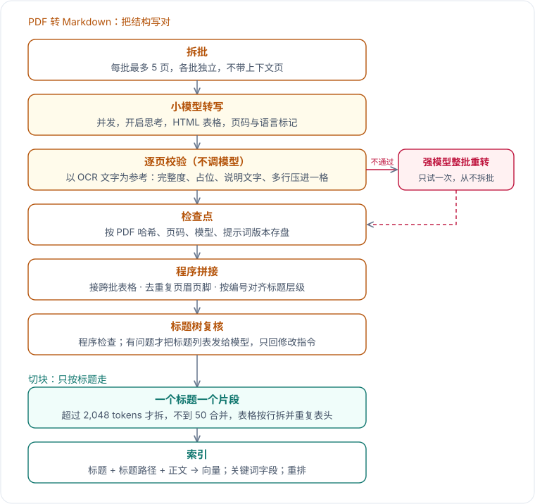

知识库里真正维护的是一份 **Markdown**。PDF、网页、人工补充的资料都转成同一种 Markdown 约定，问答本身也是 Markdown 文件。切块不关心内容从哪里来，只读 Markdown 的结构：**标题树决定片段的边界，段落、列表、表格决定片段内部能在哪里切开**。

如果把知识库看成一座图书馆，Markdown 的标题树就是每本书的目录：它决定一本书能拆成哪些章节，每一段属于哪一章。切块按这份目录走，每个片段都带着完整的标题路径；检索命中片段后，对话模型知道这段话出自哪一章、哪一条，需要更多上下文时还能沿标题路径取回整节。目录错了，片段就会切在条款中间，或者挂到错误的章节下面，所以**结构要在生成 Markdown 时写对**。

至于按目录切多细，是由评测决定的。同一套 50 道题、同一批文档上（混合检索，MRR@10），一个标题一个片段比把几个标题装进一个片段更好：

| 切块方式 | MRR |
| --- | ---: |
| 整棵标题子树装进一个大片段（上限 2,048 tokens） | 0.793 |
| 按标题树装箱到约 512 tokens | 0.864 |
| **一个标题一个片段**（超过 2,048 tokens 才拆） | **0.889** |

在此基础上，PDF 转写时让没有标题的编号条款各自分段，再做标题复核，向量检索 MRR 从 0.899 升到 0.918，R@10 达到 100%。切块规则不变，变的只是切块之前的 Markdown。

文档以长篇条款类资料为主：合同、条款书、说明书，中英双语，PDF 里双栏排版、跨页表格、合并单元格很常见。知识库的整体结构在[上一篇](../knowledge-base-architecture/)里。

## 一、参考做法

| 来源 | 建议 |
| --- | --- |
| Microsoft Learn《Chunk large documents》 | 固定大小切块从 512 tokens、25% 重叠起步，10–15% 的重叠也常用 |
| Azure《RAG 解决方案：切块阶段》 | 结构清晰的文档按结构切；也介绍了语义切块和用模型生成片段 |
| Amazon Bedrock Knowledge Bases | 提供固定大小、层级、语义切块；含表格和图片的文档建议用基础模型解析 |
| Google Document AI Layout Parser | 一个片段里的文字都来自同一个版面元素（标题、子标题、列表） |
| 论文《Financial Report Chunking for Effective RAG》 | 按文档的结构元素切块，比按段落切更好，而且不用调片段大小 |
| 论文《Is Semantic Chunking Worth the Computational Cost?》 | 语义切块的计算代价换不来稳定的效果提升 |

固定 512 tokens 是面对未知文档时的起点。对有清楚标题和条款编号的文档，按结构切块通常更好，但有一个前提：**拿来切块的文本里，结构必须是对的**。所以我们把"结构"放进 Markdown 约定里，由生成 Markdown 的那一步负责。

## 二、一份 Markdown，一套约定

不同来源各自转成 Markdown，但遵守同一套约定：

| 来源 | 怎么变成 Markdown |
| --- | --- |
| PDF | 视觉模型分批转写，程序校验、拼接，再复核标题树（第三、四节） |
| 网页 | 从页面的组件数据转换；页面上的问答折叠项抽出来放进问答文件，正文里去掉 |
| 人工补充 | 直接写 Markdown，或由 DOCX 等文件转换，经 PR 审核 |
| 问答 | 每个层级一个问答文件，一个问题一个标题，下面是答案 |

约定的内容：

- **标题**：只用 `#`–`######`，不跳级；`#` 只给文档标题（双语文件每种语言一个）；部分、章节、带标题的条款都写成标题；没有标题的编号条款每条单独成段，不编造标题。
- **表格**：一律写成 HTML 表格。超过一半的表格有合并单元格和多行表头，管道表格表达不了；短的列标签放进表头；网页里已有的管道表格也按表格处理。
- **列表和段落**：CommonMark 列表，子项缩进到上一级的正文起始列；跨页断开的段落接回去。
- **标记**：页码和语言写成 HTML 注释（`<!-- page: 12 -->`、`<!-- lang: en -->`），不显示，但切块时能读出页码和语言；程序生成的目录放在注释包住的区域里，不进入片段。
- **不放杂项**：页眉页脚、标志文字、导航按钮不写进正文；归属、版本这类元数据放在旁边的 YAML 里。

约定的好处是：**切块器只依赖 Markdown，不依赖来源**。新增一种来源，只要输出满足约定就能直接切块；约定本身也能用程序检查（标题跳级、表格闭合、页码连续），每种来源都跑同一套检查。

一个虚构的例子：

```markdown
# 债券募集说明书
## 第三节 赎回条款
### 3.1 赎回条件
发行人可在下列任一情况下提前赎回……
1. 利率变动导致……
2. 税务规定变更……
### 3.2 赎回价格
<table>…</table>
## 第四节 违约事件
```

切出来的片段（标题路径 › 内容）：

- `债券募集说明书 › 第三节 赎回条款 › 3.1 赎回条件`：赎回条件的全文，两条编号条款各自成段；
- `债券募集说明书 › 第三节 赎回条款 › 3.2 赎回价格`：整张价格表；
- `第三节 赎回条款` 本身只有一行标题，不到 50 tokens，并入相邻片段；
- `第四节 违约事件` 及其下级标题，各自成片段。

## 三、PDF 转 Markdown：让视觉模型直接读 PDF

PDF 是知识库的主体，也是最难满足约定的来源。

版面分析服务（版面 OCR）输出的 Markdown，在这类文档上有几类错误是规则修不好的：

- **双栏被拼成一张表**：左右两栏各是一张"名词 | 定义"，结果被横着拼成四列，一句话分到两行；
- **跨页表格被拆开**：后一页的表格没有表头，以续行开头；
- **数据行被标成表头**：定义表的第一条被当作表头，拆表时每块都重复它；
- **封面背景图被识别成文字**，项目符号没变成列表，表示"定义词"的斜体丢失。

这些错误没有参数可以纠正，换更多选项重新分析，结果和原来的相似度仍是 0.999。另外两条路也不行：PDF 文字层常常乱序、重叠，整页图片的页没有文字层；把 OCR 文字交给大模型整理，模型只能在别人的错误上纠错，输入 tokens 也不比直接给 PDF 少。

所以**把 PDF 页面直接交给视觉模型转写**。模型看得到版面，双栏、表格、图片才转得对。olmOCR 等研究和 Bedrock 的基础模型解析走的也是这条路。



### 每批 5 页，各批独立

- **不整份转写**。小模型面对十几页的输出会拒绝或改用"（以下略）"；大模型在 133 页的文档上写到第 106 页就到了输出上限。
- **每批 5 页**。4–6 页稳定，10 页偶尔放弃；费用由输出决定，批大小几乎不影响费用。
- **不给上下文页**。前一页放进 PDF，模型会把它也转写，页码整体错位；改给文字上下文，遇到整页图片时空文字层会误导模型。接缝全部交给程序处理。
- **小模型开思考**。21 页的样本，关闭思考时 5 批全部不通过，开启后 5 批一次通过，总成本更低。

### 逐页校验，不调模型

参考文字是 OCR 读出的这一页（OCR 的结构不可靠，但字基本都读得出来）：

| 检查 | 不通过的条件 |
| --- | --- |
| 完整度 | 字母、数字、汉字的覆盖率低于 90%；按字符多重集合计算，不受阅读顺序影响，允许和相邻页合计 |
| 占位和拒绝 | 出现"以下略""I am unable"之类 |
| 模型自己的说明 | 某行在说"本页续上页表格"，而这行字没有印在页面上 |
| 多行压进一格 | 一行表格里两个以上单元格各含多个换行：模型把"名称列表 + 数值列表"塞进了两格，对应关系只能靠位置猜 |
| 截断、页码 | 输出没有正常结束；页码标记缺失或重复 |
| Markdown 规则 | 表格外出现竖线表格；"第 X 条""Section n"开头的独立行没有写成标题 |

有一页不通过，就**整批交给更强的模型重转一次**，从不拆批，一批的页总在同一次请求里，表格不会被切断。小模型只试一次，第二次通常卡在同一页。

### 检查点和程序拼接

- **每批通过就存检查点**，键是 PDF 哈希、页码范围、模型和提示词版本。一批失败不影响其他批，重跑只补没完成的。
- **规则改了先复查已存的输出**。全库 48 份转换失败的文档，按新规则复查后 34 份直接通过，不用再发请求。
- **拼接由程序完成**：补上没闭合的表格；去掉多批重复的页眉页脚；下一批以表格行开头、或表头和列数相同，就接进上一张表；按编号样式（"第 X 部分""Section n""(a)""1.1"）统一各批的标题层级；把项目符号和换行改成合规的 Markdown。

### 提示词的教训

- **示例是最强的信号**，模型会照着示例的格式写，包括错误的格式。示例要虚构、彼此不同，并标明"仅作说明"。
- **保留"长页也要写全"**。去掉这句，模型会把密排表格页写成空页。
- **不写"会逐字比对"一类的话**，模型会因为怕错而放弃整页。

## 四、标题树复核

按标题切块，标题树就必须对。分批转写后仍有个别标题级别错位，例如一串同级条款中间夹着一个高了一级的标题。做法：

1. **程序先检查**：标题跳级；同类标题（编号方式或结尾文字相同）级别不一致；编号上的前一项级别不同；印刷目录里有、正文里却不是标题的条目。
2. **检查出问题才调用一次模型**，只发标题列表（附页码和正文长度）、检查结果和印刷目录，不发正文，只占文档的 2–10%。
3. **模型只返回修改指令**："这个标题改成几级""这一行不是标题""这个候选行是标题"。程序执行指令，正文一个字不改。
4. **目录由程序根据标题生成**，记录标题列表的哈希，标题没变就不再复核。

7 份样本里，模型提出 66 处修改，程序检查出的问题从 19 个降到 11 个，剩下的都是误报。

## 五、切块规则：按标题层级切

切块器只读 Markdown，分四步：

1. **拆成块**。把正文拆成标题、段落、列表、表格（HTML 表格和管道表格）几类块，从注释里读出页码和语言；去掉印刷出来的目录页、每页重复的页眉页脚和装饰行，跨页断开的段落接回去。
2. **建标题树**。按 `#` 的个数建树，允许跳级（`##` 下面直接 `####`）；每个块挂在它前面最近的标题下，得到完整的标题路径。
3. **一个标题一个片段**。任何级别的标题连同它自己的正文（到下一个标题为止）是一个片段，下级标题各自成片段，不和上级合并。层级越深，内容越具体，片段也越"纯"。
4. **按块调整大小**：
   - **太长才拆**：超过 2,048 tokens 才拆，先在段落和编号条款之间切，单个段落太长才按句子切。切点用动态规划选，各块大小尽量接近；在条款开头切不扣分，在子项、列表或句子中间切代价很高。
   - **表格**：不超过上限就整张保留；更大的只在整行之间拆，每块重复表头。只有短的、不含句末标点的行才算表头，因为转写和 OCR 都会把定义表的第一条误标成表头。
   - **太短就合并**：不到 50 tokens 的片段（只有标题，或一两行）并入相邻片段，只有标题的片段向量化效果很差。

问答文件另有一条规则：**一条问答一个片段**，问题作为片段标题，不再切。

每个片段带着标题路径、页码和在原文中的位置：

- **向量化的输入**是"文档标题 + 标题路径 + 片段正文"，表格转成"单元格 | 单元格"的纯文本；标题路径也单独建字段，参与关键词检索和重排。
- **片段 ID 由来源、标题路径和内容决定**。内容没变，ID 就不变，只有新片段才重新算向量；切块结果记录规则版本，规则升级就全部重切。
- **可以从片段往上走**。检索命中一个小片段后，可以按标题路径取回整节甚至整篇，给对话模型更完整的上下文；索引里已有标题路径和位置，不用改索引。

**为什么要上限**。全库约 10 万个标题，自己的正文中位数是 118 tokens，P99 是 1,867，超过 2,048 的只有 0.8%，主要是大表格，但其中几十个超过了向量模型的输入上限。另有 21.8% 不到 50 tokens，需要合并。所以绝大多数标题本来就是一个片段，上限只对少数大表格起作用。上限 2,048 和 6,000 的评测结果几乎一样，选了留有余量的 2,048。

**更细的结构在生成 Markdown 时处理**。没有标题的编号子条款（"1. ……""2. ……"）不编造标题，只要求每条单独成段：它们仍在同一个片段里，超过上限时可以在条款之间切。这就是开头 0.899 到 0.918 的来源之一。

## 六、实现：用库还是自己写

在同一批 Markdown 上，比较了几个常用切块库。指标只看内容、不看输出格式，衡量结构有没有被破坏（5 份样本合计）：

| 方案 | 表格行被切断 | 能放下却被切开的小节 | 不到 50 tokens 的碎片 |
| --- | ---: | ---: | ---: |
| 自己实现的按标题切块 | 0 | 0 | 0 |
| chonkie（正确配置） | 0 | 4 | 13 |
| LangChain（正确配置） | 0 | 6 | 36 |
| Docling HybridChunker | 40 | 18 | 19 |
| 微软官方示例的切分器 | 16 | 95 | 12 |

- **先确认配置正确再下结论**。默认配置下，chonkie 的 Markdown 规则可能下载失败而退回默认规则，LangChain 会把 HTML 表格当普通文本切，表格损坏严重；正确配置（chonkie 加表格切分器，LangChain 先把表格单独取出）后，两者都能做到表格零损坏。
- **Docling 不适合"Markdown 里夹 HTML 表格"的输入**，不同行的内容会被拼到一起。
- **库的输出里 16–18% 的 tokens 是 HTML 标签**，所以向量化前要把表格转成纯文本。
- 实现上沿用 chonkie 的接口，拆表格、拆句子用它的组件，自己只维护它没有的部分：标题路径、页码、HTML 表头的识别。

## 七、为什么最终是这个方案

RAGFlow、WeKnora 和 Azure AI Search 的方向和我们一致，都是按结构切块。差别在四个具体选择上：

| 选择 | 现成平台的做法 | 我们的做法和原因 |
| --- | --- | --- |
| 谁来解析 | RAGFlow 用自带的 DeepDoc（版面分析、OCR、表格识别），可换成 Docling、MinerU 或视觉模型；WeKnora 用文档解析服务，支持 OCR 和 MinerU；Azure 的 Document Layout 技能用版面 OCR 输出带标题的 Markdown。解析结果直接进切块 | 视觉模型转写，外面加逐页校验、整批重转和程序拼接。版面 OCR 的问题是实测出来的（第二节）；没有校验的解析器，说不出哪一页漏了内容 |
| 结构在哪一步定 | 切块时识别：RAGFlow 的 Title Chunker 按正则匹配标题；WeKnora 先找 Markdown 标题，没有就找编号、分页等线索，再不行按长度递归切，并用校验器判断每层结果 | 在生成 Markdown 时定，PDF 再做一次标题复核；切块只读 Markdown 标题，不猜结构。结构错了，改转换规则或提示词，结果在 PR 里可以审 |
| 切多细 | WeKnora 按文档中主要的那一级标题切，下级标题留在同一片段；RAGFlow 的 Title Chunker 默认上限 512 tokens；Azure 按 Markdown 小节切，小节内再按长度切 | 每一级标题单独成片段，上限 2,048。评测里比按标题树装箱高 0.025 MRR，比大片段高近 0.1（开头的表格）。可能的原因是这类文档每个条款都有自己的标题，片段越纯，向量越准 |
| 表格 | RAGFlow 可以给表格附带前后文；WeKnora 把表头加到续块上 | 源文件用 HTML 表格，按整行拆并重复真正的表头；向量化时转成纯文本 |

代价是各来源的转换和切块都要自己维护，并为它们写测试；换来的是每一步都能单独检查、单独重跑。RAGFlow 和 WeKnora 没有在我们的数据上跑过对比，"切多细"的结论来自我们自己的评测。用这些平台时，可以把切分的标题级别调深、上限调大，再用自己的评测集验证。

没有采用的做法：

| 做法 | 为什么不用 |
| --- | --- |
| 固定大小切块 | 表格被切断几十处，能放下的小节被切开的最多 |
| 语义切块 | 这类文档的标题就是最好的话题边界；按句子算向量的成本高几倍，研究也显示提升不稳定 |
| 让大模型决定切点或直接生成片段 | 每次结果可能不同，片段 ID 一变增量更新就失效；也很难用程序确认没有漏掉或改写内容 |
| Late Chunking | 需要能返回 token 级向量的长文本向量模型，换模型就要全量重建索引 |
| 让模型另写一份目录给切块用 | 结构会有两个来源，还要判断目录是否过期；标题本身就是结构 |
| Contextual Retrieval | 有公开数据支持，和切块方式无关；列为后续增强，等评测集扩大后再评估 |

## 八、检索指标测不出什么

修复切块规则、复核标题前后，检索排名几乎持平。它们的价值不在"对的文档排在前面"，而在"排在前面的片段是不是完整的条款、标题路径对不对"，这直接影响结果的显示和问答时引用条款的质量。

所以我们的规则是：**排名指标用来选检索方式，结构指标用来选切块规则**。表格行有没有被切断、能放下的小节有没有被切开，都写成了自动测试，在十几份真实文档上每次运行。答案级的指标，等扩充评测集时一起做。

## 参考

- Microsoft, [Chunk large documents for vector search solutions in Azure AI Search](https://learn.microsoft.com/en-us/azure/search/vector-search-how-to-chunk-documents)
- Microsoft, [Develop a RAG Solution on Azure: Chunking Phase](https://learn.microsoft.com/en-us/azure/architecture/ai-ml/guide/rag/rag-chunking-phase)
- Microsoft, [Document Layout skill](https://learn.microsoft.com/en-us/azure/search/cognitive-search-skill-document-intelligence-layout)、[Chunk and vectorize by document layout](https://learn.microsoft.com/en-us/azure/search/search-how-to-semantic-chunking)
- RAGFlow, [项目主页](https://github.com/infiniflow/ragflow)，文档《Configure the Chunker Component》《Configure the Parser Component》《Configuration》（仓库 `docs/guides/`）
- Tencent, [WeKnora](https://github.com/Tencent/WeKnora)，切块实现见 `internal/infrastructure/chunker/`
- Amazon Web Services, [How content chunking works for knowledge bases](https://docs.aws.amazon.com/bedrock/latest/userguide/kb-chunking.html)
- Amazon Web Services, [Parsing options for your data source](https://docs.aws.amazon.com/bedrock/latest/userguide/kb-advanced-parsing.html)
- Google Cloud, [Use Document AI layout parser with RAG Engine](https://cloud.google.com/vertex-ai/generative-ai/docs/rag-engine/layout-parser-integration)
- Jimeno Yepes et al., [Financial Report Chunking for Effective Retrieval Augmented Generation](https://arxiv.org/abs/2402.05131)
- Qu, Tu, Bao, [Is Semantic Chunking Worth the Computational Cost?](https://arxiv.org/abs/2410.13070)
- Günther et al., [Late Chunking: Contextual Chunk Embeddings Using Long-Context Embedding Models](https://arxiv.org/abs/2409.04701)
- Poznanski et al., [olmOCR: Unlocking Trillions of Tokens in PDFs with Vision Language Models](https://arxiv.org/abs/2502.18443)
- Auer et al., [Docling Technical Report](https://arxiv.org/abs/2408.09869)
- Anthropic, [Contextual Retrieval](https://www.anthropic.com/engineering/contextual-retrieval)
- [chonkie](https://github.com/chonkie-inc/chonkie)、[LangChain Markdown header splitter](https://python.langchain.com/docs/how_to/markdown_header_metadata_splitter/)、[azure-search-openai-demo](https://github.com/Azure-Samples/azure-search-openai-demo)
- [CommonMark Spec](https://spec.commonmark.org/0.31.2/)、[GitHub Flavored Markdown Spec](https://github.github.com/gfm/)
