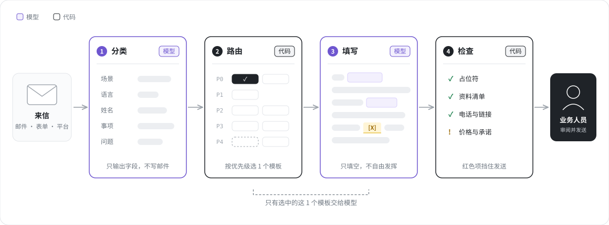

很多岗位每天都在做同一件事：收到一封来信，判断是哪种情况，找出对应的标准回复，填上对方的信息，然后发出去。销售回询价，客服回咨询，招生办回申请，物业回报修，人事回求职者，都是这样。

这类回复有两个特点：**情况是有限的几种，每种都有写好的模板；而说错一句话的代价很高。** 模板里的资料清单一项都不能少，电话和链接是固定的，价格、交期、承诺更不能随口给。

拿一封外贸询盘来说：

> We need 5000 pcs of the LP-series panel with our own logo on the frame and the box. What is your best price?

如果让模型直接写回复，它多半会很“热心”：报一个大概的单价，顺手承诺免运费，再补一句“30 天内交货”。每句话都很通顺，可每一句都没人授权过。

真正需要“想”的部分其实很少：这是哪种情况？用什么语言回？对方叫什么、问了什么？所以这个 Agent 的分工很简单：**模型负责读懂来信和填空，代码负责选模板和检查，业务人员负责审阅和发送。**

下面用一家照明出口商的询盘收件箱作为例子，但这套做法本身和行业无关。

## 先玩一下

下面嵌入的是原型本身。翻页时原型会切到对应场景，红框标出这一页讲的内容；也可以[在新窗口打开](/demos/inquiry-reply/)自由体验。


### ① 收件箱和四个步骤
来信来自 B2B 平台、官网表单和直接来信。打开一封，Agent 依次完成分类、路由、填写、检查四步，然后给出草稿。
<!-- step: layout -->
---
### ② 只问了价格，也要先收资料
Jonas 只问了“best price”，但要印自有 Logo，属于定制。定制报价的优先级高于一般报价，所以先用资料清单收齐参数。
<!-- step: priority -->
---
### ③ 9 个模板选 1
代码按优先级从上到下匹配，命中第一个就停。只有选中的这一个模板会交给模型。
<!-- step: route -->
---
### ④ 模型只填空
紫色是模型填进去的：对方姓名和产品名。其余每个字都来自模板。
<!-- step: fill -->
---
### ⑤ 留给人的空
报价要几个工作日，模型不知道，也不该猜。这个空留给业务人员，直接在正文里填；没填完不能发送。
<!-- step: blank -->
---
### ⑥ 表单说了算
留言是中文，但对方在表单里选了 English。明确的选择优先于内容判断，所以只用英文回复。
<!-- step: language -->
---
### ⑦ 模板没写的，不回答
“有没有独家代理”是商务决定。模型只加一句话：会由同事确认，并附上电话。
<!-- step: redirect -->
---
### ⑧ 兜底和双语
没有姓名、没有留言，只有一个产品名：落到产品资料模板，用通用称呼。语言也判断不出，就按模板要求，中英双语。
<!-- step: bilingual -->
---
### ⑨ 改了就重新检查
业务人员在正文里加了一句 “free shipping”，检查立刻标出来：模板里没有这个承诺，需要主管确认。
<!-- step: checks -->
---
### ⑩ 判断错了，人来改
场景菜单按优先级分组，并标出还有哪些模板也命中了。改过的地方会显示“已手动调整”，可以一键恢复。
<!-- step: override -->


## 为什么不让模型直接写？

最省事的做法，是把所有模板塞进提示词，让模型“参考着写一封”。这也是问题最多的做法：

- **编造条款。** 模型想帮忙，会回答模板里没有的问题：价格、交期、优惠。
- **清单被精简。** 八项必填资料被压成三句话，对方回了一封，业务人员还得再问一轮。
- **号码和链接搭错。** 不同模板的电话、链接很像，模型容易混用。
- **语言不稳定。** 双语回复有时漏掉一种，有时顺序颠倒。

根子上是两件事：上下文里的模板太多，注意力被稀释；模型分不清自己是在“填模板”，还是在“回答问题”。

## 四步：哪几步交给模型？

- **分类（模型）**：读懂来信，只输出几个字段：场景、语言、对方姓名、涉及的产品或事项、具体问题。它不写邮件。
- **路由（代码）**：按优先级选出唯一的模板，决定单语还是双语，填好电话和链接。这一步没有模型。
- **填写（模型）**：只拿到这一个模板，把姓名等信息填进去；模板没覆盖的问题，最多加一句引导。
- **检查（代码）**：发送前逐项核对，业务人员每改一次就重新检查一次。

模型出现了两次，但每次的任务都很窄：一次只输出字段，一次只填空。

## 一封来信命中好几个场景怎么办？

Jonas 那封既是“定制”，也是“问价”。如果按一般报价回一句“我们会尽快报价”，之后还得再追一轮资料。

所以场景要排优先级，从上到下匹配，命中第一个就停。优先级不按行业定，而按**回错的代价**来定：

| 优先级 | 什么样的场景 | 例子中的场景 |
|---|---|---|
| P0 | 必须先收齐资料才能往下走，漏掉代价最大 | OEM 定制、工程项目报价 |
| P1 | 有独立流程的请求 | 样品申请 |
| P2 | 来自特定渠道，回复要带专属页面或代码 | 经销合作、展会跟进 |
| P3 | 已有业务的下一步 | 收到采购订单、不接受报价 |
| P4 | 兜底，其他都没命中时使用 | 一般报价、产品资料 |

换到客服，P0 可能是投诉和理赔；换到招生，可能是补交材料。这个顺序是业务规则，不是模型的判断，所以写在代码里：可以测试，也可以随时调整。

## 用什么语言回？

- **对方明确选了，就用对方选的。** 表单里的语言偏好优先于一切，即使留言用的是另一种语言。
- **没选，就看内容。** 根据来信正文判断。
- **还判断不出，就用默认语言。** 例子里默认英文。
- **单语还是双语，由模板决定。** 对方明确选过语言，就只用一种；没选的话，有些模板会要求双语，英文在前。

姓名和公司名原样使用，不翻译也不改写：“李工”就是“李工”。

## 模型答不了的问题

来信里常常夹着具体问题：“能免运费吗？”“有独家代理吗？” 模型对每个问题只有两种处理：

- **模板已经覆盖。** 比如“3 个型号各 2 个”正好在样品规则之内，不用另外写什么。
- **模板没有覆盖。** 加一句话承认这个问题，说明会由同事确认，并附上电话。不给答案，也不给“大概”。

价格、交期、优惠、资格，都是要有人负责的承诺，不该由模型说出口。

## 发送前查什么？

检查由代码完成，结果直接显示在草稿上方：

- **占位符**：比如“[X] 个工作日”，没填就不能发送。
- **资料清单**：模板里有八项，草稿里就得有八项。
- **电话和链接**：只能是这个模板里的。
- **价格与承诺**：出现模板以外的价格、折扣，或者“免运费”“保证”这类词，就提醒找主管确认。
- **语言**：英文回复里不能混进中文。

红色项会挡住发送，黄色项只是提醒。最后按下“发送”的，始终是业务人员。

## 什么时候适合这样做？

只要同时满足三个条件，就值得考虑：

- 来信能归到**有限的几类场景**；
- 每类场景都有**写好的标准回复**；
- 一句**说错的承诺**代价很高。

不满足的时候，比如问题千变万化、答案要从大量资料里找，更适合[客服 Copilot](/posts/agent-assist-design/) 那种基于知识检索起草回复的方式。至于邮件怎么进来、怎么分流，可以参考[基于邮件的业务处理模型](/posts/email-triage-realtime/)。

## 写在最后

这个 Agent 里，模型做的事很少：读懂一封信，填几个空。正因为做得少，它才可靠。

把模板写好、把优先级理清楚，比反复调提示词更重要。剩下的，交给代码去检查，交给人去决定。
