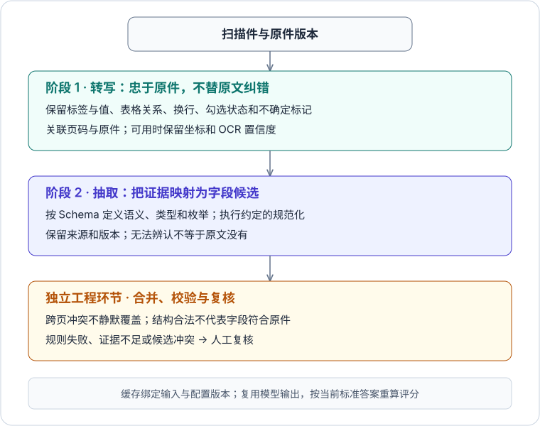
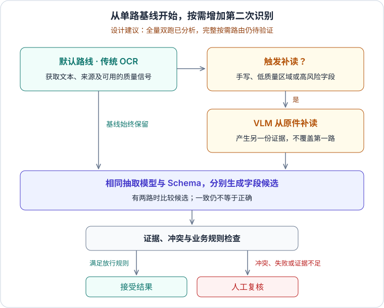

在一次完整文档测试中，表现最好的路线通过了 **4,732 条字段断言中的 4,452 条，字段通过率为 94.08%**。

这个数字看起来已经不错。但换一个问题——“有多少份文档的受测字段全部正确？”——答案是 **38 份中的 6 份**。

不是模型突然变差了，而是两个指标回答的根本不是同一个问题。字段通过率适合比较系统；一份转账指令能不能直接进入下一步，还要看错的是不是金额、账号或授权选项。即使只有一个字符错误，也可能需要整份退回复核。

这也是我们不再满足于“把 PDF 交给多模态模型，让它返回 JSON”的原因。JSON 能解析，只说明格式可用；要让结果可以交付，还得知道：

- 字段是否真的出现在原件上，模型有没有读错？
- 文字读对以后，有没有放错字段、丢掉限定条件？
- 哪些结果可以自动接受，哪些必须回到原件核对？

本文结合 VLM_Playground 中的逐页测试、抽取测试、完整文档缓存和 Schema 兼容性实验，重新梳理这几个问题。**核心不是证明某个大模型胜出，而是把错误变得可定位、可回放、可验收。**

> **阅读边界**
>
> 本文是特定金融、保险及相关业务表单上的工程实验，不是通用 OCR 排行榜。模型名称沿用测试平台当时的标签，结果包含模型、接入平台、输入方式和提示词的共同影响，不代表当前所有 API 的能力。文中只展示汇总数据；示例均为虚构。

## 一、先把实验和指标分清楚

文档覆盖成交确认单、投保申请表、财务需求分析、付款方式表和风险问卷，包含中英混排、手写、表格、签名和勾选框。项目先后做过不同规模的实验，不能把它们拼成一张排行榜。

| 实验 | 样本与输入 | 实际回答的问题 |
|---|---|---|
| 逐页转写 | 2026 年 7 月报告：7 个视觉模型、18 个单页用例、500 多条内容断言 | 页面上的关键内容有没有被保留下来？ |
| 文本抽取 | 同期报告：4 个文本模型、15 个用例；固定使用同一来源的转写文本 | 在读到相同文字的前提下，模型如何映射字段？ |
| 完整文档 | 2026 年 8—9 月调用缓存；按当前标准答案重算，得到 38 份可完整比较的 PDF、4,732 条断言 | 换掉前端 OCR 后，最终字段结果有什么差异？ |
| 大 Schema 兼容性 | 2026 年 7 月实验：11 个模型、约 384KB 的 Schema | 请求能否被接受、输出是否包含预期的顶层字段？ |

本文使用三个不同层级的指标：

1. **字段断言通过率**：通过的断言数除以参与评分的断言总数。完整文档实验将所有字段合并计数，字段多的文档权重更大。
2. **页面或用例通过率**：该页或该用例的所有关键断言通过，才记一次通过。
3. **文档全通过率**：整份文档的所有受测断言通过。它仍然不等于“原件上的所有信息都正确”，因为断言只覆盖被检查的部分。

尤其要注意：**单页内容断言的通过率，不是字符识别准确率；大 Schema 的顶层字段齐全，也不是字段值正确。**

## 二、完整文档测试：传统 OCR 仍然是有力的基线

这一轮有四条自建路线：Azure Document Intelligence，以及三个视觉大模型。它们的输出都接同一个抽取模型 GPT-5.5，使用相同的抽取提示词和对应文档的 Schema。

另有一个现有一体化服务作为业务基线。它保留自己的内部处理链路，**并没有换成我们的统一抽取阶段**，因此不能把它与其他路线的差异全部归因于 OCR。

当前有 40 个文档用例，其中 38 个在五条路线下都有有效抽取结果。下面只比较这 38 份共同样本；缺少完整结果的 2 份不进入分母。这让横向比较保持一致，但也意味着：**下表不衡量请求成功率，生产评估必须另记失败、缺失和超时。**

### 2.1 总分领先，不代表整份文档最容易一次通过

| 路线 | 字段断言通过数 | 字段通过率 | 文档全部通过 | 平均阶段耗时 / 文档 |
|---|---:|---:|---:|---:|
| Azure Document Intelligence + 统一抽取 | 4,452 / 4,732 | **94.08%** | 6 / 38 | **58.4 秒** |
| Claude Opus 4.8 + 统一抽取 | 4,407 / 4,732 | 93.13% | 9 / 38 | 112.3 秒 |
| Claude Sonnet 5 + 统一抽取 | 4,330 / 4,732 | 91.50% | 9 / 38 | 135.1 秒 |
| 现有一体化服务 | 4,295 / 4,732 | 90.77% | 8 / 38 | 129.9 秒 |
| Gemini 2.5 Pro + 统一抽取 | 3,740 / 4,732 | 79.04% | 3 / 38 | 143.7 秒 |

耗时来自缓存中记录的 OCR 与抽取阶段耗时之和，不是线上端到端延迟；一体化服务的计时来源也不同。它们可以帮助估计量级，但不能替代相同并发、重试和排队条件下的压测。

Document Intelligence 在总字段上领先，记录的平均阶段耗时约为 Opus 路线的一半；Opus 和 Sonnet 的整份全通过数却更多。这里没有矛盾：一种路线可能在许多文档上各错少量字段，另一种可能把错误集中在少数文档里。

因此，**模型选择至少要同时看总字段、整份文档和关键字段，不能只取一个平均分。** 两条领先路线相差不到 1 个百分点，这个样本也不足以支持普遍性的排名结论。

### 2.2 空字段会改变总分的观感

4,732 条断言中，有 **1,524 条期望为空，占 32.2%**。正确保留空值很重要：它能检查模型有没有凭空填内容。但空值和真实填写内容的难度不同，最好拆开看。

以 Document Intelligence 路线为例：

| 标准答案类别 | 通过数 | 通过率 |
|---|---:|---:|
| 非空字段 | 2,968 / 3,208 | 92.52% |
| 空字段 | 1,484 / 1,524 | 97.38% |
| 合计 | 4,452 / 4,732 | 94.08% |

总体的 94.08%，不能直接理解成“所有填写内容有 94.08% 读对了”。反过来，空字段的错误也不能忽略：没有授权却抽出了“已授权”，可能比漏掉一个普通文本字段严重得多。

### 2.3 文档类型比“谁最强”更有用

总体分数还会掩盖不同表单之间的差异：

| 文档类别 | 样本数 / 断言数 | Document Intelligence | Claude Opus 4.8 | Gemini 2.5 Pro |
|---|---:|---:|---:|---:|
| 成交确认单 | 9 / 1,087 | 98.5% | 99.1% | 98.0% |
| 一类较长的投保表单 | 7 / 1,381 | 93.6% | 93.0% | 74.1% |
| 付款方式表 | 4 / 77 | 80.5% | 92.2% | 90.9% |

这支持一个务实的起点：**不要为了引入 VLM 就先移除传统 OCR。** 在本批文档上，传统 OCR 是可靠且较快的默认候选；付款方式等含手写关键内容的表单，值得单独评估视觉模型补读。

但最后一行只有 4 份文档、77 条断言，不能据此宣布某个模型“最擅长所有手写”。它适合提出下一轮实验，而不是结束选型。

## 三、分阶段测试：问题卡在了哪里？

### 3.1 转写的弱点，往往是局部而致命的

18 页转写测试的页面通过情况如下。这里的“通过”是受测关键内容断言全部通过，不是逐字符无误。

| 模型标签 | 通过页面 |
|---|---:|
| Gemini 3.1 Pro Preview | 16 / 18 |
| Claude Opus 4.8 | 15 / 18 |
| Claude Sonnet 5 | 15 / 18 |
| Gemini 2.5 Pro | 14 / 18 |
| GPT-5.4 | 12 / 18 |
| Qwen3 VL 235B | 10 / 18 |
| GPT-4.1 | 7 / 18 |

比排名更值得看的是失败模式：

- 一张密集勾选框页面，**7 个模型全部未通过**。选项文字在，选中状态却丢了或错位了。
- 一张手写长数字页面，**4 个模型读错**。在印刷文本上表现很好的模型，也会把其中一两位看错。
- 中文形近字、金额旁的限定语、签名与旁边印章的归属，都会造成“整段看起来没问题，关键字段却不对”的结果。

测试通过不同接入路径输入页面：部分模型使用 PDF，部分走图片回退，PDF 路线也存在个别回退记录。因此，**不能从这张表推断 PDF 一定优于图片，更不能把接入层行为写成整个模型家族的固有限制。**

同样，Gemini 2.5 Pro 的单页结果是 14/18，完整文档结果是 79.04% 的字段通过率。这两个百分比既不是相同样本，也不是相同指标，不能叫作“从单页准确率下降到整份准确率”。长表单上的遗漏值得排查，但要量化分块是否有帮助，必须拿同一批文档做配对实验。

### 3.2 固定转写文本，才能比较抽取模型

抽取实验固定使用 Claude Sonnet 5 生成的转写文本，让四个文本模型读取相同内容。同期报告记录：

| 抽取模型 | 字段断言通过率（约） | 用例全部通过 |
|---|---:|---:|
| Gemini 2.5 Pro | 97% | 11 / 14 |
| Claude Sonnet 5 | 95% | 10 / 14 |
| GPT-4.1 | 97% | 10 / 15 |
| GPT-4.1 Mini | 96% | 9 / 15 |

报告计划覆盖 15 个用例，但前两个模型的汇总分母是 14。这里保留原始分母，不把缺少的记录自动算作成功，也不把这组数据当成完全配对的比较。

结果说明，小模型值得作为抽取阶段的候选；它**没有证明“转写正确后，抽取几乎不会出错”**。固定的转写文本本身仍含错误，测试里也有明确的抽取问题：地址行合并、字段语义边界不一致，以及清理规则没有执行。

要严格区分两种错误，应做两组测试：

- **真实转写输入**：衡量实际链路效果，看上游错误如何传播。
- **人工校正的转写输入**：尽量隔离读图错误，观察抽取模型本身。

在当前证据下，更稳妥的结论是：**不要先假设换一个更强的抽取模型就能修复整条链路。先检查它收到的文字。** 原文中的一位数字已经读错，文本模型再强也不能凭空知道正确答案。

## 四、两阶段架构：中间文本是一份可检查的契约

所谓“两阶段”，是指两次模型任务：先转写，再抽取。校验、跨页合并和人工复核是其后的工程环节，不是再让一个模型“检查一下”就结束。



拆开的价值不是保证更高分，而是让每一步可以被检查和替换：

| 环节 | 应保留的结果 | 出错后怎么查 |
|---|---|---|
| 转写 | 原始响应、页码、文字与表格关系；可用时保留坐标和置信度 | 回到对应页面，确认有没有读错或遗漏 |
| 抽取 | 字段候选、所用转写版本、Schema 与提示词版本 | 对照输入文字，确认映射和规范化规则 |
| 合并与校验 | 来源、冲突、校验结果、复核状态 | 确认跨页归属，以及结果为何被接受或拦截 |

改字段定义时，只要现有转写包含所需证据，就可以复用转写，仅重跑抽取。若新增字段依赖转写时已经丢掉的布局、图章或勾选状态，仍然要重做识别。

这条边界很重要：**Markdown 是方便抽取的中间表示，不是原件的无损替代品。** 只有一段流畅的文字，没有页码和原件关联，仍然很难审计。

### 4.1 转写要保存关系，而不是美化原件

下面是一个虚构的转写片段：

```markdown
## 第 2 页：付款资料

| 字段 | 原文 |
|---|---|
| 付款金额 | HK$12,800；最低付款额 HK$1,500 |
| 付款方式 | [x] 银行转账；[ ] 支票 |
| 通讯地址 | 示例大厦 8 楼<br>示例路 10 号 |
| 授权编号 | AB[unclear]7 |
```

下游要能分清“付款金额”和“最低付款额”，而不是把两个数字挑一个；要能识别选中的是转账，而不是只看到“银行转账、支票”两个候选词。

转写规则因此应当很具体：

- **标签和值保持关联**：表格要保留列关系；同一字段旁的单位、限定语不要丢。
- **保留有意义的换行**：多行地址等内容可用 `<br>` 表示，不在转写时擅自合并。
- **显式记录选择状态**：`[x]` 与 `[ ]` 不可省略；看不清状态时标记不确定，不能直接当作未选。
- **不做语义纠错**：形近字、异常拼写和长数字应忠于原件，不按常识“修好”。
- **签名与印章分开**：可辨认文字可以转写；不可辨认部分不要扩写成一个完整姓名。
- **不确定性必须传下去**：`[unclear]` 是待复核信号，不是让抽取模型自由补全的提示。

这些规则是格式契约，不是准确率保证。仍需通过页面断言检查它们是否真的被执行。

### 4.2 逐页、分块还是整份输入，不必一刀切

整份输入能保留上下文，分块则便于控制输出长度、定位失败和局部重跑。两者都可能漏内容，逐页也不会自动消除遗漏。

一个可验证的起点是：短文档尝试整份输入；长文档按页或逻辑章节处理，并显式保留页序、章节和续表关系。跨页姓名、地址和签名在合并阶段核对。

**合并不应简单地“后一个非空值覆盖前一个”。** 同一路径出现两个不同值，应保留各自来源并标记冲突；否则页面识别都正确，最终 JSON 仍可能被合并逻辑改错。

## 五、抽取规则与 Schema：约束格式，不要掩盖事实

转写阶段保存“原件写了什么”，抽取阶段决定“这个字段应该如何表达”。两者的规则不要混在一起。

| 规则类型 | 放置位置 | 示例 |
|---|---|---|
| 通用抽取约定 | 抽取提示词 | 只依据输入证据；不确定内容不得猜填 |
| 字段含义与边界 | Schema 字段描述 | 付款金额不包含最低付款额；日期采用约定格式 |
| 数据类型与枚举 | Schema 结构 | 金额的类型、允许的币种、是否允许 `null` |
| 可确定执行的检查 | 程序校验 | 日期合法性、枚举成员、字段间关系 |

规范化也要有边界。金额可以按约定去掉千分位，但账号和编号应按字符串处理，保留前导零；移除单位之前应先确定币种和数量级。多个实体不宜一律用 `/` 拼接，能用数组表达时应保留结构。

“没有填写”“无法辨认”“不适用”也不一定是同一件事。即使业务 JSON 都使用 `null`，审核元数据仍应区分原因，避免把“没看清”伪装成“原文没有”。

### 5.1 大 Schema 实验最容易被过度解读

约 384KB 的 Schema 在 11 个模型上测试时，出现了几种不同层面的结果：

| 调用方式或路线 | 当时观察到的结果 | 不能据此推出什么 |
|---|---|---|
| GPT-4.1、GPT-4o、GPT-4.1 Mini 的 `json_schema` 路线 | 大 Schema 测试通过 | 不等于 `strict: true` 可用；报告中严格模式另有失败记录 |
| o3、o4-mini 的大 Schema 路线 | 有输出，但缺顶层字段 | 返回 JSON 不等于满足完整结构 |
| Gemini 的大 Schema 路线 | 请求在 Schema 校验阶段被拒绝 | 不能只归因于文件大；Schema 本身的声明也可能不兼容 |
| 当时经 Bedrock 接入的 Claude 路线 | 接入层不接受该 `json_schema` 参数 | 不代表 Claude 的其他端点或后续版本不支持结构化输出 |
| Schema 写入提示词，并使用 JSON 模式 | 11 个模型都返回了 12 个预期顶层字段 | 没有逐字段核对值，也没有因此证明全部嵌套结构正确 |

需要分别验收四件事：**请求是否接受、JSON 是否可解析、结构是否符合 Schema、字段值是否符合原件。** 任何一层通过，都不能代替下一层。

该实验中，GPT-4.1 使用 `json_schema` 时记录的输入量为 40,144 token，Schema 内联时为 52,543 token，约少 23.6%。这是那条接入路径的观测，不是“Schema 不进提示词就不计费”，也不是所有平台通用的节省比例。

### 5.2 优先缩小任务，而不是无限放大 Schema

面对大 Schema，建议按这个顺序处理：

1. **先检查 Schema 自身是否合法**：例如 `required` 中的字段是否在相应 `properties` 中定义。
2. **用实际端点验证支持的子集**：嵌套、组合类型、可空字段和严格模式分别测试，不按模型名字猜能力。
3. **按业务区块拆分**：每次只携带相关字段；保留全局字段和跨页关联需要的上下文。
4. **独立验证输出**：即使使用受约束输出，仍要处理拒绝、截断、类型错误以及语义错误。

“必填但可为 `null`”适合某些严格输出契约，却不是通用的 Schema 瘦身技巧。删掉约束或把所有字段改成可空，也不应该改变原本的业务含义。

拆分可以降低复杂度，但不保证所有平台都支持。若字段散落在多页，还要验证页到区块的映射、漏路由和合并冲突。这是新的工程成本，不是免费的优化。

## 六、两路一致能减少复核，但仍会一起答错

一个自然的想法是：让传统 OCR 和 VLM 各读一遍，结果相同就自动通过。

我们在前面同一组 38 份完整文档上，进一步比较了 **Document Intelligence 路线与 Claude Opus 4.8 路线**。两者各自经过统一抽取后，按字段结果字符串精确比较：

| 指标 | 结果 |
|---|---:|
| 可比较字段 | 4,732 |
| 两路输出一致 | 4,241，占 89.62% |
| 一致且符合标准答案 | 4,232 |
| 一致但都不符合标准答案 | **9** |
| 一致集合内的断言通过率 | 99.79% |

只看标准答案非空的 3,208 个字段，两路有 2,792 个一致，其中仍有 5 个一起答错。因此，这个现象并不只是大量空字段造成的。

结果说明，一致性是有用的筛选信号；也直接说明，**一致性不是正确性的证明**。

这还是同一批数据上的离线分析，没有独立留出集。两条路线共享抽取模型、Schema 和字段定义，可能产生相关错误；标准答案也可能不完善。因此，99.79% 不能写成上线后的准确率承诺，89.62% 也不能直接当成自动放行率。

### 6.1 路由方案要单独验证

基于前面的结果，可以设计一个增量方案：



1. 先建立传统 OCR 加统一抽取的基线。
2. 对手写、低质量区域或高风险字段触发 VLM 补读。
3. 保留两路候选和各自来源，不在比较前覆盖结果。
4. 不一致、证据不足或规则失败的字段进入复核；一致的字段仍须满足放行规则。

**完整的按需路由尚未被上述实验验证。** 全量双跑时的一致率，不能证明只补读一部分页面后仍有同样表现。新方案需要连同触发规则一起重新测量漏检、误放行、额外耗时和成本。

### 6.2 置信度和业务规则，各有边界

OCR 服务返回的置信度可以辅助路由，但不是所有字段都有分数；不同服务、粒度和文档类型的分数也不能直接通用。模型自己写一句“我有 95% 把握”，更不能当成经过校准的字段置信度。

阈值应由验证集决定：观察某一阈值下的自动接受比例，以及被接受字段中的实际错误比例。金额、普通地址和辅助描述可以有不同要求，不应照搬统一的 0.9。

业务规则则负责检查可确定的约束：

- 日期是否合法，是否满足业务规定的先后关系。
- 同币种、同口径的明细是否与合计一致。
- 单选题是否出现互斥选项同时选中。
- **仅对适用的编号**检查校验位，例如部分支付卡号使用 Luhn；不要把它套在任意银行账号上。

这些规则能抓住部分错误，不能证明一个值确实来自原件。两个数字一起读错但恰好相加正确，合计校验仍然会通过。

## 七、评测体系本身也需要防错

### 7.1 用字段断言，而不是只看文本相似度

长数字错一位，全文相似度可能仍然很高。相比之下，“这个字段是否等于指定值”更贴近业务验收。olmOCR-Bench 的事实断言思路也说明，细小但关键的错误可能被编辑距离弱化。[1]

转写和抽取需要不同的断言：

- **转写断言**检查内容是否存在、选项状态和局部关系是否保留。只检查字符串出现，不能保证它出现在正确位置。
- **抽取断言**检查字段路径、值和匹配方式。账号适合精确匹配，不适合模糊相似度。
- **业务断言**检查跨字段关系和禁止条件，不能只依赖单字段通过率。

本次 38 份完整文档的 **4,732 条断言全部采用精确匹配，且均标为 `critical`**。这是测试配置，不表示 4,732 个字段的业务风险相同。

比较逻辑将 `null` 与空字符串都转为空值。它有助于统一现有数据的表示，但会掩盖两者的语义差别；生产 Schema 是否允许这种等价，需要另行约定。逐页转写测试中的格式规范化，也不应被误写成完整文档评分普遍执行的规则。

### 7.2 标准答案一改，分数必须重算

项目的断言最初由现有系统输出生成，再人工校正。这样能降低标注起步成本，但系统输出只能是草稿，不能充当事实来源。

现有一体化服务按当前答案重算后是 90.77%，而不是 100%。这正说明：**基线是被测对象，不是真理。**

一个容易漏掉的工程问题是旧评分缓存：

```text
标准答案已修正
    ↓
模型原始输出没有变化，可以复用
    ↓
旧的 passed / failed 已经过期，必须重新计算
```

本文的完整文档数据使用当前断言，对缓存中的原始抽取结果重新评分，没有直接累加旧的通过 / 失败快照。

标注维护应保留版本和修改原因。原件是裁决依据；答案写错了就修正答案，字段含义不清就修订定义。不要为了提高分数删除难例，也不要把用来反复调提示词的样本继续当作独立验收集。

### 7.3 发布指标要覆盖“不能自动处理”的部分

一套面向上线的评测，至少还应记录：

- 请求失败、拒绝、截断、超时和没有返回字段的比例。
- 非空字段、空字段、关键字段及不同文档类别的通过率。
- 文档全部通过率，以及错误在文档之间的分布。
- 自动接受比例、接受后的错误比例、人工复核比例。
- 同一运行条件下的延迟分位数，以及每份可接受结果的总成本。

可按如下方式理解总成本：

```text
总成本 = 初次识别 + 字段抽取 + 补读与重试 + 人工复核
```

小模型单次调用更便宜，不等于最终处理更便宜；如果它让更多文档进入人工队列，节省的 token 可能很快被抵消。本文没有足够的生产复核数据，因此不作总成本节省承诺。

## 八、工程落地：让一次失败可以被解释和重放

**缓存要绑定完整输入。** 项目已把抽取缓存与转写文本、抽取提示词和 Schema 的指纹绑定。生产系统还应明确纳入文档版本、模型配置、预处理参数及输出模式，避免改了参数却误用旧结果。

**保存原始响应，不只保存清理后的 JSON。** 转写文本、字段候选、结束原因和版本信息一起保留，才能判断错误发生在哪一步。含敏感信息的原件和中间结果，应按同样的权限与保留策略管理。

**截断不能当成成功，也不值得原样无限重试。** `finish_reason=length` 等结束信号需要显式处理：检查输出额度与推理预算，必要时缩小文档块或任务范围后有限重试。网络抖动与输出预算不足不是同一类故障，不应共用一种重试策略。

**不要混用字符数、可见输出 token 和推理 token。** 长文档是否能放得下，要结合端点实际的上下文与输出限制测量。单纯提高额度，不保证模型会完整转写。

**模型能力由端点配置与契约测试确认。** 是否接受 PDF、是否支持 `json_schema`、严格模式如何启用、输出上限和拒绝行为，都应按实际部署验证，而不是从模型名推断。

**先做简单基线，再增加路由。** 每增加一个分类器、补读条件或合并步骤，就增加一种潜在错误。只有当分层评测证明它减少了关键错误，且延迟与复核成本可接受时，才值得保留。

## 结语：不要把“能返回 JSON”当作完成

这组实验没有给出一个永远领先的模型，却给出了更有用的工程顺序：

1. **先拆开转写与抽取**，保存能回到原件的中间证据。
2. **用传统 OCR 和小型抽取模型建立可测的基线**，再决定哪里值得使用更强的视觉模型。
3. **同时看字段、文档与关键错误**，不要用一个总分替代上线标准。
4. **把一致性当作信号，把校验与复核当作独立环节**，不把格式正确或两路相同当作事实正确。

94% 的字段正确，是一个值得继续优化的结果；知道剩下的错误在哪里、为什么发生、如何拦住，才是系统从演示走向可用的下一步。

## 参考与数据说明

- 本文内部实验依据：VLM_Playground 的 2026 年 7 月逐页与抽取报告、大 Schema 实验记录，以及完整文档测试的当前断言和原始结果缓存。完整文档与两路一致性数据在本次整理时重算；这不是重新调用模型的结果，也不保证与旧版汇总报告完全一致。
- [1] [olmOCR-Bench：基于页面事实的 OCR 评测](https://github.com/allenai/olmocr/blob/main/olmocr/bench/README.md)。
- [2] [Microsoft：理解 Document Intelligence 的准确率与置信度](https://learn.microsoft.com/en-us/azure/ai-services/document-intelligence/concept/accuracy-confidence?view=doc-intel-4.0.0)，用于理解分数粒度、适用范围与人工复核。
- [3] [Google Cloud：结构化输出](https://cloud.google.com/vertex-ai/generative-ai/docs/multimodal/control-generated-output)，实际支持的 Schema 子集和限制应按所用端点核对。
- [4] [JSONSchemaBench](https://arxiv.org/abs/2501.10868)，分别考察结构约束的覆盖、生成效率和输出质量；“支持结构化输出”不是一个足够精确的二元标签。
